# gfx942 FP8 block-scale MoE GEMM 设计：BM256（含 bm128）与 merged

本文说明 gfx942（MI300X）上两段式 FP8 block-scale MoE（GateUp + Down）的 kernel 设计：tile 怎么切、每个 wave / lane
算什么、数据从哪里搬到哪里、K 循环每个 stage 做什么、merged 版本怎样在一次 launch 里同时跑大 block 和小 block。
目标是读完本文就能重新实现这些 kernel；本文与代码不一致时以代码为准。

| 文件 | 内容 |
|---|---|
| [moe_gateup_a8w8_blockscale_gfx942_lds.py](../src/contrib/flydsl/moe_gateup_a8w8_blockscale_gfx942_lds.py) | BM256 GateUp（含 bm128、merged hook），公共常量，`_lds_dwords` |
| [moe_down_a8w8_blockscale_gfx942_lds.py](../src/contrib/flydsl/moe_down_a8w8_blockscale_gfx942_lds.py) | BM256 Down（含 bm128、single_store、merged hook），`moe_route_counts`，`moe_zero_rows` |
| [moe_merged_a8w8_blockscale_gfx942.py](../src/contrib/flydsl/moe_merged_a8w8_blockscale_gfx942.py) | merged：任务扫描、pair 任务、`moe_gateup_merged` / `moe_down_merged` |
| [moe_a8w8_blockscale_gfx942.py](../src/contrib/flydsl/moe_a8w8_blockscale_gfx942.py) | 入口：aiter 路径、sort / mixed 路径 |

- 图由 [design_moe_a8w8_blockscale_gfx942/make_figures.py](design_moe_a8w8_blockscale_gfx942/make_figures.py) 生成
  （`python docs/design_moe_a8w8_blockscale_gfx942/make_figures.py`）。
- 按最终机器码画的 K 循环时间线见 §3.5。
- 性能数据和优化过程不在本文范围，见 [moe_a8w8_blockscale_gfx942.md](moe_a8w8_blockscale_gfx942.md) 和
  [record/moe_small_m_gfx942.md](record/moe_small_m_gfx942.md)。
- 文中的 "MiMo 形状" 指 MiMo-V2.6-Flash 的一个 EP8 rank：H = 4096、I = 2048、本卡 32 个 expert、top-8。

## 1. 计算、接口与两条路径

### 1.1 计算

记 T 为 token 数，H 为 hidden，I 为 moe_inter，E 为本卡 expert 数。对每个本卡 route（token t、第 slot 个 route、
expert e、路由权重 w）：

- **GateUp**：gate = a1[t] · W1[e, 0:I]ᵀ，up = a1[t] · W1[e, I:2I]ᵀ（FP8 × FP8，FP32 累加，块缩放见 §2.3），
  h = SiLU(gate) · up。h 每 128 列量化一次：scale = max|h| / 240，h_fp8 = h · 240 / max|h|（舍入到 FP8 E4M3FNUZ）。
- **Down**：out[t] += w · (h_fp8 · scale) · W2[e]ᵀ（W2 也是块缩放 FP8），FP32 累加完整的 K = I，每个 route 只在最后
  舍入一次到 BF16，再加进 out。

### 1.2 张量

| 张量 | 形状 / 类型 | 说明 |
|---|---|---|
| a1 | [T, H] FP8 | 激活 |
| a1_scale_t | [H/128, T] FP32 | 每 (token, 128 列) 一个，按 K block 转置存放 |
| W1 | [E, 2I, H] FP8 | 前 I 行 gate，后 I 行 up；aiter `shuffle_weight(16,16)`（§2.2） |
| w1_scale | [E, 2I/128, H/128] FP32 | 每 128 × 128 一个 |
| W2 | [E, H, I] FP8 | `shuffle_weight(16,16)` |
| w2_scale | [E, H/128, I/128] FP32 | |
| sorted_ids / sorted_weights / expert_ids / num_valid_ids | aiter `moe_sorting(block_m=256)` | §2.1 |
| A2 | [blocks·256, I] FP8 | GateUp 的输出、Down 的输入，按 sorted 行排列 |
| a2_scale_t | [I/128, blocks·256] FP32 | A2 每 (行, 128 列) 的 scale |
| out | [T, H] BF16 | |

### 1.3 两条路径

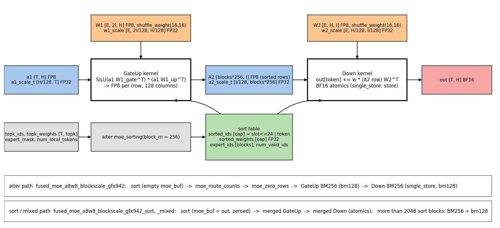

- **aiter 路径** `fused_moe_a8w8_blockscale_gfx942`：
  - aiter `_fused_moe_impl` 在 `AITER_FMOE_FP8_BLOCKSCALE_FLYDSL=1` 时调用它。
  - sort 不清零 out（传空的 moe_buf）。
  - `moe_route_counts` 统计每个 token 的本卡 route 数，`moe_zero_rows` 只清零 route 数 ≠ 1 的行。
  - GateUp BM256（bm128）→ Down BM256（single_store、bm128）。
- **sort / mixed 路径** `fused_moe_a8w8_blockscale_gfx942_sort` / `_mixed`：
  - sort 清零 out（moe_buf = out）。
  - merged GateUp → merged Down（全部用 BF16 atomic）。
  - sort block 超过 2048 个（任务扫描的容量）时退回 BM256 + bm128。

### 1.4 参数约束

| | BM256 GateUp | BM256 Down | merged |
|---|---|---|---|
| N | I 是 128 的倍数 | H 是 256 的倍数 | GateUp：I 是 256 的倍数；Down：H 是 512 的倍数（一个 pair 任务两个 N tile） |
| K | H 是 128 的倍数，H ≤ 4096（2·H/128 个 W scale 放进一个 VGPR） | I 是 128 的倍数，I ≤ 8192 | 另要求 K/128 是偶数（K 循环按 2 个 K block 展开） |
| 其他 | 所有 buffer 的字节数 < 0x7FFF0000（§2.4） | 同左 | 同左，并留 1 MiB 余量；sort block ≤ 2048 |

另外 0 < topk < 256、T < 2²⁴（sorted ID 的编码）。MiMo 形状满足全部约束。

## 2. 公共约定

### 2.1 sort 表与 block 分类

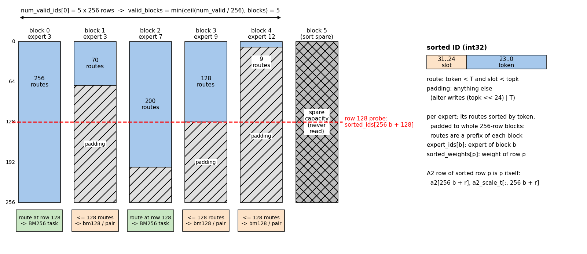

- `moe_sorting(block_m=256)` 把每个 expert 的 route 按 token 排序，补齐到 256 行的整数倍。
  - `sorted_ids[p] = slot << 24 | token`；token ≥ T 或 slot ≥ topk 的是 padding。
  - `expert_ids[b]`：block b 的 expert；`sorted_weights[p]`：行 p 的路由权重。
  - `num_valid_ids[0]`：有效行数。kernel 用 `valid_blocks = min(⌈num_valid/256⌉, blocks)`，之后的 block 是 sort 的
    空余容量，kernel 不读。
- 一个 block 的 route 是它 256 行的前缀，所以只读第 128 行就能分类：
  - 是 route：block 有 > 128 个 route，称**大 block**。
  - 是 padding：block 至多 128 个 route，称**小 block**。
  - bm128 和 merged 都用这个判断。GateUp 与 Down 读同一张表，分类一致。
- A2 的行就是 sorted 行：GateUp 把 sorted 行 p 的结果写到 A2[p]、a2_scale_t[:, p]，Down 直接读这一行。一个 block 的
  A2 行是连续的，不用按 [T, topk, I] gather。

### 2.2 W 的 shuffle_weight(16,16) 布局

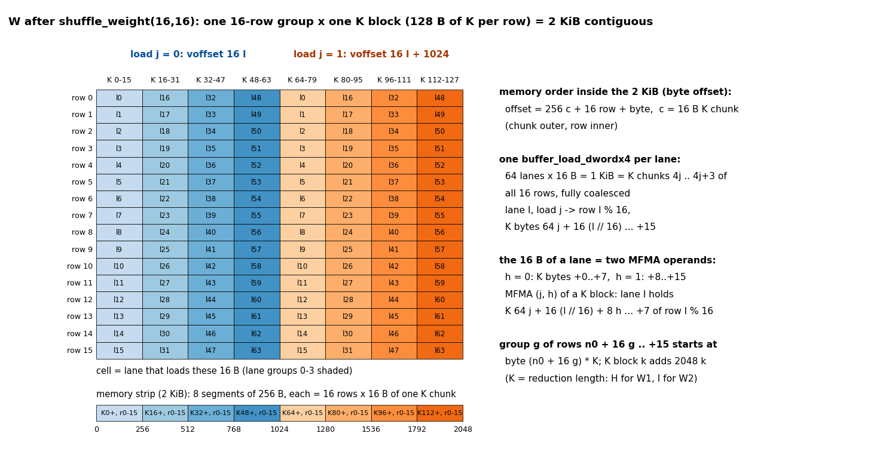

- 每 16 行一组。组内 K 方向每 16 字节一个 chunk，chunk 在外、行在内：K block k（每行 128 B）占 2 KiB，chunk c、
  行 r 的 16 字节在组内偏移 2048·k + 256·c + 16·r。
- 64 个 lane 各读 16 B（voffset = 16·lane + 1024·j，j ∈ {0, 1}）正好是 16 行 × 64 B，完全合并：
  - lane l 拿到行 l%16、K 字节 64j + 16(l//16) 起的 16 B；
  - 这 16 B 就是两个 MFMA 操作数（§2.3），不用重排。
- 第 g 组（行 n0 + 16g 起）的 K block k 在字节 (n0 + 16g)·K + 2048·k。K 是该矩阵的 reduction 长度：W1 为 H，W2 为 I。

### 2.3 MFMA 与块缩放

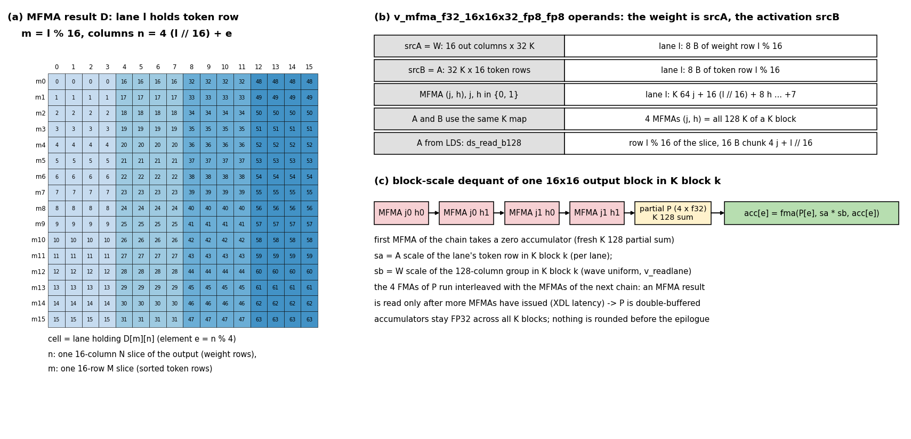

- **指令**：`v_mfma_f32_16x16x32_fp8_fp8`。srcA 放权重（16 个输出列 × 32 K），srcB 放激活（32 K × 16 个 token 行）。
  - 结果每 lane 4 个 FP32：token 行 m = l%16，输出列 n = 4(l//16) + e。
  - 所以 epilogue 里每个 lane 拿的是一行的 4 个连续输出列。
- **K 映射**：
  - MFMA (j, h)（j, h ∈ {0, 1}）中，lane l 提供 K 字节 64j + 16(l//16) + 8h 起的 8 个。
  - A 和 B 用同一个映射，4 个 MFMA 覆盖一个 K block 的 128 个 K。
  - A 从 LDS 读时按同样的方式取：行 l%16、16 B chunk 4j + l//16，一次 `ds_read_b128` 给两个 MFMA（h = 0, 1）。
- **块缩放**：每个 16×16 输出块、每个 K block 是一条 4 个 MFMA 的链。
  - 链的第一个 MFMA 用 0 作累加器，链的结果是 K 128 的部分和 P（FP32）。
  - 然后 acc += P × (sa × sb)：sa 是该 lane 所在 token 行在 K block k 的 A scale（每 lane 不同），sb 是这 16 列所属
    128 列组在 K block k 的 W scale（wave 内一致）。
  - acc 全程 FP32，到 epilogue 才舍入。
- **退休与 MFMA 交错**：P 的 4 个 FMA 与下一条链的 MFMA 交错发射。
  - 每发一个 MFMA，就退休一个上一条链的元素。FMA 读 P 时，产生 P 的 MFMA 已经算完（XDL 延迟），MFMA 管线也不停。
  - 代价是 P 要两份：当前链写一份，上一条链的另一份还在被退休。
  - 每个 MFMA→FMA 对前后用 `sched_barrier(0)` 固定顺序。

### 2.4 buffer descriptor 与越界偏移

- 每个张量（或 tile）一个 raw buffer descriptor，num_records 是有效字节数。地址由 32 位 voffset（每 lane）和 soffset
  （uniform）组成。
- 无效行的 voffset 取 `OOB_OFFSET = 0x7FFF0000`：加上 tile 内偏移后仍在 descriptor 之外。
  - 越界的 load 返回 0、不访存，越界的 store 被丢弃。
  - 所以 padding 行不需要分支：它们的 A 是 0，MFMA 结果是 0，GateUp 写出 FP8 0 和 scale 0，Down 跳过它们的 atomic。
- 前提是所有 extent < 0x7FFF0000（`validate_parameters` 检查）。2 GiB 也限制了 sort 容量：MiMo 形状（I = 2048）时
  A2 最多约 104 万行，对应约 13 万个 token（top-8）。
- BM256 的 W descriptor 从当前 expert、当前 N tile 开始：基址在标量寄存器里加（W + e·N·K + n·TILE_N·K），voffset
  只表示 tile 内偏移，soffset 表示 K block。GateUp 的这个 descriptor 覆盖 I + 128 行（gate 行和 I 行之后的 up 行）。
  pair 任务的 W descriptor 覆盖整个 expert，每组的行偏移放在 soffset 里。
- A 的 voffset（各行的 token 偏移）每个任务算一次，K block 只改 soffset（128·k）。

### 2.5 LDS 与 XOR swizzle

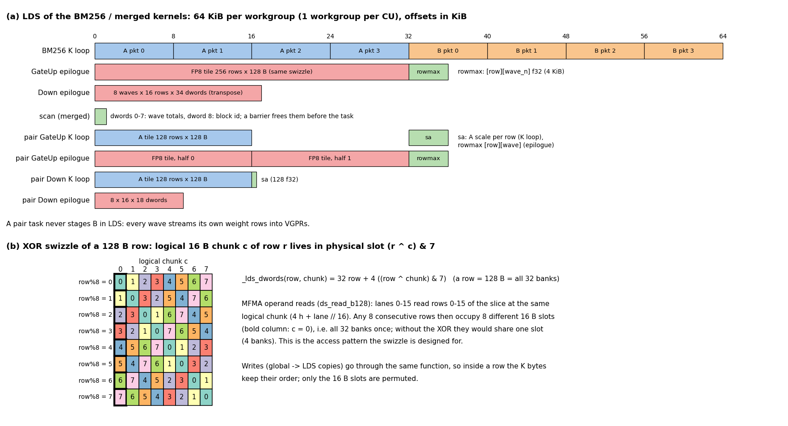

- BM256 kernel 和 merged kernel 每个 workgroup 用 64 KiB LDS，所以每个 CU 只驻留一个 512 线程的 workgroup
  （每个 SIMD 两个 wave）。
- 一行 128 B（K block 的 128 个 FP8）。16 B chunk c 放在物理槽 (row ^ c) & 7，即
  `_lds_dwords(row, chunk) = 32·row + 4·((row ^ chunk) & 7)`。
- 连续 8 行读同一个逻辑 chunk 时，8 个物理槽互不相同，正好铺满 32 个 bank。MFMA 的读法（lane l 读行 l%16）就是这种
  访问。global → LDS 的写也走同一个函数，行内 K 字节顺序不变。

| 用途 | 位置（字节） | 内容 |
|---|---|---|
| BM256 K 循环 | [0, 32K) | A 的 4 个 packet，每个 64 行 × 128 B |
| | [32K, 64K) | B 的 4 个 packet，每个 64 行 × 128 B |
| BM256 GateUp epilogue | [0, 32K) | FP8 输出 tile 256 行 × 128 B（同样的 swizzle） |
| | [32K, 36K) | 行最大值 rowmax[256][4]（4 个 wave_n） |
| BM256 Down epilogue | [0, 17K) | 每个 wave 一块 16 行 × 34 dword 的转置区 |
| merged 任务扫描 | dword 0–8 | 8 个 wave 的计数、选中的 block id |
| pair GateUp | [0, 16K) | K 循环：A tile 128 行 × 128 B；epilogue：两个 half 的 FP8 tile 各 16 KiB，占 [0, 32K) |
| | [32K, 36K) | K 循环：A scale（128 个）；epilogue：行最大值 [128][8 个 wave] |
| pair Down | [0, 16K) | K 循环：A tile；epilogue：8 × 16 × 18 dword 的转置区 |
| | [16K, 16.5K) | A scale（128 个） |

### 2.6 workgroup 到任务的映射（BM256）

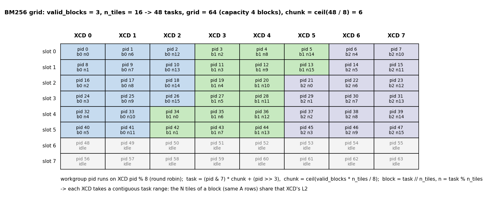

- gfx942 有 8 个 XCD，workgroup pid 按 pid % 8 轮流派发。
- **grid**：按 sort 容量算，8·⌈blocks·n_tiles / 8⌉。host 不读 num_valid，没有同步。
- **任务**：task = (pid & 7)·chunk + (pid >> 3)，chunk = ⌈valid_blocks·n_tiles / 8⌉；block = task // n_tiles，
  n = task % n_tiles。
  - slot（pid >> 3）≥ chunk 或 task ≥ 任务数的 workgroup 直接退出。
- 效果：每个 XCD 拿一段连续的任务，同一个 block 的各 N tile（读相同的 A 行）落在同一个 L2。

## 3. BM256 GateUp（2x4_pf1）

### 3.1 任务与 tile

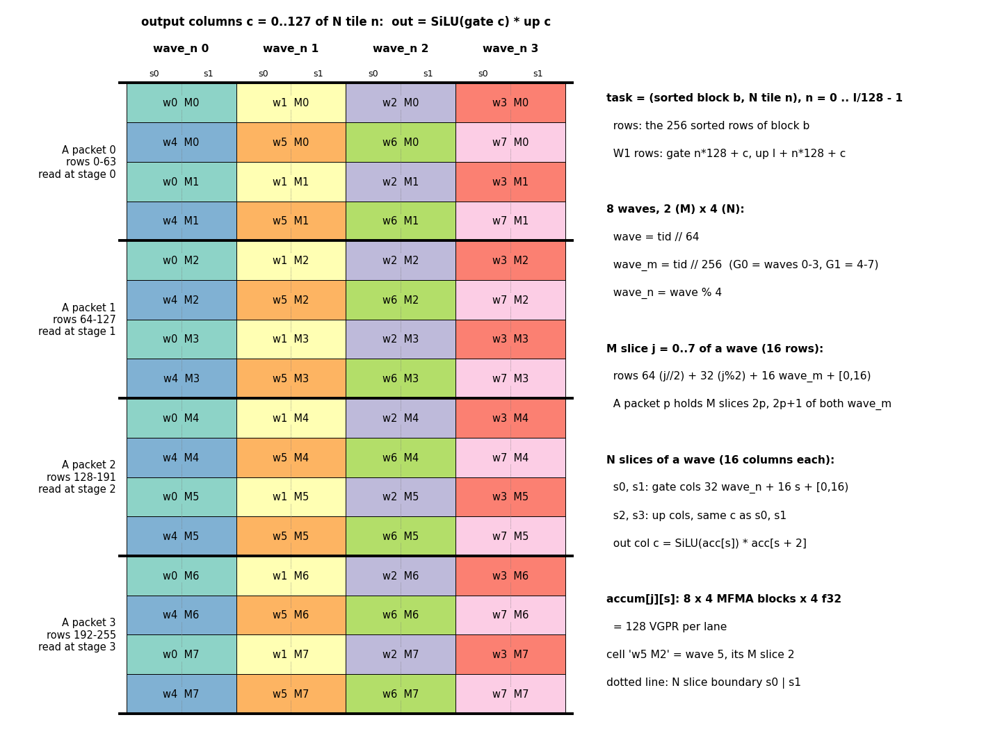

- 任务 = (sorted block b, N tile n)，n_tiles = I/128。
  - 输出：256 个 sorted 行 × 128 个输出列。
  - 权重：W1[e] 的 gate 行 n·128 .. +127 和 up 行 I + n·128 .. +127，共 256 行。
- 8 个 wave 排成 2（M）× 4（N）：wave = tid // 64，wave_m = tid // 256，wave_n = wave % 4。
- 每个 wave：
  - 8 个 M slice（每个 16 行），4 个 N slice（每个 16 列：s0、s1 是 gate 列 32·wave_n + 16s，s2、s3 是对应的 up）。
  - accum 是 8 × 4 个 16×16 块，128 VGPR。输出列 c 的结果 = SiLU(acc[s]) · acc[s+2]。
- M slice j 的行是 64(j//2) + 32(j%2) + 16·wave_m + [0, 16)。A packet p（行 64p .. 64p+63）正好是两个 wave_m 的
  M slice 2p、2p+1。

### 3.2 A、B 从 global 到 LDS

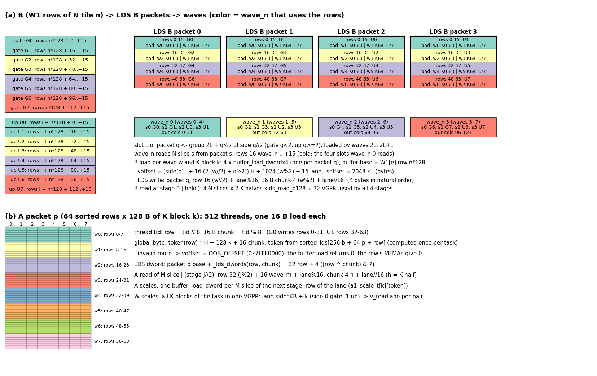

- **B（每个 K block 4 个 packet，每个 64 行 × 128 B）**：
  - packet q 的第 L 个 16 行槽（LDS 行 16L .. 16L+15）放 side q//2（q < 2 为 gate）的第 2L + q%2 个 16 行组。
  - wave_n 读每个 packet 的第 wave_n 个槽：s0 = gate 组 2·wave_n，s1 = gate 组 2·wave_n+1，s2、s3 = 同样的 up 组，
    所以一个 wave 的列在 tile 里是连续的。
  - 装载：wave w 每个 K block 发 4 条 `buffer_load_dwordx4`（每个 packet 一条），装 packet q 的槽 w//2 中 K 的一半
    （w%2 = 0：K 0–63，1：K 64–127）。
    - voffset = (side(q)·I + 16·(2·(w//2) + q%2))·H + 1024·(w%2) + 16·lane，soffset = 2048·k。
    - LDS 位置：packet q 的行 16·(w//2) + lane%16，chunk 4·(w%2) + lane//16。
- **A（每个 K block 4 个 packet，每个 64 个 sorted 行 × 128 B）**：
  - 512 个线程各读 16 B：线程 tid 负责行 tid//8、chunk tid%8。G0 写行 0–31，G1 写行 32–63。
  - global 字节偏移 = token(行)·H + 128·k + 16·chunk。token 在任务开始时从 `sorted_ids[256b + 64p + 行]` 取一次；
    padding 行用 OOB_OFFSET。
- **A scale**：每个 M slice 一条 `buffer_load_dword`，读该 lane 所在行的 token 在 K block k 的 scale
  （a1_scale_t[k][token]，soffset = 4·T·k）。
- **W scale**：任务开始时一个 lane 读一个：lane = side·KB + k，值为 w1_scale[e][n + side·I/128][k]。用时
  `v_readlane(.., side·KB + k)`。这要求 2·KB ≤ 64，即 H ≤ 4096。

### 3.3 K 循环：每个 K block 4 个 stage

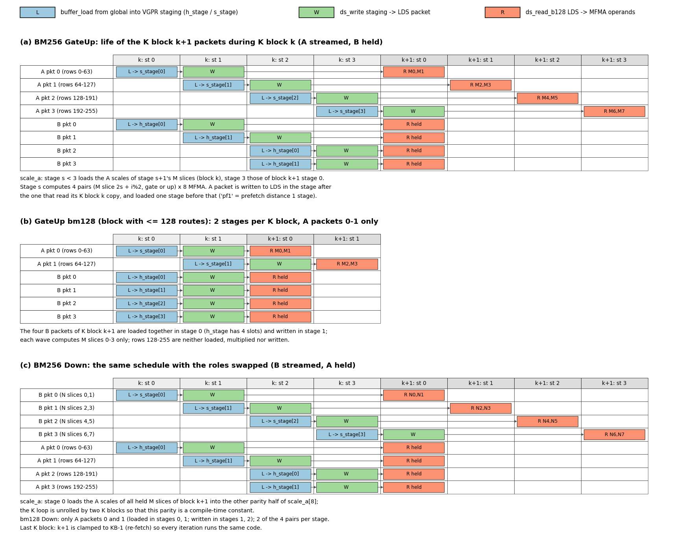

上图 (a) 是 GateUp。每个 stage 是一个 memory phase（M）加一个 compute phase（C），两者之后各一个 `s_barrier`。

- **B 驻留（held）**：stage 0 把本 K block 的 4 个 N slice 全部从 LDS 读进寄存器（4 × 2 × `ds_read_b128` = 32 VGPR），
  四个 stage 共用。
- **A 流式（streamed）**：stage s 只读 A packet s 的两个 M slice。
- **下一个 K block 的预取**：packet 在 stage p 从 global 读进寄存器暂存（s_stage / h_stage），下一个 stage 写进 LDS。
  这时本 K block 的这份 packet 刚被两组 wave 读完（§3.4）。global 读比 LDS 写早 1 个 stage，即名字里的 "pf1"。

K block k 内各 stage 的操作：

| stage | LDS 写 | LDS 读（本 stage 的 MFMA 用） | global → 寄存器（K block k+1） | A scale | MFMA |
|---|---|---|---|---|---|
| 0 | A pkt 3（K block k 的，上一个 K block 的 stage 3 读入） | B 全部 4 个 N slice；A 的 M0、M1 | A pkt 0；B pkt 0 → h[0] | 本 K block 的 M2、M3 | M0、M1 |
| 1 | A pkt 0、B pkt 0（k+1） | A 的 M2、M3 | A pkt 1；B pkt 1 → h[1] | 本 K block 的 M4、M5 | M2、M3 |
| 2 | A pkt 1、B pkt 1（k+1） | A 的 M4、M5 | A pkt 2；B pkt 2 → h[0]，B pkt 3 → h[1] | 本 K block 的 M6、M7 | M4、M5 |
| 3 | A pkt 2、B pkt 2、3（k+1） | A 的 M6、M7 | A pkt 3 | K block k+1 的 M0、M1 | M6、M7 |

伪代码（每个 wave；K 循环按两个 K block 展开）：

```text
for k in 0 .. KB-1:
  kn = min(k + 1, KB - 1)                      # 最后一个 K block 重复读一次 KB-1，循环体不用特判
  for s in 0 .. 3:
    # ---- memory phase ----
    ds_write  s == 0 ? A[3] : (A[s-1], B[s-1], and B[3] when s == 3)       # 寄存器暂存 -> LDS
    if s == 0: held = ds_read B (4 N slices x 2 K halves)
    a = ds_read A slices 2s, 2s+1 (x 2 K halves)
    load scale_a: s < 3 ? (k, M slices 2s+2, 2s+3) : (kn, M0, M1)
    buffer_load A[s] of kn -> s_stage[s];  B[s] of kn -> h_stage[s%2] (s <= 2);  B[3] of kn -> h_stage[1] (s == 2)
    s_waitcnt lgkmcnt(0); s_barrier
    # ---- compute phase ----
    s_setprio 3
    for i in 0 .. 3:                             # pair: M slice 2s + i%2, side i//2 (0 gate, 1 up)
      for kstep in 0 .. 3, for n in (2 side, 2 side + 1):        # 8 MFMA
        P[i%2][n] = mfma(B word, A word, kstep == 0 ? 0 : P[i%2][n])
        if first MFMA of the pair: ps[i%2] = scale_a(M slice) * readlane(sb, side * KB + k)
        retire one element of the previous pair: acc += P[(i+1)%2] * ps[(i+1)%2]
    s_setprio 0; s_barrier
```

- stage 0 的"上一个 pair"是上一个 K block stage 3 的最后一个 pair。第一个 K block 的上一个 pair 是 prologue 填的 0。
- **prologue**：
  - 读 K block 0 的 A 4 个 packet。
  - B packet 0、1 读入并写进 LDS，再读写 packet 2、3。
  - 读 M0、M1 的 A scale，写 A 的 4 个 packet。
  - accum、partial 清零；`s_waitcnt lgkmcnt(0)`；barrier。
  - G1 多执行一个 barrier（§3.4）。
- **循环后**：退休最后一个 pair；G0 多执行一个 barrier。

### 3.4 两组 wave 错开一个 barrier

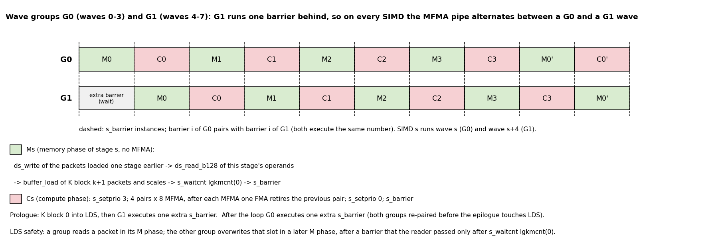

- G0 = waves 0–3（wave_m 0），G1 = waves 4–7（wave_m 1）。SIMD s 上是 wave s 和 wave s+4。
- prologue 之后 G1 多执行一个 `s_barrier`：两组执行的 barrier 次数相同、按序配对，但 G1 在程序里落后一个 phase。
  - G0 在 C phase（MFMA）时，G1 在 M phase（LDS、VMEM），反之亦然。
  - 每个 SIMD 的 MFMA 管线交替服务两个 wave，一个 wave 的访存和等待由另一个 wave 的 MFMA 盖住。
- C phase 用 `s_setprio 3`，结束时 `s_setprio 0`。
- 循环结束后 G0 多执行一个 barrier，两组重新对齐，epilogue 才开始改写 LDS。
- **LDS 安全**：一组在自己的 M phase 读某个 packet，读之后、barrier 之前有 `s_waitcnt lgkmcnt(0)`。另一组改写这个
  槽发生在更晚的 M phase，中间至少隔一个两组共同的 barrier。上表的"读后一个 stage 再写"保证了这一点。

### 3.5 机器码上的时间线与审计

`tests/contrib/moe/audit_moe_pipeline_gfx942.py` 在最终 ISA 上检查：

- 每个 packet 的 RAW / WAR；
- barrier 配对（G0、G1 的执行次数、谁多执行一个）；
- vmcnt / lgkmcnt 覆盖、暂存寄存器的生命周期。

两个 kernel 都 PASS。它画出的 G0 时间线（prologue + 前两个 K block，最终 ISA）：

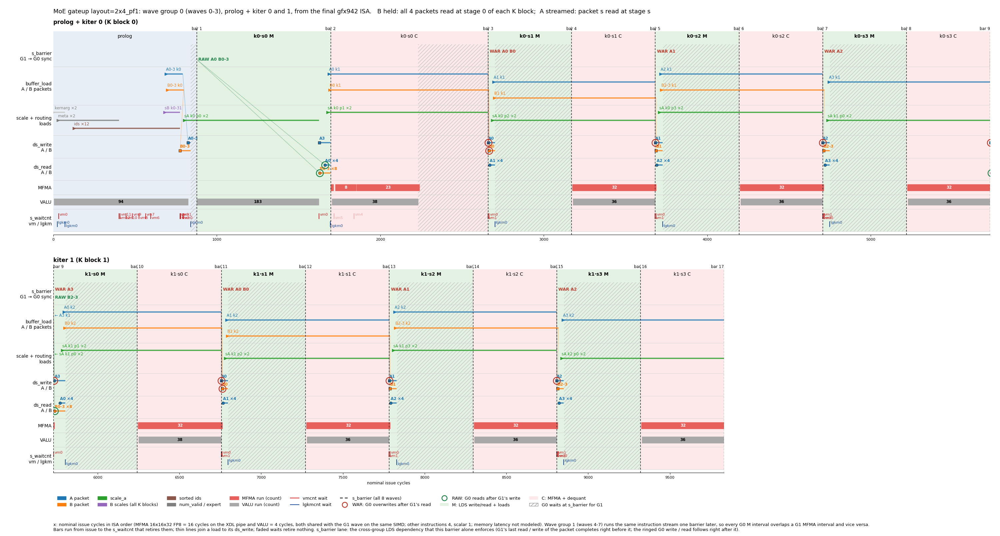

Down 的同类图：[moe_down_4x2_pf1_swimlane.png](moe_pipeline/moe_down_4x2_pf1_swimlane.png)，文本报告：
[audit_report.txt](moe_pipeline/audit_report.txt)。

### 3.6 寄存器（每 lane）

| 内容 | 大小 | VGPR |
|---|---|---|
| accum | 8 M slice × 4 N slice × 4 f32 | 128 |
| held B | 4 N slice × 2 K 半 × 4 dword | 32 |
| A 暂存 s_stage | 4 packet × 4 dword（bm128：2） | 16 |
| B 暂存 h_stage | 2 × 4 dword（bm128：4 × 4） | 8 / 16 |
| 本 stage 的 A | 2 M slice × 2 K 半 × 4 dword | 16 |
| partial | 2 组 × 2 N slice × 4 f32 | 16 |
| scale_a、partial_scale、W scale | 4 + 2 + 1 | 7 |
| 合计（ISA，含地址、偏移） | | 250，无 spill；SGPR 54（bm128 版 72） |

### 3.7 epilogue：SiLU、FP8 量化、经 LDS 写出

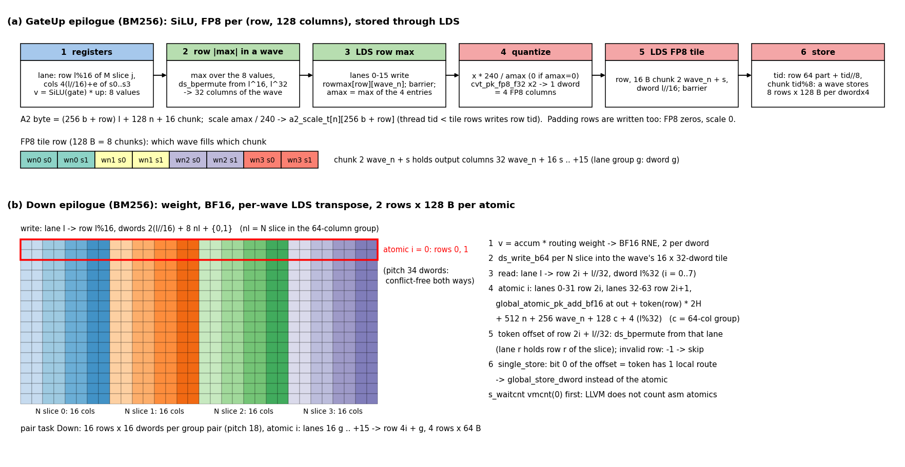

1. **退休**最后一个 pair；G0 多执行一个 barrier（两组对齐，之后才能改写 LDS）。
2. **SiLU**：每个 M slice j、s ∈ {0, 1}：v = SiLU(acc[j][s]) · acc[j][s+2]，每 lane 每 M slice 8 个值。
   SiLU(x) = x · rcp(1 + exp2(−x·log2 e))。
3. **行最大值**：
   - 每个 M slice 取 8 个值的 max|v|，再用 `ds_bpermute` 取 lane l^16、l^32 的值求 max，得到本 wave 32 列的最大值；
   - lane 0–15 写 rowmax[行][wave_n]；`s_waitcnt lgkmcnt(0)`，barrier。
4. **量化**：
   - amax = 4 个 wave_n 的最大值；inverse = 240 / amax（amax = 0 时为 0）。|x| ≤ amax 保证 x·240/amax 舍入后不超出
     FP8 范围。
   - 两条 `v_cvt_pk_fp8_f32` 把 4 个值打包成一个 dword。
   - 写进 LDS 的 FP8 tile：行、chunk 2·wave_n + s、dword l//16（与 K 循环同样的 swizzle，占 A 区）。
   - `s_waitcnt lgkmcnt(0)`，barrier。
5. **写出**：
   - part = 0..3（bm128：0..1）：行 = 64·part + tid//8，chunk = tid%8；`ds_read_b128` 后 `buffer_store_dwordx4` 到
     A2[(256b + 行)·I + 128n + 16·chunk]。
   - 一个 wave 的一条 store 写 8 个完整的 128 B 行。
6. **scale**：线程 tid < 256（bm128：128）写 a2_scale_t[n][256b + tid] = rowmax(tid) / 240。

padding 行同样写出：FP8 0、scale 0。

## 4. BM256 Down（4x2_pf1）

### 4.1 任务与 tile

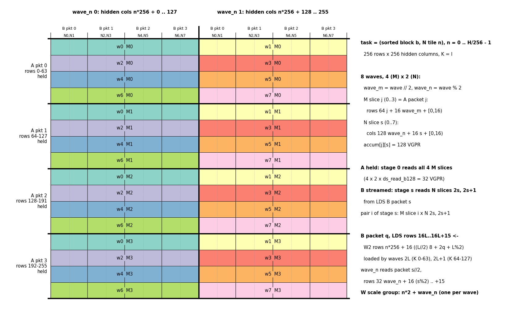

- 任务 = (sorted block b, N tile n)，n_tiles = H/256。
  - 输出：256 个 sorted 行 × 256 个 hidden 列。
  - 权重：W2[e] 的行 n·256 .. +255，K = I。
- 8 个 wave 排成 4（M）× 2（N）：wave_m = wave // 2，wave_n = wave % 2。
- 每个 wave：
  - 4 个 M slice：M slice j = A packet j，行 64j + 16·wave_m + [0,16)。
  - 8 个 N slice：列 128·wave_n + 16s。
  - accum 128 VGPR。
- **B packet** q 的第 L 个槽放 W2 的第 (L//2)·8 + 2q + L%2 个 16 行组（相对 N tile），由 waves 2L、2L+1 各装一半 K。
  wave_n 从 packet s//2 的行 32·wave_n + 16(s%2) 读 N slice s，对应 W2 行 128·wave_n + 16s。
- **W scale**：一个 wave 的 128 列在同一个 scale 组 n·2 + wave_n 里，lane k 放 K block k 的 scale（I ≤ 8192）。

### 4.2 K 循环

与 GateUp 同一个模板，角色互换：A 驻留、B 流式（上一节图 (c)）。

| stage | LDS 写 | LDS 读 | global → 寄存器（K block k+1） | A scale | MFMA |
|---|---|---|---|---|---|
| 0 | B pkt 3（K block k 的） | A 全部 4 个 M slice；B 的 N0、N1 | B pkt 0；A pkt 0 → h[0] | K block k+1 的全部 M slice | M0–M3 × N0、N1 |
| 1 | B pkt 0、A pkt 0（k+1） | B 的 N2、N3 | B pkt 1；A pkt 1 → h[1] | | M0–M3 × N2、N3 |
| 2 | B pkt 1、A pkt 1（k+1） | B 的 N4、N5 | B pkt 2；A pkt 2 → h[0]，A pkt 3 → h[1] | | M0–M3 × N4、N5 |
| 3 | B pkt 2、A pkt 2、3（k+1） | B 的 N6、N7 | B pkt 3 | | M0–M3 × N6、N7 |

- stage s 的 pair i = M slice i × N slice 2s、2s+1，每个 pair 8 个 MFMA。
- A scale 提前一整个 K block 读：存进 scale_a[8] 的另一半，用 (K block 奇偶)·4 + M slice 索引。K 循环按两个 K block
  展开，所以这个奇偶是编译期常数。
- 寄存器：accum 128、held A 32、B 暂存 16、A 暂存 8、本 stage 的 B 16、partial 16、scale_a 8。ISA 合计 246 VGPR，
  SGPR 58（single_store 61，bm128 65 / 69）。

### 4.3 epilogue：LDS 转置 + BF16 atomic

见 §3.7 的图 (b)。

1. K 循环之后重新读该 lane 各行的 sorted ID 和路由权重（不在 K 循环里占寄存器，这些 load 与收尾重叠）。
2. 计算 token_offset = route 有效 ? token·2H : −1。single_store 时，若该 token 的本卡 route 数为 1，置位 bit 0。
3. 退休最后一个 pair；G0 多执行一个 barrier；`s_waitcnt vmcnt(0)`。LLVM 不知道后面 inline asm 的 atomic 也计入
   vmcnt，这里先把前面的 load 等完。
4. 对每个 M slice j：
   - 用 `ds_bpermute` 取 8 个行偏移：atomic i 覆盖本 slice 的行 2i、2i+1，偏移从持有该行的 lane 取（lane r 持有行 r）。
   - 对每个 64 列组 c（每个 wave 两个）：
     - v = acc × 路由权重 → BF16（RNE），两个一个 dword。
     - 4 条 `ds_write_b64` 写进本 wave 的 16 × 32 dword 转置区：lane l → 行 l%16，dword 2(l//16) + 8·nl。
       行距 34 dword，写读都无 bank 冲突。
     - 8 条 `ds_read_b32`：lane l → 行 2i + l//32，dword l%32。8 个读包在一个不透明的 inline asm 拷贝里：只等一次，
       LLVM 也不会把读下沉到 atomic 的分支里。
     - 8 条 `global_atomic_pk_add_bf16`：地址 = out + token_offset + 512n + 256·wave_n + 128c + 4(l%32)，lane 0–31
       写行 2i 的 128 B，lane 32–63 写行 2i+1。偏移为 −1 的行跳过。
     - single_store 的行（bit 0 置位）改用 `global_store_dword`。

### 4.4 single_store 与 out 的清零

- `moe_route_counts` 统计每个 token 的本卡 route 数。`moe_zero_rows` 把 route 数 ≠ 1 的行清零，可用 num_rows 限定只清
  EP 接收 buffer 的有效行。
- route 数 = 1 的行由 Down 的 n_tiles 个 N tile 各 store 一段，整行被完整覆盖，不需要清零。
- 前提：out 是本 rank 私有的（多个生产者往同一个 buffer 累加时不能用 store）。

## 5. bm128：BM256 kernel 内的 128 行流水线

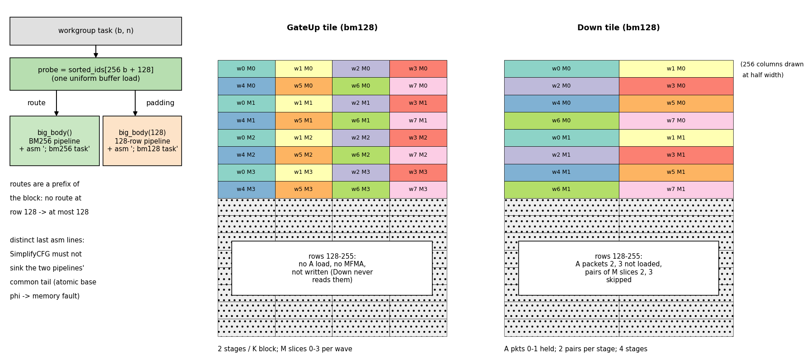

- **判断**：任务开始时读 `sorted_ids[256b + 128]`（一次 uniform load）。
  - 是 route：跑 `big_body()`，即 BM256 流水线。
  - 是 padding：跑 `big_body(128)`，即 128 行流水线。
  - grid、workgroup 形状、任务顺序都不变。
- **GateUp（§3.3 图 (b)）**：
  - 每个 K block 2 个 stage，只用 A packet 0、1，每个 wave 只算 M slice 0–3。
  - B 的 4 个 packet 在 stage 0 一起读进 h_stage（4 个槽），stage 1 写进 LDS。
  - epilogue 只写 0–127 行（Down 不会读其余行）。
- **Down**：只用 A packet 0、1（stage 0、1 读，stage 1、2 写），每个 stage 只算 M slice 0、1 两个 pair；B 不变，
  仍是 4 个 stage。
- **两份代码的结尾**：各放一条内容不同的空 inline asm（`"; bm256 task"` / `"; bm128 task"`）。
  - 没有它们时，LLVM SimplifyCFG 会把两份 Down epilogue 相同的尾部合并到一个 block。
  - atomic 的 SGPR 基址（`"s"` 操作数）因此变成存在 VGPR 里的 phi，`v_readfirstlane` 读到被覆盖的值，GPU 访存错误。

## 6. merged：一次 launch 跑大 block 和小 block

### 6.1 结构

- merged kernel 就是 BM256 kernel，只是把 plugin 传给它的 compile 函数：
  `compile_moe_*_a8w8_blockscale_gfx942_lds(..., merged=merged_plugin(mode, ...))`。
- plugin 提供四样东西：
  - `task(ctx)`：返回 (active, big, block, tile)，替代 §2.6 的映射。
  - `body(ctx, block, pair)`：pair 任务。
  - `grid(num_blocks)`：grid 大小。
  - `key`：源码哈希（§6.8）。
- kernel 主体：

  ```text
  active, big, block, tile = merged.task(ctx)
  if active:
      if big: big_body()                      # BM256 任务 (block, N tile)，与 §3、§4 相同
      else:   merged.body(ctx, block, tile)   # pair 任务 (block, N tile 2·tile 和 2·tile+1)
  ```

- 两种任务共用 BM256 kernel 的 64 KiB LDS 和 512 个线程；一个 workgroup 只跑一个任务。
- 资源（ISA，MiMo 形状）：merged GateUp 250 VGPR / 70 SGPR，merged Down 250 VGPR / 69 SGPR，都不 spill。

### 6.2 任务表

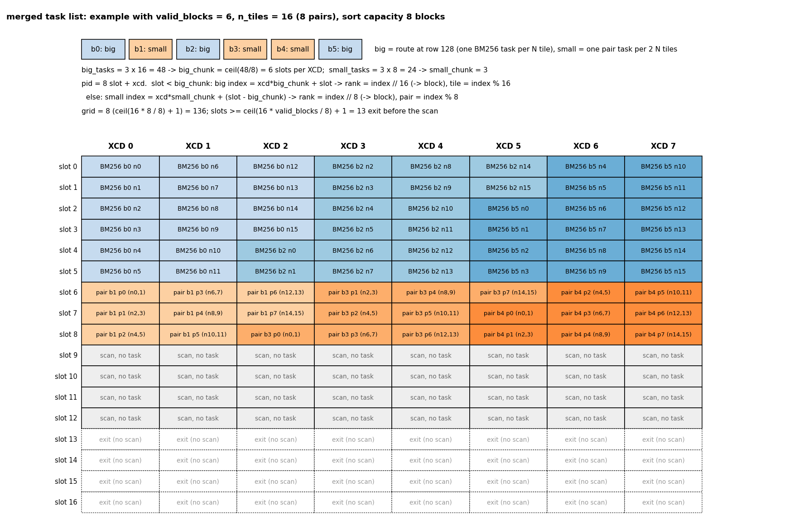

- 大 block 每个 N tile 一个 BM256 任务（n_tiles 个），小 block 每两个相邻 N tile 一个 pair 任务（n_tiles/2 个）。
- **grid** = 8·(⌈n_tiles·blocks / 8⌉ + 1)，按 sort 容量算。
- **每个 XCD 的槽**：先放一段连续的 BM256 任务（big_chunk 个槽），再放一段连续的 pair 任务（small_chunk 个槽）：
  - big_chunk = ⌈n_tiles·#大 block / 8⌉，small_chunk = ⌈(n_tiles/2)·#小 block / 8⌉。
  - slot = pid >> 3，xcd = pid & 7。
  - slot < big_chunk：BM256 任务 index = xcd·big_chunk + slot，rank = index // n_tiles（第 rank 个大 block），
    tile = index % n_tiles。
  - 否则：pair 任务 index = xcd·small_chunk + (slot − big_chunk)，rank = index // (n_tiles/2)（第 rank 个小 block），
    pair = index % (n_tiles/2)。
  - index 超出任务数，或 slot − big_chunk ≥ small_chunk：不活跃。
- **跳过扫描**：用到的槽数 ⌈a/8⌉ + ⌈b/8⌉ ≤ ⌈(a+b)/8⌉ + 1 ≤ ⌈n_tiles·valid_blocks / 8⌉ + 1。slot 不小于这个界的
  workgroup 不扫描，直接退出。

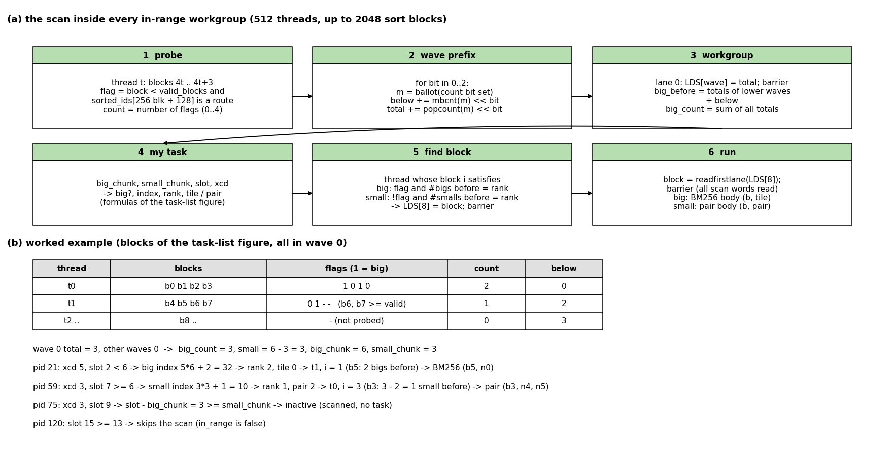

每个需要扫描的 workgroup 自己算出全部任务表中属于它的那一项（不需要额外 kernel，也不需要全局原子）：

1. **探测**：线程 t 负责 block 4t .. 4t+3（512 个线程最多 2048 个 block，即 `MAX_BLOCKS`）。
   - valid_blocks 之后的 block 不发 load（voffset 用 OOB_OFFSET）。
   - flag = block 的第 128 行是 route；count = 4 个 flag 之和（0..4）。
2. **wave 内前缀**：count 的 3 个 bit 平面各做一次 ballot。
   - `mbcnt` 得到更低 lane 的个数，累加成 below（本线程之前的大 block 数）；`popcount` 累加成本 wave 的总数。
3. **workgroup 内**：lane 0 把本 wave 的总数写进 LDS[wave]；barrier。
   - big_before = 更低 wave 的总数之和 + below；big_count = 所有 wave 的总数之和。
4. **算出自己的任务**：按上面的公式得到 big?、rank、tile / pair。
5. **找 block**：每个线程检查自己的 4 个 block，满足条件的那个把 block id 写进 LDS[8]；barrier。
   - 大任务：flag 为真，且之前的大 block 数 = rank。
   - pair 任务：flag 为假，且之前的小 block 数（block − 之前的大 block 数）= rank。
6. **开始任务**：block = readfirstlane(LDS[8])；再一个 barrier，保证所有 wave 读完扫描字之后任务才改写这块 LDS。

### 6.3 pair 任务的分工

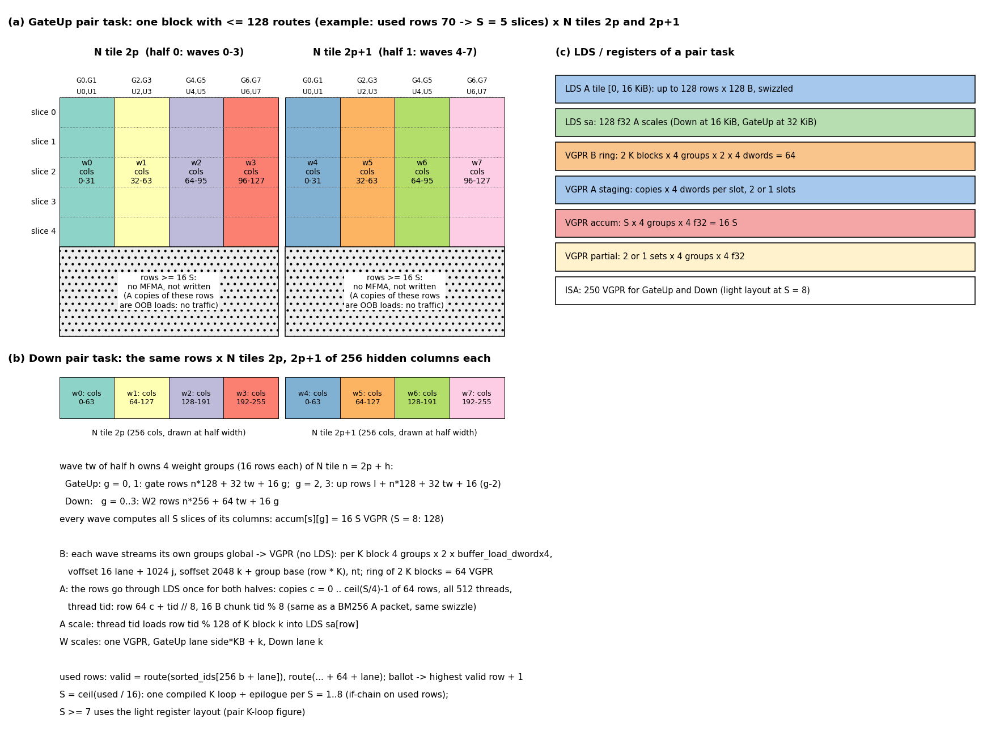

- 一个 pair 任务 = 一个小 block（至多 128 个 route）× 两个相邻 N tile（2p、2p+1）。
  - half h = waves 4h .. 4h+3，算 N tile 2p + h。
  - 两个 half 共用 A tile 和 barrier。
- half 内的 wave tw（0..3）持有 4 个 16 行的权重组：
  - GateUp：g = 0、1 是 gate 行 n·128 + 32·tw + 16g，g = 2、3 是 up 行 I + n·128 + 32·tw + 16(g−2)。输出列为
    32·tw .. +31，与 BM256 的 wave_n 列分法相同，所以 A2 的 scale 组仍是整个 N tile 的 128 列。
  - Down：g = 0..3 是 W2 行 n·256 + 64·tw + 16g，输出列 64·tw .. +63。W scale 组是 (n·256 + 64·tw) // 128，
    每个 wave 一个。
- 每个 wave 算所有 S 个 M slice（每个 16 行）的自己的列：accum[s][g]，16·S VGPR（S = 8 时 128）。
- **B 不经过 LDS**：每个 wave 把自己的 4 组权重直接读进寄存器。
  - 每个 K block 4 组 × 2 条 `buffer_load_dwordx4`：voffset = 16·lane + 1024·j，soffset = 组基址（行·K）+ 2048·k，
    nt（cache policy aux = 2）。
  - 寄存器里是 2 个 K block 的 ring（64 VGPR），读进来就是 MFMA 操作数（§2.2）。
- **A 经过 LDS**：
  - 512 个线程拷贝 ⌈S/4⌉ 份，每份 64 行；GateUp 按 token gather，Down 读 A2 的 sorted 行。
  - 第 c 份由线程 tid 负责行 64c + tid//8、chunk tid%8，与 BM256 的 A packet 相同，LDS 也用同样的 swizzle。
  - A scale：线程 tid 读行 tid % 128 的 scale，写进 LDS 的 sa 区（4 个线程写同一个值）。
- **W scale**：一个 VGPR，GateUp 为 lane = side·KB + k，Down 为 lane = k。

### 6.4 行数 S 与变体

- 用到的行数 used_rows = 最后一个有效行 + 1。每个 wave 对行 0–63、64–127 的 route 各做一次 ballot，取最高位；
  wave 内一致。
- S = ⌈used_rows / 16⌉，S ∈ 1..8。
  - 每个 S 编译一份 K 循环和 epilogue，用 if 链按 used_rows 选择。
  - MFMA、A 的拷贝、写出都按 16 行粒度随 route 数变化，而不是固定 128 行。
- 16·S 行之外：
  - 不做 MFMA，不写出；A 的拷贝虽然覆盖 64 行一份，但这些行是 padding，load 越界、不访存。
  - GateUp 和 Down 由同一张 sort 表算出同一个 S，所以 Down 只读 GateUp 写过的行。
- **寄存器布局**：S ≤ 6 用 full，S ≥ 7 用 light（S = 7、8 时 accum 已有 112 / 128 VGPR）。
- **每个变体用自己的不透明 tid 拷贝**（`v_mov_b32 ... ; slices S`，注释各不相同）。
  - 否则 LLVM 会把各变体相同的 prologue load 提到分支之前，结构化后的 CFG 让它们活过每个变体的 K 循环，造成 spill。
  - 同样的 inline asm 也会被提出去，所以注释必须不同。

### 6.5 pair 任务的 K 循环

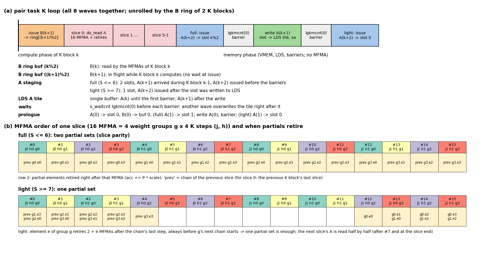

- 8 个 wave 一起走，不错开。每个 K block 分两个 phase。
- **compute phase**：
  - 先发 B(k+1) 到 ring 的另一半（不等待）。
  - 对每个 slice s：从 LDS 读 A（2 × `ds_read_b128`）和 sa，发 16 个 MFMA（4 组 × 4 个 K 步），按退休表退休上一个 slice。
- **memory phase**（只有 VMEM、LDS 和 barrier）：
  1. full：发 A(k+2) 到暂存槽 k%2。
  2. `s_waitcnt lgkmcnt(0)`，barrier。
  3. 把 A(k+1) 和它的 scale 从暂存槽写进 LDS tile。
  4. `s_waitcnt lgkmcnt(0)`，barrier。
  5. light：这时才发 A(k+2) 到唯一的暂存槽。
- **LDS A tile 是单缓冲**：第一个 barrier 之前所有 wave 都读完 A(k)，之后才写 A(k+1)。
  - barrier 之前的 `s_waitcnt lgkmcnt(0)` 必须显式写：指令选择可能把用这些读结果的 MFMA 移到 barrier 之后，
    "消费者在 barrier 前"不能保证读已返回。
- **prologue 的 VMEM 顺序与循环一致**：A(0)、B(0)、（full）A(1)。
  - 循环头合并 prologue 和回边两条路径的 vmcnt，取更严格的一个。
  - 顺序不一致时，循环里等 B 的 wait 会连带等刚发的 A。
- **K 循环的次数**经一条 `s_mov_b32`（inline asm）变成不透明值。否则 K = 256（循环 1 次）时 LLVM 把循环展平，直线代码
  spill，而这些 launch 没有 scratch。
- **MFMA 顺序与退休**：

| | full（S ≤ 6） | light（S ≥ 7） |
|---|---|---|
| 一个 slice 的 MFMA 顺序 | K 步 (j, h) 在外、组 g 在内 | K 半 j → 组对 → K 四分之一 h → 组对内的组 |
| 退休 | 第 p 个 MFMA 后退休上一个 slice 的组 p//4、元素 p%4 | 组 g 的元素 e 在该链最后一步之后 2 + e 个 MFMA 退休，总在 g 的下一条链开始之前 |
| partial | 两套（按 slice 奇偶） | 一套（省 16 + 4 VGPR） |
| 下一个 slice 的 A | 在本 slice 的 MFMA 之前整片读入（提前一个 slice） | 本 slice 的 K 半 0 用完后读下一片的半 0，slice 末尾读半 1（省 8 VGPR） |
| A 暂存 | 2 个槽，A(k+2) 在 barrier 之前发 | 1 个槽，A(k+2) 在写完 LDS 之后发（省一个槽） |

两种布局下每个累加器的累加顺序相同，结果逐位一致。light 的代价是退休窗口和预读距离变短：在第三版 4-wave kernel 上
全部用 light 时 S ≤ 5 比 full 慢 3–5%，所以只在放不下的 S = 7、8 使用，pair 任务沿用这个选择
（[record §7.2–7.4](record/moe_small_m_gfx942.md)）。

### 6.6 pair 任务的 epilogue

- **GateUp**（每个 half 算自己的 N tile）：
  - 每个 slice：v = SiLU(gate)·up（每 lane 2 个 sub × 4 个值）；wave 内用 `ds_bpermute`（l^16、l^32）求行最大值，
    lane 0–15 写进 sa 区的 [行·8 + wave]；barrier。
  - 行 amax = 本 half 4 个 wave 的最大值；量化后写进本 half 的 FP8 tile（[0, 16K) 或 [16K, 32K)，不 swizzle）：
    行、chunk tw·2 + sub、dword l//16；barrier。
  - 写出：half 内线程 htid = tid % 256，行 = 32·part + htid//8，chunk = htid%8，每条 `buffer_store_dwordx4` 每个 wave
    8 行 × 128 B。行 ≥ 16·S 的 store 用 OOB_OFFSET 丢弃。
  - scale：htid < 16·S 的线程写 a2_scale_t[n][256b + htid]。
- **Down**：与 BM256 相同的转置思路，按组对（32 列）转置。
  - 每个 wave 16 行 × 16 dword，行距 18。
  - atomic i 由 lane 16g .. 16g+15 写行 4i + g，每条 atomic 4 行 × 64 B。
  - token 偏移用 `ds_bpermute` 从持有该行的 lane 取；无效行跳过。
  - 先 `s_waitcnt vmcnt(0)`；4 个 LDS 读包在一个不透明拷贝里。
- epilogue 的线程下标也从一个带注释的不透明 tid 拷贝算。否则它与 prologue 相同的表达式会被 GVN 合并，跨 K 循环存活。

### 6.7 两种任务在一个 kernel 里

- pair 任务的入口再取一个不透明 tid（`"; pair task"`）。否则 BM256 任务和 pair 任务相同的下标计算会被 SimplifyCFG /
  GVN 合并或提前，延长寄存器生命周期。
- LDS：BM256 任务用 §2.5 的布局；pair 任务在同一块 64 KiB 的开头取自己的视图（A 区、sa 区）。扫描用的 9 个 dword 在
  任务开始前由一个 barrier 释放。
- 大 block 的 BM256 任务与 §3、§4 完全相同。merged 不和 bm128 一起用：大 block 的 route > 128，用不上 128 行流水线。

### 6.8 编译与缓存

- FlyDSL 的 kernel 缓存键只含 root 文件同目录的源码和闭包里的标量，不含 plugin 对象和它的代码。import aiter 后还会
  开启磁盘缓存。
- 所以 plugin 的 `key` 是 merged 模块（及其 import 的 pyhip 模块）源码的哈希，放进 launch 的闭包。没有它时，改了
  plugin 也会复用第一次编译的 kernel。
- `merged_plugin(mode, n_dim, k_dim, topk, num_experts)` 用 `functools.cache`，每个形状一个 plugin 对象。
- kernel 内动态 `if` 里赋值的名字不能与外层同名（FlyDSL AST 改写的限制）；在 kernel 外定义、含动态 `if` 的函数要先过
  `ASTRewriter.transform`（`task`、`scan`、`emit_pair`）。

## 7. 入口函数

| 函数 | 做什么 |
|---|---|
| `fused_moe_a8w8_blockscale_gfx942(..., single_store=True, bm128=True)` | aiter 路径：route counts → zero rows（或 `out.zero_()`）→ GateUp → Down。A2 和 scale 每次从 torch 分配，sort block 数取 min(sort 容量, `max_sorted_blocks`)。 |
| `fused_moe_a8w8_blockscale_gfx942_mixed(...)` | sort 已清零 out：block 数 ≤ 2048 时 merged GateUp + merged Down，否则 BM256 + bm128（atomic）。 |
| `fused_moe_a8w8_blockscale_gfx942_sort(...)` | aiter `moe_sorting(256, moe_buf=out)` + `_mixed`。 |
| `unsupported_reason(tokens, H, I, topk, local_experts)` | aiter hook 判断能否接管：H ≤ 4096，以及 GateUp / Down 的 `validate_parameters`（含 sort 容量下 A2 的 2 GiB 上限）。 |
| `moe_gateup_a8w8_blockscale_gfx942_lds(a, w1, a_scale_t, w1_scale, sorted_ids, expert_ids, num_valid_ids, out, out_scale_t, topk, bm128=False)` | BM256 GateUp |
| `moe_down_a8w8_blockscale_gfx942_lds(a2, w2, a2_scale_t, w2_scale, sorted_ids, sorted_weights, expert_ids, num_valid_ids, out, topk, zero_out=True, single_store=False, route_counts=None, bm128=False)` | BM256 Down |
| `moe_gateup_merged(...)` / `moe_down_merged(...)` | merged 两个 stage（Down 不支持 single_store） |

- 所有 launch 走 `helpers.run_compiled`：第一次调用之后用缓存的 `CompiledFunction`，每个 kernel 的 host 开销 11–23 µs。
- kernel 带 target feature `-packed-fp32-ops` 编译（不生成 packed FP32 指令）。

## 8. 实现要点（容易出错的地方）

1. **寄存器**：8 个 wave、每 SIMD 两个 wave，每个 wave 最多 256 VGPR。accum 已占 128，K 循环里的暂存、A / B 操作数、
   partial 要精打细算。每次改动都看 ISA 的 `.vgpr_count` 和有没有 scratch；这些 launch 没有分配 scratch，spill 会直接
   访存错误。
2. **一个 kernel 里有两份大代码时**（bm128 的两条流水线、merged 的两种任务、pair 的 8 个变体）：
   - 每条分支用自己的不透明 tid 拷贝，注释各不相同，防止公共前缀被提前、公共下标被合并；
   - 每条分支以一条不同的空 inline asm 结尾，防止公共尾部被下沉（§5）。
3. **inline asm 的访存**（atomic、store）不计入 LLVM 的 vmcnt：发之前 `s_waitcnt vmcnt(0)`。LDS 读结果用一个不透明拷贝
   集中，只等一次。
4. **LDS 的 WAR**：改写一个 LDS 区之前，所有读者的读必须已返回。读者在 barrier 前 `s_waitcnt lgkmcnt(0)`，不要依赖
   "MFMA 在 barrier 前"。
5. **prologue 的 VMEM 发射顺序**与循环体相同，否则循环里的 vmcnt 等待会覆盖不该等的 load。
6. **MFMA → FMA 的交错**用 `sched_barrier(0)` 固定，否则调度器会把 FMA 挪到依赖的 MFMA 旁边，等 XDL 延迟。
7. **两组 wave 的错开**靠"G1 在 prologue 后多一个 barrier、G0 在循环后多一个 barrier"。改 stage 结构时，两组执行的
   barrier 总数必须相同；用审计工具检查。
8. **越界偏移**：所有无效行用 OOB_OFFSET，而不是分支；extent 要留在 0x7FFF0000 以内。
9. **wave 内一致的值**（expert、block、计数）用 `readfirstlane` 放进 SGPR，buffer 基址也放在 SGPR。
10. **FlyDSL**：buffer 接口的 voffset / soffset 是字节；`fx.copy` 的 soffset 是元素。缓存键、AST 改写的限制见 §6.8。

## 9. 验证

- **正确性**（gfx942）：

  ```bash
  python -m pytest -q tests/contrib/moe/test_gateup_a8w8_blockscale_gfx942.py   # GateUp FP8 输出，6 个形状
  python -m pytest -q tests/contrib/moe/test_down_a8w8_blockscale_gfx942.py     # Down、single_store、bm128、GateUp→Down、aiter 入口
  python -m pytest -q tests/contrib/moe/test_moe_small_m_gfx942.py              # merged、sort / mixed 路径、容量退回
  ```

  - 参考实现按同样的方式量化中间结果。
  - bm128 GateUp 在它计算的行上与 BM256 逐位相同；merged GateUp 在大 block 上与 BM256 逐位相同。
  - Down 的多 route token 用 BF16 atomic，累加顺序不固定，按误差范围比较；单 route 的行逐位可复现。
- **机器码**：`FLYDSL_DUMP_IR=1 FLYDSL_DUMP_DIR=<dir> FLYDSL_RUNTIME_ENABLE_CACHE=0` 运行任一测试，得到
  `<dir>/<kernel>_0/22_final_isa.s`。看 VGPR、SGPR、LDS、spill，以及 K 循环的指令（每 2 个 K block：GateUp 743 条、
  Down 708 条；bm128 的 128 行循环 399 / 406 条）。
- **流水线审计**：`python tests/contrib/moe/audit_moe_pipeline_gfx942.py --dump <dir>`，编译两个 kernel 并检查 barrier
  配对、LDS 的 RAW / WAR、waitcnt 覆盖；`--plot <dir>` 画 §3.5 的时间线，`--self-test` 检查故意改坏的 kernel 会被发现。
- **性能**：`tests/contrib/moe/bench_moe_a8w8_blockscale_gfx942_vs_asm.py`（与 aiter asm 比）、
  `tests/contrib/moe/bench_moe_small_m_gfx942.py`（asm / bm256 / bm128 / merged，带空闲 GPU 门限）。
