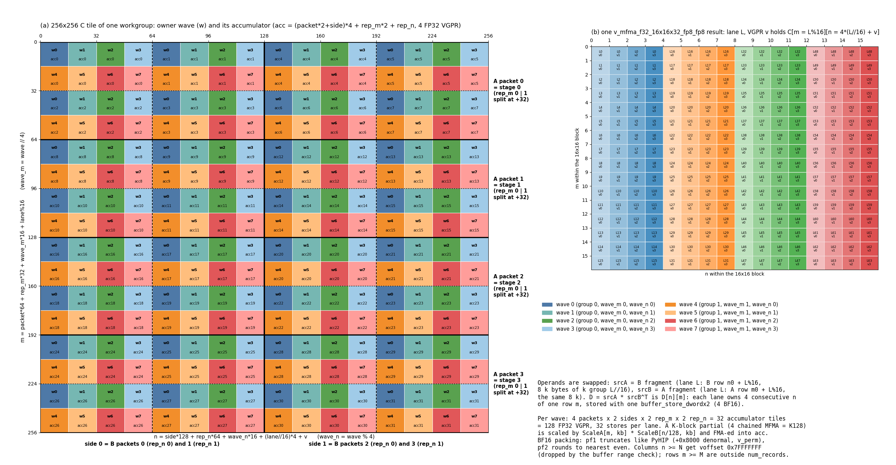
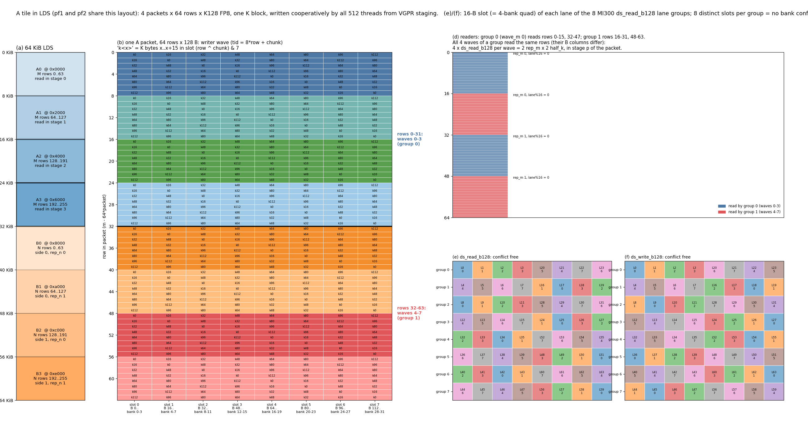
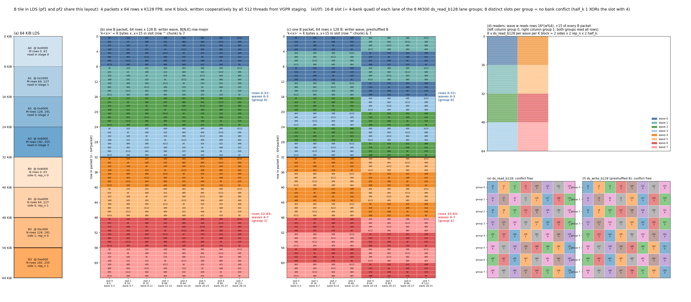
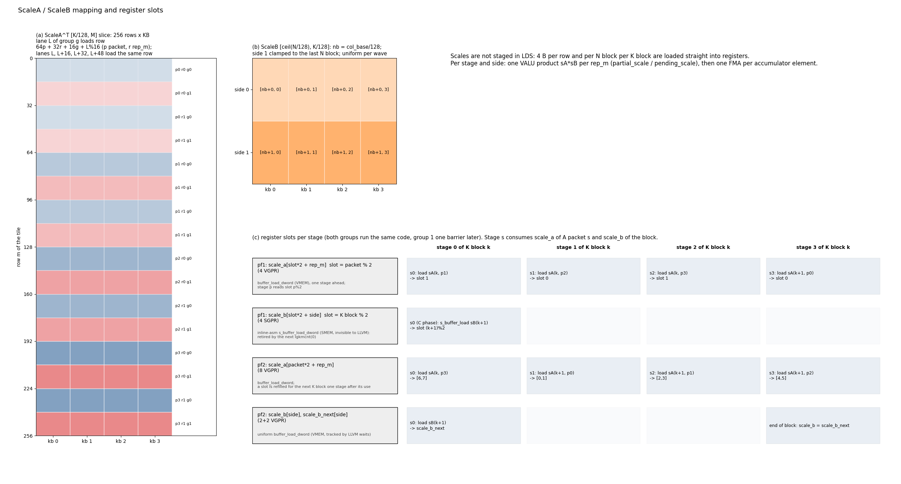
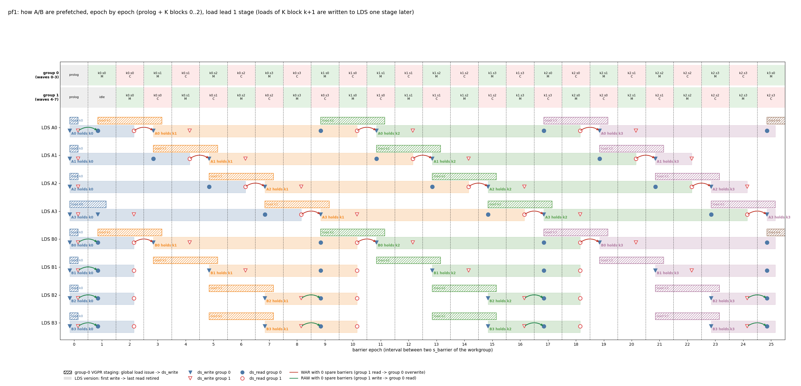
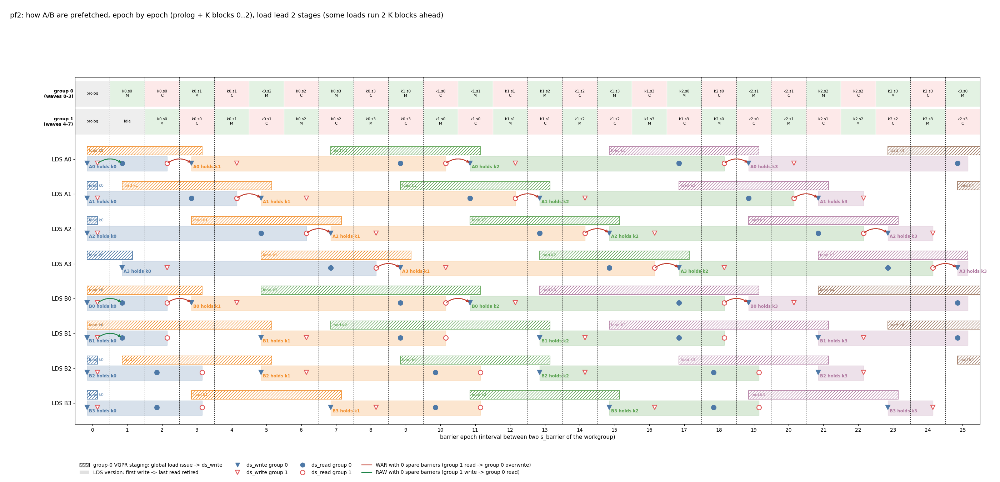
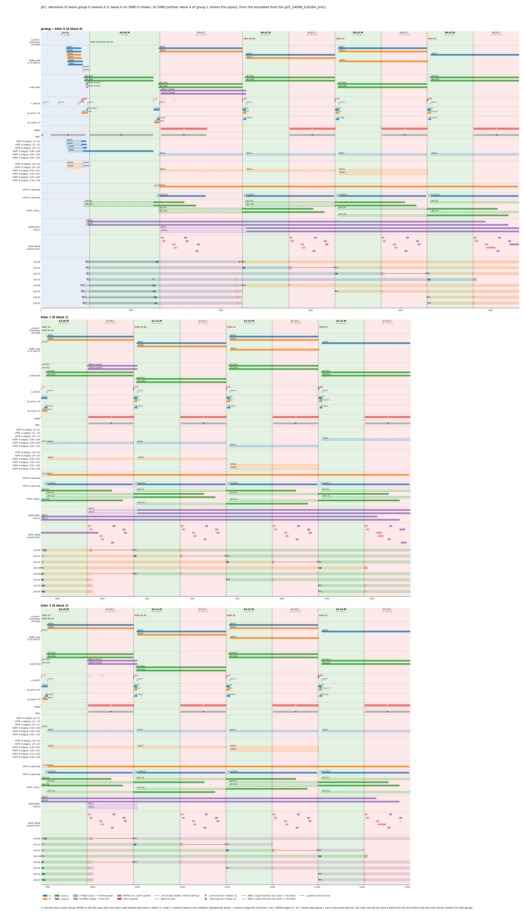
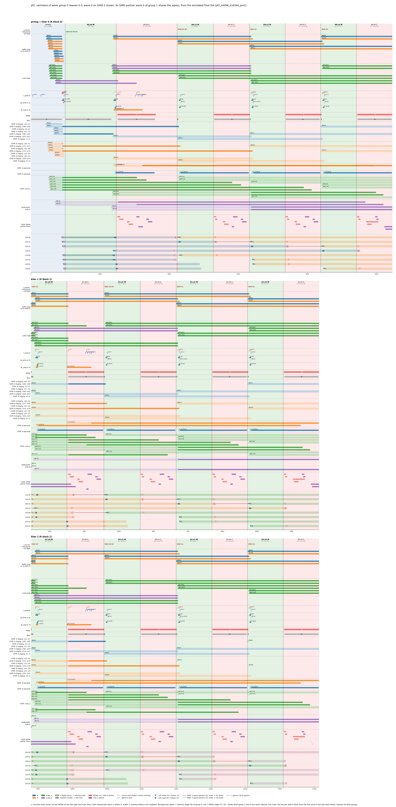

# gfx942 FP8 block-scale GEMM：2x4-LDS 实现（pf1 / pf2）设计与流水审计

本文档覆盖 PyHIP 中两个 gfx942 FlyDSL 2x4-LDS block-scale GEMM，并给出对其**最终 ISA**的严格流水审计结果：

| 名称 | 源码 | 说明 |
|---|---|---|
| pf1（1-stage load lead） | [gemm_a8w8_blockscale_gfx942_2x4_lds_pf1.py](../../src/contrib/flydsl/gemm_a8w8_blockscale_gfx942_2x4_lds_pf1.py) | PyHIP [gemm_fp8_gfx942_4x2_lds.py](../../src/contrib/gemm_fp8_gfx942_4x2_lds.py) 的 FlyDSL 移植，输出与其逐位一致（PyHIP 按 gfx950 的 (N, M) 顺序把同一网格叫 "4x2"） |
| pf2（2-stage load lead） | [gemm_a8w8_blockscale_gfx942_2x4_lds_pf2.py](../../src/contrib/flydsl/gemm_a8w8_blockscale_gfx942_2x4_lds_pf2.py) | 同一 tile/LDS 布局，部分 global load 提前 2 个 K block；B 的 side 1 在 barrier 之后读，与 side 0 的 MFMA 重叠 |
| 公共函数 | [gemm_a8w8_blockscale_gfx942_common.py](../../src/contrib/flydsl/gemm_a8w8_blockscale_gfx942_common.py) | `tb_swizzle`、inline-asm `s_buffer_load_f32`、BF16 打包 |
| 正确性测试 | [test_a8w8_blockscale_gfx942_flydsl.py](../../tests/contrib/gemm/test_a8w8_blockscale_gfx942_flydsl.py) | 12 个形状 × 是否 preshuffle × 3 个 kernel |
| 流水审计工具 | [audit_gemm_2x4_lds_pipeline_gfx942.py](../../tests/contrib/gemm/audit_gemm_2x4_lds_pipeline_gfx942.py) | 本文第 11 节的方法；报告见 [audit_report.txt](./audit_report.txt) |
| 作图脚本 | [make_figures.py](./make_figures.py) | 本文全部 PNG |

图片在 [images/](./images/) 目录，用相对路径引用。如果 Markdown 预览里图片显示为破图（例如客户端通过 VS Code Agent Host 远程打开本文件时，预览不会去远端读取相对路径的图片），运行 `python make_figures.py --inline` 生成图片以 data URI 内嵌的 `README_inline.md`（本目录 `.gitignore` 已忽略它），改为预览该文件即可。

同目录下的 8x1 kernel（[gemm_a8w8_blockscale_gfx942_8x1.py](../../src/contrib/flydsl/gemm_a8w8_blockscale_gfx942_8x1.py)）和 PyHIP v32（[gemm_fp8_gfx942.py](../../src/contrib/gemm_fp8_gfx942.py)）不在本文范围。按要求，KB=2/3（K=256/384）时 pf1 的 VGPR spill 不在本文讨论范围。

## 0. 结论速览

审计对象是 FlyDSL 0.4.0 为 gfx942 生成的最终 ISA（`COMPILE_ONLY` 编译，不启动 kernel），配置为 N=4096，K ∈ {16384, 640, 128}（KB = K/128 = 128 / 5 / 1），pf1 与 pf2，B preshuffle 与否（K=16384 两种都审）。审计逐 lane 模拟一个 256×256 workgroup 的全部 8 个 wave，详见第 11 节。

| # | 结论 | 证据 |
|---|---|---|
| F1 | **8 wave 错半拍下没有 LDS 生命周期冲突**：所有配置中，8 个 wave 之间按 dword 粒度检查的 RAW/WAR/WAW 违例为 0，没有读到未写入的 LDS，也没有一条 `ds_write` 的两个 lane 写同一 dword | K=16384 每个配置检查 32824–32832 条 ds 指令（8 wave） |
| F2 | **KB≥2（KB=5、128）没有寄存器生命周期冲突**：没有任何 VGPR/SGPR 在 load 未退休时被读或被覆盖（含 LLVM 看不见的 inline-asm `s_buffer_load_dword`）；数据来源逐条核对：131072 次 MFMA 操作数、131072 次 scale-FMA、65536 个 C 元素各写一次且含全部 128 个 K block；epilogue 在合成的 FP32 accumulator 值上执行，65536 个 BF16 的位模式与 pf1 截断 / pf2 RNE 的期望逐位一致 | [audit_report.txt](./audit_report.txt) |
| F3 | pf1 在 **KB=1** 时有一处 SGPR WAW：两条 inline-asm `s_buffer_load_dword` 同时在途地写 `s10`（下一 K block 的 scale_b，结果是死值）。当前 ISA 中无人读取该值，故**无害**，但属于真实的寄存器重叠，是潜在风险 | 第 10.3 节 |
| F4 | pf2 的 2-stage 预取在稳态被一条编译器插入的 `s_waitcnt vmcnt(7)` 截短：它只为第一轮迭代（prologue 直接 load 到 `scale_b` 寄存器）存在，却在每个 K block 的 stage 0 MFMA 阶段强制提前 2 个 block 发出的 B0/A0/B1 落地。不影响正确性；把 prologue 的 scale load 移到 A/B load 之前即可消除（已离线编译验证，未改源码） | 第 10.4 节 |
| F5 | KB=1 时两个 kernel 都把全部 128 条 scale-FMA 下沉到 epilogue，partial 寄存器存活最多 8 个 epoch，FMA 不再藏在 MFMA 下；正确性不受影响 | 第 10.5 节 |
| F6 | 错开量只能是 1 个 barrier：稳态有 0 空余 barrier 的跨组依赖（pf1：WAR A0–A3、B0 与 RAW B2、B3；pf2：WAR A0–A3、B0）。注入"waves 4-7 落后 2 个 barrier"立即出现 LDS 违例；"两组同相"（落后 0）仍然正确，只是失去重叠 | 第 9 节、第 11.3 节 |

审计工具自身经过变异自测：在真实 ISA 中注入 8 类缺陷（落后 2 个 barrier、删除 barrier 前的 `lgkmcnt(0)`、删除 `ds_write` 前的 `vmcnt`、`ds_write` 提前一个 barrier、scale load 发出后立即读、`ds_read` 偏 8 KiB、同一条 `ds_write` 的两个 lane 写同一 dword、BF16 打包放错半字），pf1/pf2 共 16 个缺陷全部被检出；"两组同相"按预期通过。

## 1. 数据契约

- `C[M, N] = A[M, K] · B[N, K]^T`，A、B 为 FP8（gfx942 上为 E4M3FNUZ），C 为 BF16。
- block scale：`ScaleA^T[K/128, M]`（每行每个 K block 一个 FP32），`ScaleB[ceil(N/128), K/128]`（每 128×128 一个 FP32）。
- B 可以是普通 `[N, K]` 行主序，也可以是 aiter `shuffle_weight(B, layout=(16, 16))`：字节偏移 `q = ((n0·K/32 + k0)·2 + k1)·256 + bn·16 + kk`，其中 `n = 16·n0 + bn`，`k = 32·k0 + 16·k1 + kk`。
- 每个 K block 先算完整的 K128 MFMA 部分和（4 条 16x16x32 MFMA 串联），再乘 `ScaleA[m, kb] · ScaleB[n/128, kb]`，用 FP32 FMA 累加进 accumulator。
- BF16 输出：pf1 与 PyHIP 一致，加 0x8000 的 FP32 非规格数后用 `v_perm` 取高半（对正规数等于截断）；pf2 为 round-to-nearest-even。
- 约束：`N % 16 == 0`，`K % 128 == 0`，`K ≥ 128`。

## 2. 分块与 wave 映射（C tile）



- 一个 workgroup 计算 256×256 的 C tile，512 线程 = 8 个 wave64。pf1 用 `tb_swizzle` 把 block id 映射到 (block_m, block_n)；pf2 用 8 个 M tile 一组共享同一 B 列 tile 的映射。
- wave 网格是 2 (M) × 4 (N)：`wave_m = wave // 4`，`wave_n = wave % 4`。下文把 wave_m=0 的 wave 0–3 称为 **group 0（G0）**，wave_m=1 的 wave 4–7 称为 **group 1（G1）**。
- 每个 wave 负责 128 行 × 64 列，但**是交错的 16×16 块**（图 (a)）：
  - 行 `m = 64·packet + 32·rep_m + 16·wave_m + lane%16`：A 的 4 个 64 行 packet 恰好对应 4 个 stage，stage p 只算 A packet p 的 64 行；
  - 列 `n = 128·side + 64·rep_n + 16·wave_n + 4·(lane//16) + v`：side 0/1 各对应 B 的两个 64 行 packet。
- 每个 wave 有 32 个 accumulator tile（`acc = (packet·2+side)·4 + rep_m·2 + rep_n`）× 4 个 FP32 VGPR = 128 VGPR。
- MFMA 交换了操作数（图 (b)）：`v_mfma_f32_16x16x32_fp8_fp8 D, srcA=B 片段, srcB=A 片段`，得到 `D[n][m]`，于是 lane L 的 4 个结果是同一行 m 的 4 个连续 n，epilogue 用一条 `buffer_store_dwordx2` 写 4 个 BF16。越界列的 voffset 设为 0x7FFFFFFF，由 buffer range check 丢弃；越界行在 `num_records` 之外。

## 3. LDS 布局：A 与 B

LDS 共 64 KiB：A 占 `[0, 32 KiB)`，B 占 `[32 KiB, 64 KiB)`，各存**一个 K block（K128）**，分成 4 个 8 KiB packet，每个 packet 64 行 × 128 B。pf1 与 pf2 布局完全相同。





- **swizzle**：逻辑上的第 c 个 16 B（K 字节 `16c..16c+15`）放在物理 slot `(row ^ c) & 7`（[`_lds_dwords`](../../src/contrib/flydsl/gemm_a8w8_blockscale_gfx942_2x4_lds_pf1.py#L34)）。
- **写者**：全部 512 线程协作写每个 packet。普通 A/B：线程 `tid` 写第 `tid//8` 行的第 `tid%8` 个 16 B，于是 G0 写每个 packet 的 0–31 行、G1 写 32–63 行。preshuffle 的 B：wave w 写行 `16·(w//2) + lane%16`、16 B 块 `4·(w%2) + lane//16`，同样是 G0 写 0–31 行、G1 写 32–63 行。
- **读者**：
  - A：G0 读每个 packet 的 0–15、32–47 行，G1 读 16–31、48–63 行（组内 4 个 wave 读相同的行）；
  - B：wave w 读每个 packet 的第 `16·(w%4)..+15` 行，**两个组都读全部行**。
  - 因此每个 A packet、B packet 的读写都跨组：G0 读的行有一半由 G1 写，反之亦然。这就是第 9 节跨组依赖的来源。
- **bank**：MI300 的 `ds_read_b128` 以 8 个 lane 为一组（每组 128 B 正好覆盖 32 个 bank，分组见 [archive/bank-conflict](../../archive/bank-conflict/README.md)）。图 (e)(f) 逐组列出每个 lane 命中的物理 slot：A/B 的读、A 的写和 preshuffle B 的写，每组 8 个 slot 互不相同，无 bank 冲突（half_k=1 只是把 slot 与 4 异或）。

## 4. Scale：不经过 LDS



- ScaleA：每个 lane 用 `buffer_load_dword` 直接取自己那一行的 scale（同一行被 lane L、L+16、L+32、L+48 重复读）。每个 stage 需要 2 个值（rep_m 0/1）。
- ScaleB：每个 K block 只要两个值（side 0 = `col_base/128`，side 1 = 下一个 N block，越界时钳到最后一个）。pf1 用 inline-asm `s_buffer_load_dword` 读进 SGPR（[`s_buffer_load_f32`](../../src/contrib/flydsl/gemm_a8w8_blockscale_gfx942_common.py#L32)：LLVM 看不到它的延迟，调用者自己保证后面有 `lgkmcnt(0)`）；pf2 用 uniform 地址的 `buffer_load_dword` 读进 VGPR（LLVM 自动插等待）。
- 寄存器槽（与模拟结果一致，见第 5 节的 stage 表）：

| kernel | 槽 | 写入（load 发出） | 消费 |
|---|---|---|---|
| pf1 | `scale_a[slot·2 + rep_m]`，slot = packet % 2，4 VGPR | stage p 取下一 packet 的 scale（stage 3 取下一 K block 的 packet 0） | stage p 的 C 阶段读 slot p%2 |
| pf1 | `scale_b[slot·2 + side]`，slot = K block % 2，4 SGPR | stage 0 的 C 阶段（barrier 后）取下一 K block | 整个下一 K block |
| pf2 | `scale_a[packet·2 + rep_m]`，8 VGPR | stage 0 取本 block packet 3；stage 1–3 取下一 block packet 0–2 | stage p 读 `[2p, 2p+1]` |
| pf2 | `scale_b[side]` + `scale_b_next[side]`，4 VGPR | stage 0 取下一 K block 到 `scale_b_next` | block 末尾 `scale_b = scale_b_next` |

- 每个 stage、每个 side、每个 rep_m 用一条 `v_mul_f32` 算 `sA·sB`（pf1 的 `partial_scale`，pf2 的 `pending_scale`），再对 partial 的每个元素做一条 FMA。

## 5. K 循环：每个 K block 4 个 stage，每个 stage 两个 barrier

一个 K block 按 A 的 4 个 packet 分成 4 个 stage。每个 stage 分两段，各以一个 `s_barrier` 结束：

- **M 段（memory）**：把上一段发出的 global load 结果从 VGPR staging 写进 LDS（下一 K block 的 packet），`ds_read` 本 stage 的操作数，发出下一 K block 的 global load，`s_waitcnt lgkmcnt(0)`，`s_barrier`。
- **staging** 指存放预取数据的 VGPR（源码里的 `a_stage`、`b_stage`，pf2 另有 `a_next*`、`b_next*`）。每个 lane 用一条 `buffer_load_dwordx4` 把下一 K block 某个 packet 的 16 B 读进 4 个 VGPR；等 LDS 里对应的 packet 被读完，再经 `s_waitcnt vmcnt` 和 `ds_write_b128`（带 XOR swizzle）写进 LDS，之后这 4 个 VGPR 即可复用。必须经寄存器中转，原因有两个：gfx942 没有每 lane 16 B 的 global→LDS 直写指令（只有每 lane 4 B、按 lane 连续写入、无法 swizzle 的 `buffer_load_dword ... lds`，见 [archive/bank-conflict](../../archive/bank-conflict/README.md#using-memory-buffer-load-to-lds)）；LDS 只有一份，数据要先在寄存器里等对应 packet 空出来。scale 不进 LDS，直接 load 进参与计算的寄存器，不叫 staging。
- **C 段（compute）**：`s_setprio 3`，32 条 MFMA（2 side × 2 rep_m × 2 rep_n × 4 k_step），4 条 `v_mul_f32`（scale 乘积），32 条 scale-FMA，`s_setprio 0`，`s_barrier`。

每个 K block 8 个 barrier。pf1 的循环体是 2 个 K block（scale_b 的两个 SGPR 槽交替；KB 为奇数时先单独做 block 0），pf2 的循环体是 1 个 K block。每个 wave 每个 K block：128 MFMA、128 scale-FMA、16 `v_mul_f32`、24 `ds_read_b128`、8 `ds_write_b128`、8 条 `buffer_load_dwordx4`（A/B）、8 条 `buffer_load_dword`（scale_a），以及 2 个 scale_b（pf1：SMEM；pf2：VMEM）。

下表摘自审计报告（K=16384，wave 0，K block 2；括号里是数据所属的 K block，`s:` 表示 SMEM；"retired" 为该 wait 实际退休的请求数）：

**pf1**

| epoch | 段 | ds_write | ds_read | 发出的 load | wait（退休数） |
|---|---|---|---|---|---|
| 17 | k2.s0 M | A3(k2) | B0–B3 ×8，A0 ×4（k2） | sA1(k2)×2，A0(k3)，B0(k3) | vm0(3) lgkm0(13) |
| 18 | k2.s0 C | | | s:sB0(k3)，s:sB1(k3) | vm5(0) vm4(0)（编译器插入，不退休任何请求） |
| 19 | k2.s1 M | A0(k3) B0(k3) | A1 ×4 | sA2(k2)×2，A1(k3)，B1(k3) | vm1(3) vm0(1) lgkm0(8) |
| 21 | k2.s2 M | A1(k3) B1(k3) | A2 ×4 | sA3(k2)×2，A2(k3)，B2(k3)，B3(k3) | vm1(3) vm0(1) lgkm0(6) |
| 23 | k2.s3 M | A2(k3) B2(k3) B3(k3) | A3 ×4 | sA0(k3)×2，A3(k3) | vm2(3) vm1(1) vm0(1) lgkm0(7) |

**pf2**

| epoch | 段 | ds_write | ds_read | 发出的 load | wait（退休数） |
|---|---|---|---|---|---|
| 17 | k2.s0 M | A3(k2) | B0–B1 ×4（side 0），A0 ×4 | sB(k3)×2，sA3(k2)×2，A1(k3)，B2(k3) | vm13(3) lgkm0(9) |
| 18 | k2.s0 C | | B2–B3 ×4（side 1，barrier 之后） | | **vm7(6)**、vm6(1)，lgkm3..0 |
| 19 | k2.s1 M | A0(k3) B0(k3) | A1 ×4 | A2(k3)，B3(k3)，sA0(k3)×2 | lgkm0(6) |
| 21 | k2.s2 M | A1(k3) B1(k3) B2(k3) | A2 ×4 | A3(k3)，**B0(k4)**，sA1(k3)×2 | vm9(5) vm8(1) lgkm0(7) |
| 23 | k2.s3 M | A2(k3) B3(k3) | A3 ×4 | **A0(k4)**，**B1(k4)**，sA2(k3)×2 | vm11(1) vm10(1) lgkm0(6) |

C 段内的 FMA 顺序（"延迟退休"）：

- pf1：每条 MFMA 后紧跟一条 FMA，退休的是**上一组** partial：side 0 的前 8 条 MFMA 退休上一 stage side 1 的 partial 2–3（`previous_packet`），之后的 FMA 退休本 stage 已完成的 partial。partial FIFO 共 4×4 VGPR，`partial_scale` 2 个。最后一个 stage 的 side 1 partial 2–3 在循环外退休（[L296](../../src/contrib/flydsl/gemm_a8w8_blockscale_gfx942_2x4_lds_pf1.py#L296)）。
- pf2：每个 (side, rep_m) 对 = 2 条 4-MFMA 链；上一对的 8 个 FP32 结果（`pending`）在本对的 8 条 MFMA 下各退休一个元素，跨 stage、跨 K block 也如此；最后一对在循环外退休（[L303](../../src/contrib/flydsl/gemm_a8w8_blockscale_gfx942_2x4_lds_pf2.py#L303)）。
- 审计统计：稳态 partial 在其最后一条 MFMA 之后 0–2 个 epoch 内被 FMA 消费。

## 6. 8 wave 错半拍（4+4 stagger）

- prologue：所有 wave 把 K block 0 的 8 个 packet 写进 LDS，`lgkmcnt(0)`，`s_barrier`；随后 **G1 多执行一个 `s_barrier`**（pf1 [L284](../../src/contrib/flydsl/gemm_a8w8_blockscale_gfx942_2x4_lds_pf1.py#L284)，pf2 [L210](../../src/contrib/flydsl/gemm_a8w8_blockscale_gfx942_2x4_lds_pf2.py#L210)）。
- 循环：两组执行同一段代码，G1 恰好落后 1 个 barrier。于是**每个 epoch 一组在 M 段、另一组在 C 段**。每个 SIMD 上是 wave w（G0）与 wave w+4（G1），一个 wave 的 LDS/global 指令与同 SIMD 另一个 wave 的 MFMA 重叠；C 段 `s_setprio 3` 让 MFMA 优先发射。
- epilogue：**G0 在循环后多执行一个 `s_barrier`**（pf1 [L302](../../src/contrib/flydsl/gemm_a8w8_blockscale_gfx942_2x4_lds_pf1.py#L302)，pf2 [L308](../../src/contrib/flydsl/gemm_a8w8_blockscale_gfx942_2x4_lds_pf2.py#L308)），两组 barrier 数重新相等。这两个条件 barrier 必须成对存在。
- 审计实测：K=16384 每个 wave 都执行 1026 个 `s_barrier`（1 + 8·128 + 1）；G0 第一条 MFMA 在 epoch 2，G1 在 epoch 3。
- 记号：epoch = workgroup 相邻两个 `s_barrier` 之间。G0 在 K block k、stage s 的 M 段位于 epoch `8k + 2s + 1`，C 段在下一个 epoch；G1 各晚 1。

**与 ping-pong 的关系**：这个流水的 ping-pong 在 wave 级和寄存器级，LDS 不做 ping-pong。

| 层次 | 有没有 | 实现 |
|---|---|---|
| wave 级（ping-pong 调度） | 有，是本流水的核心 | 上面的 4+4 错拍：同一 SIMD 上的 G0、G1 两个 wave 每个 epoch 互换 M（访存）与 C（MFMA）角色，C 段 `s_setprio 3`。与 Triton AMD 后端的 block ping-pong（条件 barrier 错开一半 warp + `s_setprio`）是同一思路 |
| 寄存器级 | 有，局部 | pf1：`b_stage` 两槽按 `packet % 2` 轮换（[L144](../../src/contrib/flydsl/gemm_a8w8_blockscale_gfx942_2x4_lds_pf1.py#L144)）；`scale_a` 两槽按 `packet % 2` 轮换；`scale_b` 两组 SGPR 按 `K block % 2` 轮换（循环体展开 2 个 K block 就是为了让槽号成为编译期常量，[L287](../../src/contrib/flydsl/gemm_a8w8_blockscale_gfx942_2x4_lds_pf1.py#L287)）；`partial` 的 (0,1)、(2,3) 两对交替退休。pf2：`scale_b` / `scale_b_next` 双缓冲（block 末复制，[L298](../../src/contrib/flydsl/gemm_a8w8_blockscale_gfx942_2x4_lds_pf2.py#L298)），`pending` 比正在计算的一对晚一拍退休 |
| LDS 级（双缓冲） | 没有 | LDS 只存一个 K block：A、B 各 32 KiB，正好占满 gfx942 每个 workgroup 可用的 64 KiB，第二份缓冲需要 128 KiB。改为按 packet 原地回填：A packet p 在 stage p 读完，stage p+1 的 M 段就写入下一 K block 的 packet p；B 在 stage 0 一次读进 32 个 VGPR 的 `b_ops`，从 stage 1 起 B 的 LDS 就可回填。"另一份缓冲"在寄存器里：global → VGPR staging 的预取，以及整个 block 都持有 B 的 `b_ops` |

LDS 不做双缓冲的代价是第 9 节的 0 空余 WAR：G1 在 epoch e 读完 packet X，G0 在 epoch e+1 就覆盖 X，中间只隔一个 barrier，所以错开量只能是 1 个 barrier。若要做 LDS 双缓冲，只能把每份缓冲减半（例如每份只放 K64，或缩小 tile），代价是 K128 的 block scale 要跨两份缓冲累加，或者降低每字节 LDS 读的 MFMA 复用。仓库里的 MoE 8-wave Down（[design_moe_gemm_8wave_down.md](../design_moe_gemm_8wave_down.md)）用的是四槽 LDS 环形缓冲加直接写 LDS 的 load，与这里不同。

## 7. 预取





两张图由模拟结果画出（K=16384，prolog + K block 0..2）：每行一个 LDS packet；斜线框是 G0 的 VGPR staging（global load 发出 → 写入 LDS 的 `ds_write`），浅色条是一个 packet 版本在 LDS 中的寿命（第一次写 → 最后一次读退休），▼/● 为 G0 的写/读，▽/○ 为 G1 的写/读，红/绿箭头是 0 空余 barrier 的 WAR/RAW。

| | pf1 | pf2 |
|---|---|---|
| stage 0 发出 | A0(k+1)，B0(k+1)，sA(k, p1) | A1(k+1)，B2(k+1)，sB(k+1)，sA(k, p3) |
| stage 1 发出 | A1(k+1)，B1(k+1)，sA(k, p2) | A2(k+1)，B3(k+1)，sA(k+1, p0) |
| stage 2 发出 | A2(k+1)，B2(k+1)，B3(k+1)，sA(k, p3) | A3(k+1)，B0(k+2)，sA(k+1, p1) |
| stage 3 发出 | A3(k+1)，sA(k+1, p0) | A0(k+2)，B1(k+2)，sA(k+1, p2) |
| stage 0 写 LDS | A3(k)（上一 block stage 3 取） | A3(k)（上一 block stage 2 取） |
| stage 1 写 LDS | A0，B0（k+1） | A0，B0（k+1） |
| stage 2 写 LDS | A1，B1（k+1） | A1，B1，B2（k+1） |
| stage 3 写 LDS | A2，B2，B3（k+1） | A2，B3（k+1） |
| load → ds_write | 都是 2 个 epoch（下一 stage 的 M 段） | A1–A3、B2、B3 与 A0(k+2) 为 4 个 epoch，B0/B1(k+2) 为 6 个（设计值） |

- pf1：packet p 的下一版本在 stage p 被读完后、stage p+1 才写，所以 A/B 的 staging 只需活 2 个 epoch；B2、B3 在 stage 2 一起取进两个 b_stage 槽，stage 3 一起写（`b_stage` 只有 2 个逻辑槽）。
- pf2：A 的写入时刻与 pf1 相同，但 load 提前一到两个 stage 发出；B2/B3 的读放到 stage 0 的 C 段，因此 B2 可以在 stage 2 写。代价是 staging 多占 VGPR（pf2 250 vs pf1 240）。实际有效提前量见第 10.4 节：B0/A0/B1(k+2) 被一条编译器插入的 `vmcnt(7)` 截短到与 pf1 相近。
- 最后一个 K block 的 "下一 block" 被钳到 KB−1（`k_next` / `k1`、`k2`），load 照发、LDS 照写，写入的是与当前内容相同的数据，没有读者。审计把它们当作普通版本检查，仍满足 WAR。pf1 在 block 0 的 stage 0 也会把 prologue 已写过的 A3 再写一遍（相同数据）。

## 8. 泳道图（group 0，prolog → kiter 0、1、2）





由模拟出的最终 ISA 指令流画出。group 0 的 4 个 wave 执行完全相同的指令序列（只有地址不同），图中画的是 SIMD 0 上的 wave 0；同一 SIMD 上的 G1 wave 4 参与时间轴（共享 XDL/VALU 流水）并给出跨组依赖。横轴是名义发射周期：MFMA 在 XDL 流水上占 16 周期、VALU 4 周期（两 wave 共享），其余指令 4 周期、标量 1 周期，不建模访存延迟。背景绿色为 G0 的 M 段、红色为 C 段，顶部 "G1:" 为同一区间 G1 所处的段。

泳道（自上而下）：

| 泳道 | 含义 |
|---|---|
| s_barrier: cross-group LDS deps | 该 barrier 单独保护的跨组依赖（G1 的读/写在它之前退休，G0 的写/读在它之后发出） |
| buffer_load A / B | A/B global load，从发出到退休它的 `s_waitcnt` |
| scale loads | scale_a（VMEM）、scale_b（pf1 为 SMEM） |
| s_waitcnt | vmcnt / lgkmcnt；淡色表示这条 wait 没有退休任何请求 |
| ds_write / ds_read A / B | 同一 epoch、同一 tile 的 LDS 指令合并为一条，标注 packet、条数与数据 K block |
| MFMA / VALU | 连续的 MFMA / VALU 段及条数 |
| VGPR: A/B staging（每行一个物理寄存器区间） | 斜线 = load 在途（发出 → 退休 wait），实心 = 已到达、等待 `ds_write` |
| VGPR: B / A operands | `ds_read` 结果从发出到最后一条读它的 MFMA |
| VGPR: scale_a，SGPR/VGPR: scale_b | 同上，直到最后一条 `v_mul_f32` |
| VGPR: MFMA partial chains | 一条 4-MFMA 链从第一条 MFMA 到退休它的 FMA；紫色为 side 1（延迟到下一 stage 退休） |
| LDS A0..B3 | 每个 packet 每个数据版本一条浅色条（第一次写 → 最后一次读退休），▼/● 为 G0，▽/○ 为 G1，箭头为 0 空余 barrier 的依赖 |

## 9. LDS 跨组依赖与生存周期

审计把每个 `ds_read`/`ds_write` 展开到 64 lane × 4 dword 的 LDS 地址，按 dword 记录最后写者和自上次写以来的各 wave 读者。另一 wave 的访问必须在**更早的 epoch** 中被一条 `s_waitcnt` 退休（之后的 barrier 才能保护它），否则为违例。所有配置违例数为 0。

"空余 barrier" = 消费者所在 epoch − 生产者退休所在 epoch − 1；0 表示只靠紧邻的那个 barrier。下表为跨组、稳态（epoch ≥ 10）的最小值（全程最小值还包括 prologue：所有 packet 在 epoch 0 写、G0 在 epoch 1 读，RAW 空余为 0）：

| packet | 下一版本写入（G0） | 本版本读取 | pf1 WAR / RAW | pf2 WAR / RAW |
|---|---|---|---|---|
| A0 | s1 M | s0 M | **0** / 4 | **0** / 4 |
| A1 | s2 M | s1 M | **0** / 4 | **0** / 4 |
| A2 | s3 M | s2 M | **0** / 4 | **0** / 4 |
| A3 | 下一 block s0 M | s3 M | **0** / 4 | **0** / 4 |
| B0 | s1 M | s0 M | **0** / 4 | **0** / 4 |
| B1 | s2 M | s0 M | 2 / 2 | 2 / 2 |
| B2 | pf1 s3 M，pf2 s2 M | pf1 s0 M，pf2 s0 C | 4 / **0** | 1 / 3 |
| B3 | s3 M | pf1 s0 M，pf2 s0 C | 4 / **0** | 3 / 1 |

- **WAR 0**：G1 在其 M 段（epoch e）读 packet X，G0 在 epoch e+1 的 M 段覆盖 X。只有当 G1 的 `ds_read` 在 epoch e 内退休（M 段末尾的 `s_waitcnt lgkmcnt(0)`）并且两者之间恰有一个 barrier 时才安全。
- **RAW 0（仅 pf1 B2/B3）**：G1 在 k.s3 M（epoch 8k+8）写 B2/B3，G0 在 k+1.s0 M（epoch 8k+9）读。同样依赖 G1 的 `lgkmcnt(0)` + barrier。pf2 把 B2/B3 的读推迟到 s0 C，留出 1 个空余 barrier。
- **错开量**：若 G1 落后 L 个 barrier，上述 WAR 的空余变为 1−L。L=1（设计值）恰好为 0；L=2 为 −1，审计的变异测试在两个 kernel 上都报出 LDS 违例和错误结果；L=0（两组同相）各项空余 +1，仍然正确，只是 M/C 不再重叠。
- **组内**（同组不同 wave）的最小空余为 WAR 1、RAW 0（prologue）。
- 跨组读写关系的根源是第 3 节的写者/读者映射：每个 packet 两组各写一半行，而 A 的每一组读两组写的行、B 的每一组读全部行。
- epilogue 不使用 LDS；G0 多出的 barrier 只用于让 barrier 数配对。

## 10. 寄存器资源与生存周期

### 10.1 资源

| 配置（最终 ISA） | VGPR | AGPR | SGPR | spill / scratch | LDS |
|---|---|---|---|---|---|
| pf1，K=16384，preshuffle / 普通 B | 240 / 236 | 0 | 50 / 48 | 0 | 64 KiB |
| pf1，K=640 / K=128 | 238 / 174 | 0 | 44 / 37 | 0 | 64 KiB |
| pf2，K=16384，preshuffle / 普通 B | 250 / 244 | 0 | 42 / 41 | 0 | 64 KiB |
| pf2，K=640 / K=128 | 250 / 201 | 0 | 41 / 34 | 0 | 64 KiB |

VGPR ≤ 256 → 每个 SIMD 至多 2 个 wave；64 KiB LDS → 每个 CU 1 个 workgroup。因此每个 CU 恰好驻留一个 workgroup 的 8 个 wave，每个 SIMD 一个 G0 wave、一个 G1 wave，错半拍正是在这两个 wave 之间发生。

逻辑寄存器（每 wave）：

| 资源 | pf1 | pf2 |
|---|---|---|
| accumulator | 128 VGPR | 128 VGPR |
| B 操作数 `b_ops`（整个 K block 复用） | 32 | 32（side 0 在 M 段读，side 1 在 C 段读） |
| A 操作数 `a_ops`（一个 stage） | 16 | 16 |
| partial / pending | 16 + `partial_scale` 2 | `pending` 8 + `pending_scale` 1，外加正在串联的 2×4 |
| A/B staging（逻辑） | `a_stage` 16 + `b_stage` 8 | `a_stage` 8 + `b_stage` 8 + `a_next1/2` 8 + `b_next2/3` 8 |
| scale_a / scale_b | 4 VGPR / 4 SGPR | 8 VGPR / 2+2 VGPR |

编译器按时间复用物理寄存器：以 K=640 的 ISA 为例（寄存器分配随 K 变化），pf1 的 `v[164:167]` 前几个 stage 是 MFMA partial 链、stage 3 起是 A3(k+1) 的 staging；`v[226:229]` 先后装 B0、B1(k+1) 的 staging，再装 A2(k+1) 的 staging。pf2 的 `v[184:187]`、`v[172:175]`、`v[176:179]`、`v[180:183]` 都是先作 partial 链、再作 A3(k+1)、B0/B1(k+2)、A0(k+2) 的 staging。每一次交接都要求前一用途的最后读在新 load 发出之前、且新 load 落地前没人读——审计对每次交接逐条确认（无在途读写；数据来源正确）。

### 10.2 稳态生存周期（wave 0，K block 2，模拟结果）

"定义"是 load 发出（寄存器从此被占用），"就绪"是退休它的 `s_waitcnt` 所在段，"最后使用"是最后一条读它的指令所在段；跨度单位为 epoch。

| 资源 | pf1：定义 → 就绪 → 最后使用 | 跨度 | pf2：定义 → 就绪 → 最后使用 | 跨度 |
|---|---|---|---|---|
| A staging（下一 block） | sp M → s(p+1) M → `ds_write` s(p+1) M | 2 | A1/A2/A3：s0/s1/s2 M → 两段后的 M → `ds_write` | 4 |
| A staging（两个 block 后） | — | | A0(k+2)：s3 M → **k+1.s0 C** → `ds_write` k+1.s1 M | 4 |
| B staging（下一 block） | B0、B1：s0、s1 M；B2、B3：s2 M → 下一 M → `ds_write` | 2 | B2/B3：s0/s1 M → s2/s3 M → `ds_write` | 4 |
| B staging（两个 block 后） | — | | B0/B1(k+2)：s2/s3 M → **k+1.s0 C** → `ds_write` k+1.s1/s2 M | 6 |
| B 操作数 | s0 M → s0 M → s3 C | 7 | side 0：s0 M → s3 C；side 1：s0 C → s3 C | 7 / 6 |
| A 操作数 | sp M → sp M → sp C | 1 | 同 pf1 | 1 |
| scale_a | sp M → s(p+1) M → s(p+1) C | 3 | 使用后下一 stage 重新取，跨 7 | 7 |
| scale_b | s0 C（SMEM）→ s1 M（`lgkmcnt(0)`）→ 下一 block s3 C | 14 | `scale_b_next`：s0 M → s2 M → block 末复制到 `scale_b`，下一 block 使用 | 8 |
| MFMA partial | side 0：同一 C 段；side 1 的 pair 2–3：下一 stage 的 C 段 | 0 / 2 | 下一对 MFMA 下逐元素退休 | 0–2 |

pf1 的 staging 只活 2 个 epoch，所以 B 只要 2 个逻辑槽（B2、B3 在 stage 2 一起取）；pf2 的 staging 活 4–6 个 epoch，换来更早发出 global load，VGPR 多 10 个。

### 10.3 F3：pf1 在 KB=1 时的 SGPR WAW（当前无害）

K=128 的 pf1 ISA，stage 0 的 C 段开头：

```
s_waitcnt lgkmcnt(0)
s_barrier
s_setprio 3
s_buffer_load_dword s10, s[16:19], s27   ; inline asm：下一 block 的 scale_b side 0（KB=1 时钳到 block 0）
s_nop 0
s_buffer_load_dword s10, s[16:19], s28   ; side 1，目标同为 s10，而第一条仍在途
```

- 原因：[`load_scale_b(1 - slot, k_next)`](../../src/contrib/flydsl/gemm_a8w8_blockscale_gfx942_2x4_lds_pf1.py#L220) 取的是下一 K block 的 scale_b；KB=1 时没有下一 block，两个结果都是死值。`s_buffer_load_f32` 是带 side effect 的 inline asm，LLVM 认为输出立即可用、且无人使用，于是把两个输出分到同一个 `s10`。SMEM 乱序返回，`s10` 的最终值不确定。
- 现状：`s10` 下一次被写（`s_lshl_b32 s10, s24, 13`）在一条 `lgkmcnt(0)` 之后，中间也无人读，审计未发现其他冲突，所以结果正确（8 条 WAW 即 8 个 wave 各一条）。
- 风险：LLVM 可以把死输出分到任意寄存器，包括此时正活着的值；SMEM 晚到会覆盖它，而没有任何 wait 保护。KB≥2 时这些值是循环携带的，LLVM 会给它们独立 SGPR（审计 0 冲突）。
- 建议（未改）：KB=1 时不发下一 block 的 scale_b load（例如 `if const_expr(KB > 1): load_scale_b(...)`）；或在可行时换成 LLVM 可见的 SMEM load。

### 10.4 F4：pf2 stage 0 C 段的 `vmcnt(7)` 截短了 2-stage 预取

K=16384 的 pf2 ISA，stage 0 的 C 段：

```
s_waitcnt lgkmcnt(0)
s_barrier                                    ; stage 0 M 段结束
ds_read_b128 v[200:203], v157 offset:16384   ; B side 1（共 4 条）
...
v_mfma_f32_16x16x32_fp8_fp8 v[184:187], v[216:217], v[234:235], 0
v_fmac_f32_e32 v13, v4, v170
s_waitcnt vmcnt(7)                           ; ISA 第 395 行
v_mul_f32_e32 v232, v164, v166               ; pair scale = scale_a[0] * scale_b[0]
```

- 第一轮迭代（epoch 2）：这条 wait 退休的正是 prologue 的 `buffer_load_dword v166, ...`（K block 0 的 scale_b side 0，[L198](../../src/contrib/flydsl/gemm_a8w8_blockscale_gfx942_2x4_lds_pf2.py#L198)）——它只为此存在。
- 稳态：`v166` 每个 block 末由 `v_mov_b32 v166, v167`（`scale_b = scale_b_next`）写入，没有在途 load。但同一条 wait 每轮都执行（LLVM 插 wait 时合并了循环入口与回边两条路径），而 vmcnt 按序退休，于是在 stage 0 的 C 段强制 6 个请求落地：B0(k+2)、sA1(k+1)×2、A0(k+2)、B1(k+2)、sA2.0(k+1)。它们的消费者都在下一个 M 段或更晚。
- 影响：A0/B1(k+2) 的有效提前量从 4 个 epoch 缩到 2 个，B0(k+2) 从 6 个缩到 4 个，与 pf1 相近；如果 global 延迟超过这段时间，停顿发生在 G0 的 C 段——正是需要掩盖 G1 访存的那一段。正确性不受影响。
- 已验证的修改（未合入源码）：把 prologue 的 8 条 scale load（[L193–L198](../../src/contrib/flydsl/gemm_a8w8_blockscale_gfx942_2x4_lds_pf2.py#L193)）移到 A/B load 之前。重新编译（K=16384、K=640）后，stage 0 C 段不再有 vmcnt wait（只剩 side-1 B 读的 4 个 `lgkmcnt`），B0/A0/B1(k+2) 改在下一 block 的 s1 M、各自 `ds_write` 之前退休；VGPR 仍为 250，全部审计项通过。未测性能（GPU 为共享环境），合入前应按 [gpu-benchmark-validation](../../.github/skills/gpu-benchmark-validation/SKILL.md) 的方法测量。

### 10.5 F5：KB=1 时 scale-FMA 下沉到 epilogue

K=128 时两个 kernel 都没有包住 K block 的循环，LLVM 把每个 wave 全部 128 条 scale-FMA 下沉到 epilogue（epoch 10，G0 的补偿 barrier 之后）：32 条 partial 链（128 VGPR）存活 2–8 个 epoch，C 段只剩 MFMA（stage 表中 VALU 为 0）。VGPR 174/201，无 spill，FMA 与存储检查全部通过。只影响 K=128 的性能。

## 11. 审计方法

### 11.1 模拟

- 输入：FlyDSL 以 `COMPILE_ONLY=1 FLYDSL_DUMP_IR=1` 编译得到的 `22_final_isa.s`（不启动 kernel）。
- 一个 workgroup 的 8 个 wave 按 `s_barrier` 同步推进：每个 wave 运行到下一个 `s_barrier`，所有存活 wave 都到达后 epoch 加一。仿真 M=N=4096、workgroup 37（内部 tile，无越界）。
- SALU/VALU 整数运算按 64 lane 具体执行（SCC、VCC、EXEC、kernarg、workgroup id 都是具体值，每个张量占一个独立的 2^40 字节地址窗口），因此所有 LDS 与 global 地址都是逐 lane 的精确值；循环计数、`wave_m` 条件 barrier 等分支按实际值执行。
- load 的数据不是数值而是**来源**：每个 dword 的 global 字节地址。它经过 VGPR staging、`ds_write`、逐 dword 的 LDS 模型、`ds_read`、move/select 流入 MFMA；MFMA 结果、scale 乘积和 accumulator 带 (m, n, K block) 标签。
- accumulator 另带一个按 (m, n) 生成的合成 FP32 值（各种尾数、正负号、2^-15..2^16 的正规数）；epilogue 的 VALU（`v_add_f32`、`v_bfe_u32`、`v_add3_u32`、`v_cmp_u_f32`、`v_cndmask`、`v_and_or_b32`、`v_perm_b32` 等）在这些值上真实执行，因此打包结果可以逐位核对。
- 计数器按硬件顺序重放：VMEM 按发出顺序退休，LDS 按序，SMEM 乱序（`lgkmcnt(N>0)` 只保证比在途 SMEM 数更早的 LDS 请求完成，SMEM 只在 `lgkmcnt(0)` 时确定完成）。load 的目的寄存器在退休它的 wait 执行时才写入。

### 11.2 检查项

1. barrier 配对：每个 wave 的 `s_barrier` 数相同；识别只由一组执行的条件 barrier；测 G1 落后量。
2. 寄存器：读、写在途 load 的目的 VGPR/SGPR/AGPR 即为冲突（同一计数器上按序返回的后续 load 除外）。
3. LDS：逐 dword 记录最后写者和此后各 wave 的读者；另一 wave 的访问必须在生产者被 wait 退休的 epoch 之后；记录每对依赖的空余 barrier。同一条 `ds_write` 内两个 lane 写同一 dword 且数据不同也算违例。
4. MFMA：srcA 每行来自同一 B 行 n，srcB 每行来自同一 A 行 m，两者在每个 (k 组, 字节) 上是同一个 k，32 个 k 互不相同且属于同一 K block；srcC 必须是同一 (m, n, K block) 链且 k 不重叠。
5. FMA：必须是覆盖全部 128 个 k 的 partial × `v_mul_f32(ScaleA^T[kb, m], ScaleB[nb, kb])`，m 相同、`n/128 == nb`，累加进同一 (m, n) 的 accumulator，每个 K block 恰好一次。
6. 存储：每个 BF16x2 dword 恰好由其地址对应的 (m, n)、(m, n+1) 两个 accumulator 打包而成，且各含全部 KB 个 K block；其位模式必须等于两个合成值按该 kernel 的方式舍入后低半字放 (m, n)、高半字放 (m, n+1)（pf1：加 0x8000 非规格数后截断；pf2：RNE）；256×256 tile 每个元素恰好写一次。

### 11.3 变异自测

在 KB=5 的真实 ISA 中注入缺陷，要求审计报错：

| 注入 | pf1 | pf2 |
|---|---|---|
| waves 4–7 落后 2 个 barrier（复制两个条件 barrier） | 报错：LDS 356 条及数据错误 | 报错：LDS 324 条及数据错误 |
| 两组同相（删除两个条件 barrier） | 通过（预期） | 通过（预期） |
| 删除循环中最后一个 barrier 前的 `lgkmcnt(0)` | 报错：LDS 60、寄存器 1056 | 报错：LDS 176、寄存器 2560 |
| 删除 `ds_write` 前的 `vmcnt` | 报错：寄存器 320 | 报错：寄存器 256 |
| 某条 `ds_write` 提前一个 barrier | 报错：LDS 32 | 报错：LDS 80 |
| scale load 发出后立即读其寄存器 | 报错：寄存器 32 | 报错：寄存器 80 |
| 某条 `ds_read` 偏移 8 KiB（读错 packet） | 报错：MFMA/FMA/存储 | 报错：MFMA/FMA/存储 |
| 同一条 `ds_write` 的两个 lane 写同一 dword（清掉地址第 7 位） | 报错：LDS 128（均为指令内 lane 冲突）及数据错误 | 报错：LDS 161（160 条指令内 lane 冲突）及数据错误 |
| BF16 打包放错半字（改 `v_and_or_b32` 掩码 / `v_perm_b32` 选择子） | 报错：存储 512（仅位级检查能发现） | 报错：存储 512（仅位级检查能发现） |

完整输出见 [audit_report.txt](./audit_report.txt) 末尾。

## 12. 局限

- 只仿真一个内部 tile。边界 tile 执行同样的指令和 LDS 地址，只有 global range check 与 scale 行钳位不同；边界数值由 pytest 的形状（M=1、17、129、255、257、4097，N=272、528 等）覆盖。
- 编译器负责的流水 hazard（MFMA/VALU 等待周期、`s_nop`）不在模型内，只建模了内存计数器。
- BF16 打包只在合成的正规 FP32 值上逐位核对，NaN/Inf/非规格数输入的分支没有被执行到。
- 假设 gfx942 的 vmcnt 按序退休（load 与 store 共用），同一 wave 的 LDS 请求按序执行；`ds_write_b128` 的 bank 分组按 `ds_read_b128` 的实测分组估计。
- 泳道图时间轴是名义发射周期，不含访存延迟；真实停顿需要 ATT。
- 结论针对 FlyDSL 0.4.0 及其 LLVM 生成的 ISA；编译器或源码变化后应重跑审计。
- KB=2/3（K=256/384）按要求未讨论。

## 13. 复现

```bash
# 编译（COMPILE_ONLY，不启动 kernel）全部配置并审计；pf1 K=128 因 F3 返回非零
python tests/contrib/gemm/audit_gemm_2x4_lds_pipeline_gfx942.py --dump /tmp/gemm_isa --report /tmp/gemm_audit_report.txt
# 变异自测（KB=5）
python tests/contrib/gemm/audit_gemm_2x4_lds_pipeline_gfx942.py --isa /tmp/gemm_isa --self-test
# 作图；不带 --isa 只画布局图
python docs/gfx942_gemm_blockwise/make_figures.py --isa /tmp/gemm_isa
# 生成图片内嵌的 README_inline.md（用于无法加载相对路径图片的预览）
python docs/gfx942_gemm_blockwise/make_figures.py --inline
```

K=16384 的单个配置仿真约 20 秒，全部配置约 70 秒（CPU）。
