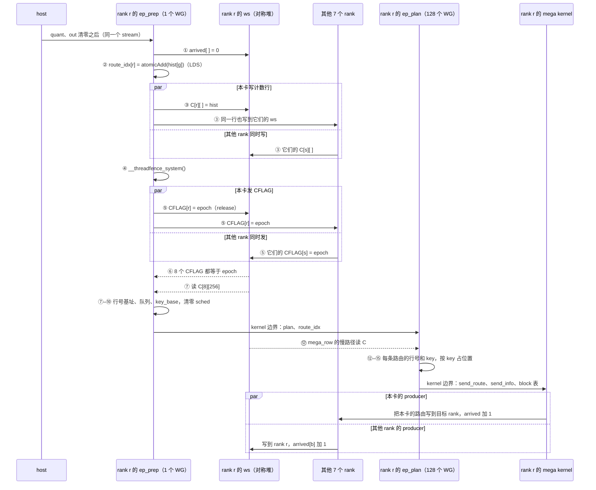
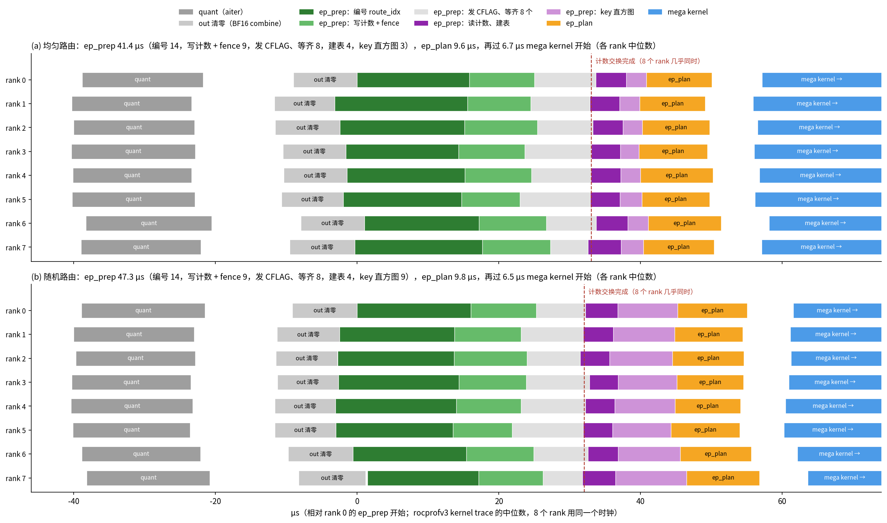
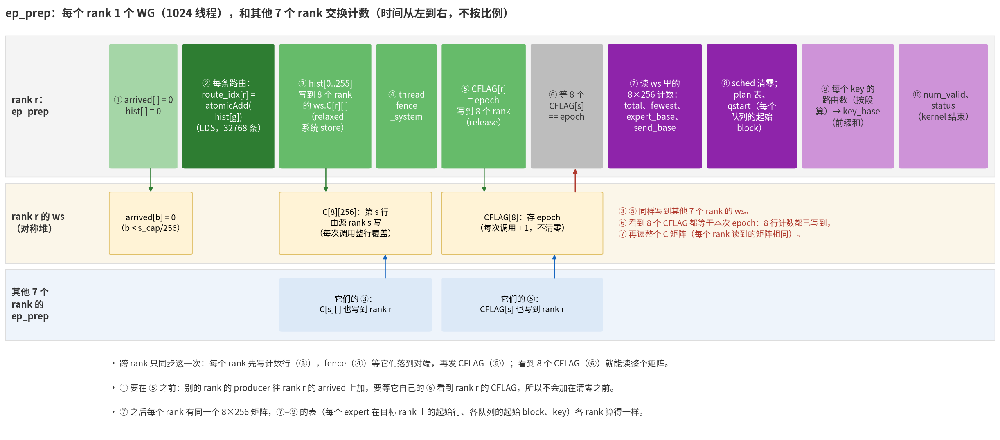
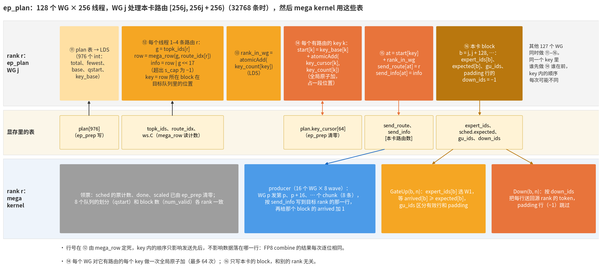
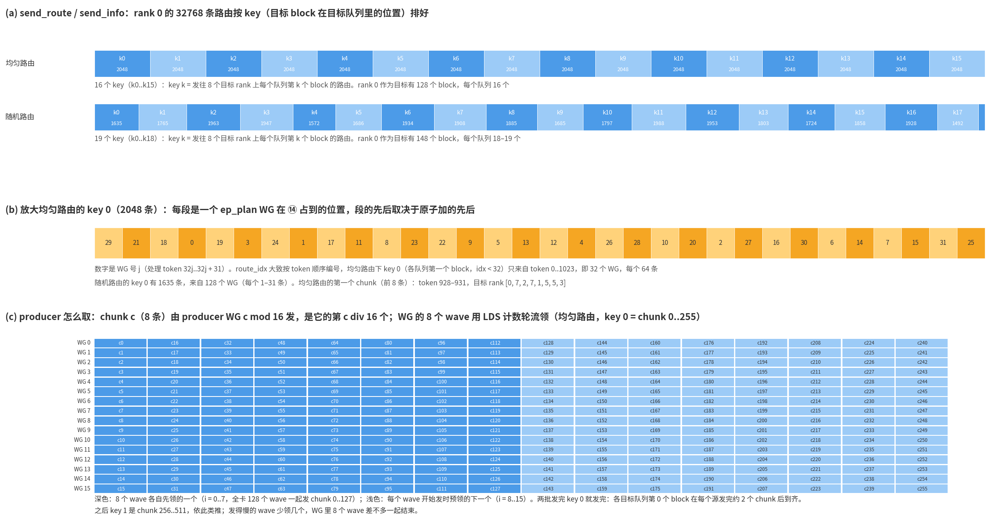

# gfx942 EP8 mega MoE：`ep_prep` 和 `ep_plan`

mega kernel 之前有两个小的 HIP kernel：`ep_prep` 和其他 rank 交换路由计数、算出接收端的布局，`ep_plan` 排出 producer 的
发送顺序和本卡的 block 表。本文按步骤画出它们做什么、跨 rank 怎么同步、写出的表给谁用，以及实测耗时（MiMo，8 卡，
每卡 4096 token × top-8 = 32768 条路由，BF16 combine，2026-11-12）。整体实现见
[mega_moe_ep8_impl.md](mega_moe_ep8_impl.md)：buffer 在第 1.4–1.6 节，接收端的行布局在第 2.1 节，producer 在第 3.4 节。
本文与代码不一致时以代码为准。

| 文件 | 内容 |
|---|---|
| [ep_moe_comm_gfx942.cpp](../../src/contrib/flydsl/ep_moe_comm_gfx942.cpp) | `mega_row`（[第 49 行](../../src/contrib/flydsl/ep_moe_comm_gfx942.cpp#L49)）、`route_key`（[第 63 行](../../src/contrib/flydsl/ep_moe_comm_gfx942.cpp#L63)）、`ep_prep`（[第 80 行](../../src/contrib/flydsl/ep_moe_comm_gfx942.cpp#L80)）、`ep_plan`（[第 219 行](../../src/contrib/flydsl/ep_moe_comm_gfx942.cpp#L219)） |
| [ep_moe_gfx942.py](../../src/contrib/flydsl/ep_moe_gfx942.py) | `EPMoEGfx942.forward()`（[第 134 行](../../src/contrib/flydsl/ep_moe_gfx942.py#L134)）：依次下发 `out` 清零、`ep_prep`、`ep_plan`、mega kernel |
| [images/ep_prep_plan.py](images/ep_prep_plan.py) | 本文的图（`python docs/megamoe_ep8_942/images/ep_prep_plan.py /tmp/fonts`），数据在 [images/data/prep_plan.json](images/data/prep_plan.json) |

步骤编号全文统一：①–⑩ 是 `ep_prep`，⑪–⑯ 是 `ep_plan`。

## 0. 一页总结

- **两个 kernel 各做什么**
  - `ep_prep`（每个 rank 1 个 WG，1024 线程）：给本卡每条路由编号（`route_idx`：本卡发给同一个 expert 的第几条），和其他
    7 个 rank 交换 8×256 的计数矩阵，然后算出每个 expert 在目标 rank 上的起始行、每个目标 rank 8 个队列的起始 block、
    每个发送 key 在发送列表里的起点，并清零 mega kernel 要用的计数。
  - `ep_plan`（128 个 WG × 256 线程）：算每条路由在目标 rank 上的行号，把本卡的路由按 key（目标 block 在目标队列里的
    位置）排成 `send_route` / `send_info`；同时写本卡的 block 表（`expert_ids`、`expected`、`gu_ids`、padding 行的 `down_ids`）。
- **为什么要先交换计数**：接收端一个 expert 的行按源 rank 交错（源 s 的第 i 条在第 8i + s 行，用完的源往前压紧）。
  源 rank 要自己算出目标行，就需要全部 8 个源的计数；这样接收端不用排序，GateUp 直接按 block 读。
- **跨 rank 只同步一次**：`ep_prep` 里写计数行 → fence → 发 CFLAG → 等齐 8 个 CFLAG。之后各 rank 手里是同一个矩阵，
  算出的表完全一样，`ep_plan` 和 mega kernel 不再为计划互相等待。
- **耗时**（8 个 rank 的中位数）：

| | 均匀路由 | 随机路由 |
|---|---|---|
| `ep_prep` | 41.4 µs | 47.3 µs |
| `ep_plan` | 9.6 µs | 9.8 µs |
| `ep_plan` 结束到 mega kernel 开始 | 6.7 µs | 6.5 µs |
| `ep_prep` 开始到 mega kernel 开始 | 57.9 µs | 63.4 µs |
| 占一层时间（2139 µs / 2393 µs）的比例 | 2.7% | 2.6% |

- `ep_prep` 里（均匀路由）：编号 14.5 µs，写计数 + fence 9.4 µs，发 CFLAG 并等齐 8.4 µs，读计数建表 4.3 µs，key 直方图
  2.8 µs（随机路由 8.6 µs）。
- 计数交换是 8 个 rank 之间的一道栅栏：最后写完计数的 rank（这次是 rank 7）之后约 5 µs，8 个 rank 在约 1 µs 之内一起
  离开交换。之前的快慢差别在这里被抹平。
- 可能的改进（都没试过）见第 3.6 节：编号改成多个 WG 并行（14.5 µs 里的大部分）、随机路由下 key 直方图用上空闲线程、
  查清交换协议本身约 5 µs 的延迟和 `ep_plan` 到 mega kernel 之间 6.7 µs 的空档。

## 1. 在一次调用里的位置

`forward()` 在同一个 stream 上依次下发：quant（调用方）→ `out` 清零（只在 BF16 combine 时）→ `ep_prep` → `ep_plan` →
mega kernel → `ep_finish`，中间没有 host 同步。下图是 rank r 视角的时序（实线是写，虚线是读到 / 等到）：



- 跨 rank 的写只有 ③（计数行）、⑤（CFLAG），以及 mega kernel 里 producer 写的数据和 `arrived`。
- 别的 rank 只等 rank r 的 CFLAG，不等 rank r 的 `ep_plan`：它们的 producer 可能在 rank r 的 `ep_plan` 还没结束时就开始
  往 rank r 写。这没有问题：⑯ 只写 padding 行的 `down_ids`（有效行由 producer 写），两边不会写到同一行；`expected` 只被本卡
  的 GateUp 读，在 `ep_plan` 之后。

### 1.1 实测时间线



- 测法：8 个 rank 都在 `rocprofv3 --kernel-trace` 下跑，去掉前 6 次调用（编译和预热）后，每个 kernel 取开始、结束时刻的
  中位数，以 rank 0 的 `ep_prep` 开始为 0。rocprofv3 的时间戳在一台机器的 8 个 rank 之间是同一个时钟（同一次调用里
  8 个 rank 的 `ep_prep` 结束时刻最早和最晚相差的中位数是 1.6 µs）。
- `ep_prep` 里的分段用加了时间戳的副本测（第 6 节）：时间戳相对本 rank 的交换完成时刻，再把退出时刻对齐到 rocprof 的
  `ep_prep` 结束。第一段（编号）里含 kernel 启动到第一条指令的时间（约 1–4 µs，含对齐误差）。
- 读图：
  - 各 rank 进入 `ep_prep` 的时刻相差约 4 µs（rank 1 −3.1 µs 最早，rank 6 +1.0 µs 最晚），交换完成的时刻只差约 1 µs
    （虚线）：先到的 rank 在 ⑥ 多等。
  - 最后写完计数的是 rank 7：它的编号用了 16.1 µs，比中位数多约 1.6 µs。它写完计数之后还要 5.3 µs 才完成
    交换，这一段是协议本身的延迟（release 前的 L2 写回、跨卡 store、轮询；没有再细分）。
  - 交换之后各 rank 的路径一样长：建表 4.3 µs，key 直方图 2.8 µs（随机 8.6 µs），`ep_plan` 紧接着开始，9.6 µs。
  - `ep_plan` 结束后 6.7 µs mega kernel 才开始，各 rank 都一样，原因没有查（可能是 host 下发 mega kernel 慢于 GPU：
    FlyDSL 的启动路径参数多）。
  - quant 结束到 `out` 清零开始约 12 µs，GPU 空着：这时 `zero_` 还没下发（bench 在 quant 和 `forward()` 之间的 host
    开销）。之后的 `out` 清零、`ep_prep`、`ep_plan` 首尾相接。

## 2. 输入、输出和中间表

| 名字 | 大小（int32） | 位置 | 谁写 | 谁读 |
|---|---|---|---|---|
| `topk_ids` | T × 8 | 本地 | 调用方 | ② 编号，⑫ 算行号 |
| `route_idx` | T × 8 | 本地 | ② | ⑫（step1 路径的 `ep_dispatch` 也用） |
| `ws.C` | 8 × 256 | 对称堆 | 各 rank 的 ③：第 s 行由 rank s 写 | ⑦；⑫ 里 `mega_row` 的慢路径 |
| `ws.CFLAG` | 8 | 对称堆 | 各 rank 的 ⑤ | ⑥ |
| `ws.arrived` | s_cap / 256 = 288 | 对称堆 | ① 清零；之后 8 个源 rank 的 producer 原子加 | GateUp(b, 0) 等它 |
| `plan` | 976 | 本地 | ⑧ ⑨（`key_cursor` 由 ⑭ 原子加） | ⑪ ⑭ |
| `sched` | 16 + 3 × 288 | 本地 | ⑧ 清零票计数、done、scaled；⑯ 写 expected | mega kernel |
| `num_valid` | 1 | 本地 | ⑩：min(本卡行数, s_cap) | mega kernel（block 数） |
| `status` | 8 | 本地 | ⑩：[0] = 0（step1 的 dispatch 计数）；[1] 本卡需要的行数；[2] [3] [4] 交换完成 / 进入 / 退出的时间戳（100 MHz） | host（`rows_needed()` 查容量）、trace |
| `send_base` | 256 | 本地 | ⑦ | 只有 step1 路径的 `ep_dispatch` |
| `send_route`、`send_info` | T × 8 | 本地 | ⑮ | producer |
| `expert_ids` | 288 | 本地 | ⑯ | GateUp、Down |
| `gu_ids` | s_cap | 本地 | ⑯：有效行 = 行号，padding 行 = −1 | GateUp |
| `down_ids` | s_cap | 对称堆 | ⑯ 写 padding 行（−1）；有效行由源 rank 的 producer 写 | Down |

T = 4096 时 s_cap = 2 × 4096 × 8 + 32 × 256 = 73728（288 个 block）。`plan` 的布局：

| 偏移 | 内容 | 说明 |
|---|---|---|
| [0, 256) | total[g] | 8 个源发给 global expert g 的路由数之和 |
| [256, 512) | fewest[g] | 8 个源里最少的路由数，`mega_row` 的快慢路径分界 |
| [512, 768) | base[g] | expert g 在目标 rank（g / 32）上的起始行，256 对齐 |
| [768, 776) | rows[d] | 目标 rank d 的总行数（含 padding） |
| [776, 848) | qstart[d][0..8] | 目标 rank d 的 8 个队列的起始 block，[8] 是有效 block 数 |
| [848, 912) | key_base[k] | key k 在 `send_route` 里的起点（⑨ 的前缀和） |
| [912, 976) | key_cursor[k] | ⑭ 里各 WG 原子加占位置用，⑧ 清零 |

## 3. `ep_prep`



### 3.1 步骤

1. ① 进入：`status[3]` 记时间戳，LDS 里的 `hist[256]` 清零，本卡 `ws.arrived[0..288)` 清零。
2. ② 编号（[第 97 行](../../src/contrib/flydsl/ep_moe_comm_gfx942.cpp#L97)）：每轮 8192 条，每个线程 8 条——先发 8 个
   `topk_ids` 的 load，再依次做 8 次 LDS `atomicAdd(&hist[g], 1)`（`ds_add_rtn_u32`），返回值写到 `route_idx[r]`。
   32768 条要 4 轮。同一个 expert 的编号大致按 token 顺序，同一轮里的先后不确定；只要求 0 .. C[me][g] − 1 不重不漏。
3. ③ 写计数行：2048 次系统范围的 relaxed store（每个线程 2 次），把 `hist[e]` 写到 rank p 的 `ws.C[me][e]`，p = 0..7
   （包括自己，也走 peer 指针）。ISA 是 `flat_store_dword … sc0 sc1`。
4. ④ `__threadfence_system()`：`buffer_wbl2 sc0 sc1`（写回本 XCD 的 L2）、等所有 store 完成、`buffer_inv sc0 sc1`；
   然后 `__syncthreads`。
5. ⑤ 线程 t（t < 8）：对 rank t 的 `ws.CFLAG[me]` 做系统范围 release store，值是本次的 epoch（又一次 `buffer_wbl2`，
   再 `flat_store_dword sc0 sc1`）。
6. ⑥ 线程 t（t < 8）：轮询本卡的 `ws.CFLAG[t]` 直到等于 epoch（系统范围 acquire load，之后 `buffer_inv sc0 sc1`，没等到
   就 `s_sleep 1`）。`__syncthreads` 之后 `status[2]` 记交换完成的时间戳。
7. ⑦ 把 8×256 计数读进 LDS。线程 g（g < 256）算 total[g]、fewest[g]，以及排在本卡之前的源发给 g 的路由数 sbase[g]；
   再算 base[g] = 同一目标 rank 上前面各 expert 的 ⌈total / 256⌉ · 256 之和（逐项累加，最多 31 项），每个目标 rank 的最后
   一个 expert 顺便写 rows[d]；`send_base[g] = base[g] + sbase[g]`（step1 路径用的连续排布）。
8. ⑧ 清零 `sched` 的票计数（前 16 个）、done[ ]、scaled[ ]；写 `plan` 的 total、fewest、base、rows 和
   qstart[d][q] = ⌊min(rows[d], s_cap) / 256⌋ · q / 8（整数除法，和 mega kernel 的队列划分一样）；`key_hist`、
   `key_cursor` 清零。
9. ⑨ key 直方图（第 3.4 节），线程 0 做前缀和写 `key_base`。
10. ⑩ `num_valid = min(rows[me], s_cap)`，`status[0] = 0`（step1 的 dispatch 计数），`status[1] = rows[me]`，`status[4]`
    记退出时间戳。

### 3.2 计数交换为什么是对的

- **先写数据，再发 flag**：③ 的 store 是 relaxed 的，④ 的系统 fence 等它们都落到对端显存之后，⑤ 才发 CFLAG。对端在 ⑥
  用 acquire load 看到 CFLAG 等于本次 epoch 以后，⑦ 读到的一定是这次的计数行。
- **epoch 代替清零**：host 每次调用把 epoch 加 1，CFLAG 存 epoch、比较相等，上一次留下的值不会被误认，不用清零。
- **arrived 在发 CFLAG 之前清零**（①）：别的 rank 的 producer 要往本卡的 `arrived` 加，得先在它自己的 ⑥ 看到本卡的
  CFLAG，再跑完它的 `ep_plan`、启动 mega kernel；本卡的 release 在清零之后，所以加不会落在清零之前。
- **`out` 清零**（BF16 combine）：在同一个 stream 上排在 `ep_prep` 之前，`ep_prep` 开始时清零 kernel 已经结束；别的 rank
  的 Down 往本卡 `out` 加，也要先看到本卡在 ⑤ 发的 CFLAG（清零结果的可见性见实现文档第 5 节）。
- **下一次调用不会覆盖还没读完的数据**：rank s 下一次调用的 ③ 会覆盖本卡的 `C[s]`；而 rank s 要先过它这一次的
  `ep_finish`，`ep_finish` 要等本卡的 FFLAG，本卡发 FFLAG 时本卡的 `ep_plan`（最后一个读 `C` 的）早已结束。`arrived` 同理：
  本卡下一次的 ① 在本卡这一次的 `ep_finish` 之后，那时所有源这一次的原子加都已完成。所以 `C`、`arrived` 都不用双缓冲。

### 3.3 行、队列和 key（⑦ ⑧）

- **base**：每个 expert 的起点按 256 对齐，一个 block 只属于一个 expert；padding 只出现在每个 expert 最后一个不满的 block。
- **`mega_row(g, idx, me)`**：idx < fewest[g] 时行号是 base[g] + 8·idx + me；否则是
  base[g] + Σ_s min(C[s][g], idx + [s < me])，即前 idx 轮各源实际放了多少条，加上第 idx 轮里排在本源之前、还有路由的源。
  图见实现文档第 2.1 节的 [impl_expert_rows.png](images/impl_expert_rows.png)。
  - 例（随机路由，rank 0 发给 expert 0 的 132 条，8 个源的计数是 [132, 140, 132, 134, 123, 122, 118, 136]，fewest = 118）：
    idx = 117 在第 936 行（8 × 117）；idx = 119 在第 951 行而不是 952（rank 6 只有 118 条，已经用完）；最后一条 idx = 131
    在第 1018 行。expert 0 共 1037 行，第 5 个 block（行 1024–1036，13 行）只有 rank 1、3、7 的路由，rank 0 不往那里发。
- **qstart**：每个目标 rank 的有效 block 平分成 8 段，队列 q 是 [qstart[q], qstart[q+1])，和 mega kernel 的 XCD 队列
  一致。均匀路由下是 [0, 16, 32, …, 128]，随机路由下 rank 0 是 [0, 18, 37, 55, 74, 92, 111, 129, 148]。
- **`route_key(g, row)`**：行超出 s_cap 时是 63（这条路由不发）；否则是 row / 256 这个 block 在目标 rank（g / 32）的队列
  里的位置 block − qstart[q]（3 步二分找 q），≥ 63 的也归到 63。

### 3.4 key 直方图（⑨）

- ⑭ 需要每个 key 在 `send_route` 里的起点，即本卡发往更小 key 的路由数。`ep_prep` 不逐条算 key，而是按段数：
- 线程 g（g < 256）处理本卡发给 expert g 的 n = C[me][g] 条。行号随 idx 递增，所以落在同一个 block 的 idx 是一段连续区间
  [lo, hi)：
  - lo < fewest：行号是 base + 8·idx + me，下一个 block 的起点 end 对应 hi = ⌈(end − base − me) / 8⌉，再和 fewest 取小；
  - lo ≥ fewest：在 [lo + 1, n) 里二分找第一个行号 ≥ end 的 idx（没有就是 n），每一步算一次 8 项的 `mega_row`。
  - 每段对 `key_hist[route_key(g, 这一段的行)]` 做一次 LDS 原子加 hi − lo。
- 均匀路由下每个 expert 4 段、全走公式，2.8 µs。随机路由下 fewest 之后的段要二分，同一个 wave 里各线程的分支和次数也不同，
  8.6 µs（没有再细分）。只有 256 个线程干活，另外 768 个空着。

### 3.5 实测分段

时间戳是一个副本里加的 3 个 `s_memrealtime`（第 6 节），8 个 rank 各自的中位数再取中位数（µs）：

| 段 | 区间 | 均匀路由 | 随机路由 | 内容 |
|---|---|---|---|---|
| ① ② 编号 | 进入 → 编号完 | 14.5 | 14.4 | 32768 次带返回值的 LDS 原子加，都在一个 CU 上 |
| ③ ④ 写计数 + fence | → fence 完 | 9.4 | 9.4 | 2048 次系统范围 store（7/8 跨卡），系统 fence |
| ⑤ ⑥ 发 CFLAG、等齐 | → 交换完成 | 8.4（rank 7：5.3） | 8.3（rank 7：5.6） | 等最慢的 rank，加上协议本身的延迟 |
| ⑦ ⑧ 读计数、建表 | → 建表完 | 4.3 | 4.2 | 读 8 KB 计数，几次 256 线程的循环 |
| ⑨ ⑩ key 直方图 | → 退出 | 2.8 | 8.6 | 随机路由要二分 |
| 合计（rocprof） | | 41.4 | 47.3 | 另含 kernel 启动到第一条指令 |

- 各 rank 的 ①–④ 差不多（均匀路由下编号 13.9–16.1 µs，写计数 8.3–10.3 µs），交换之后的几段几乎一样
  （建表 4.0–4.7 µs）。
- 交换那一段对最慢的 rank 也有 5 µs：它写完计数时别的 rank 都已写完（最近的 rank 6 早 0.6 µs），剩下的是 ⑤ 的
  L2 写回和跨卡 store、CFLAG 传到各 rank、⑥ 的轮询（每次 `buffer_inv sc0 sc1` + `s_sleep 1`）。具体哪一项占多少没有测。

### 3.6 可能的改进（都没有试过）

1. **编号并行化**：② 是最大的一段（14.5 µs），32768 次带返回值的 LDS 原子加压在一个 CU 上（约每纳秒 2 次）。可以让
   128 个 WG 各数一段路由（像 `ep_plan` 那样），`ep_prep` 只把 128 份局部直方图加起来；`route_idx` 改成“前面各段的计数
   + 段内序号”，仍然是 0 .. C[me][g] − 1 的一个排列，`mega_row` 不用改。要多一个 kernel 或者多 WG 的 `ep_prep`，读 128 × 256
   个局部计数也要时间，能省多少要测。
2. **随机路由的 key 直方图**：8.6 µs 里只有 256 个线程在算，可以每个 expert 用 4 个线程分段，或者对 idx ≥ fewest 的部分直接
   按各源的计数算出段界，不二分。上限是省 6 µs 左右（均匀路由下没有收益）。
3. **交换协议的延迟**：先加时间戳把 ③ 的 store、④ 的 fence、⑤ 的 release、⑥ 的轮询分开测，再决定要不要改（比如轮询不
   `s_sleep`）。最慢的 rank 也要 5 µs，这一段直接在关键路径上。
4. **`ep_plan` 到 mega kernel 的 6.7 µs**：用 `rocprofv3 --hip-runtime-trace` 看 host 什么时候下发 mega kernel；如果是
   host 慢，用 HIP graph 捕获整个调用（所有状态都在 device 上，可以捕获）就能去掉。

## 4. `ep_plan`



### 4.1 步骤

1. ⑪ 976 个 int 的 `plan` 读进 LDS（`tab`），`key_count[64]` 清零。
2. ⑫ WG j 处理本卡路由 [per·j, per·j + per)，per = ⌈路由数 / 128⌉（32768 条时 256，每个线程 1 条；最多 1024，
   `forward()` 里有 assert）。每条路由：g = `topk_ids[r]`；row = `mega_row(g, route_idx[r], me)`（慢路径直接读显存里的
   `ws.C`）；info = row | g << 17，row ≥ s_cap 时是 −1（这条路由丢掉）；key = `route_key(g, row)`。
3. ⑬ rank = `atomicAdd(&key_count[key], 1)`（LDS）：这条路由在本 WG 这个 key 里的序号。
4. ⑭ 线程 k（k < 64）：本 WG 在 key k 有 n > 0 条，就对全局的 `key_cursor[k]` 原子加 n；返回值加上 `key_base[k]` 是本 WG
   在 key k 里那一段的起点。
5. ⑮ at = 起点 + rank；`send_route[at] = r`，`send_info[at] = info`。
6. ⑯ 本卡的 block（[第 258 行](../../src/contrib/flydsl/ep_moe_comm_gfx942.cpp#L258)）：blocks = min(rows[me], s_cap) / 256，
   WG j 做 b = j, j + 128, …（128 个 block 时每个 WG 一个）。逐项扫 base 找 block 属于哪个本地 expert e；
   n = min(256, total[g] − (256b − base[g]))；线程 0 写 `expert_ids[b] = e`、`expected[b] = n`；每个线程一行：`gu_ids` 是
   行号或 −1，padding 行的 `down_ids` 写 −1。

### 4.2 发送顺序



- **为什么按 key 排**：mega kernel 的每个 XCD 队列按 block 顺序发 GateUp 任务，第 k 个 block 要等所有源把它的行发到。
  所有源都先发各队列位置 0 的 block，再发位置 1……，最早的 GateUp 任务就能最早开始（实现文档第 3.4 节、第 8.4 节）。
- **不用排序就全局有序**：⑨ 给每个 key 一段区间，128 个 WG 在 ⑭ 用原子加在区间里各占一段，不需要跨 WG 的前缀和或者
  第二个 kernel。原子加只在 WG 有这个 key 的路由时做，每个 WG 最多 64 次。
- **key 内的顺序每次不同**：段的先后看 ⑭ 原子加的先后，段内看 ⑬ LDS 原子加的先后。行号已由 `mega_row` 定死，所以只影响
  先发哪条、不影响数据落在哪一行，FP8 combine 的结果逐位确定（BF16 combine 的不确定来自 Down 的原子加，和这里无关）。
- 图 (a)：均匀路由下 16 个 key 各 2048 条；随机路由下 19 个 key，前 18 个各 1492–1988 条，最后一个只有 245 条
  （只有部分目标队列有第 19 个 block）。
- 图 (b)：均匀路由下 `route_idx` 大致按 token 顺序编号，key 0（各队列第一个 block，idx < 32）只来自 token 0–1023，
  即 WG 0–31，每个 64 条，顺序是原子加的先后（29, 21, 18, 0, …）。随机路由下 key 0 有 1635 条，来自全部 128 个 WG
  （每个 1–31 条）。
- 图 (c)：producer 怎么取（实现文档第 3.4 节）。chunk c（8 条）由 producer WG c mod 16 发，WG 的 8 个 wave 用 LDS 计数
  轮流领，每个 wave 开始发一个 chunk 时就预领下一个。均匀路由下 key 0 是 chunk 0–255，每个 wave 发 2 个就发完。
  第一个 chunk 是 token 928–931 的 8 条，目标是 rank [0, 7, 2, 7, 1, 5, 5, 3]：一个 chunk 就分散到多条 xGMI 链路。

### 4.3 耗时

9.6 µs（均匀路由）/ 9.8 µs（随机路由），没有分段测。每个线程只有 1 条路由，推测时间主要是几段串行的访存（读 `plan`、
读 `topk_ids` / `route_idx`、全局原子加、分散的 store）加上 kernel 启动和结束。

## 5. 例子：rank 0 的表

均匀路由（每个 expert 从每个源各收 128 条）：

| 表 | 值 |
|---|---|
| C[s][g] | 全是 128 |
| total、fewest、base | total = 1024，fewest = 128，base[g] = 1024·(g mod 32)（每个 expert 4 个 block） |
| rows、num_valid、`status[1]` | 32768（128 个 block，没有 padding） |
| qstart[d] | [0, 16, 32, 48, 64, 80, 96, 112, 128] |
| `route_idx` | expert 0 的 128 条编号 0..127，行号 0, 8, 16, …, 1016（rank 0：8·idx + 0） |
| key | key k = 目标队列第 k 个 block = 本地 expert 4q + ⌊k / 4⌋ 的第 k mod 4 个 block；16 个 key |
| key_base | key_base[k] = 2048k（k ≤ 15），k ≥ 16 都是 32768 |
| key 0 | 2048 条：8 个目标 rank × 8 个队列 = 64 个 block，每个 32 条 |
| block 表 | expected 全是 256；`expert_ids` = [0, 0, 0, 0, 1, 1, 1, 1, …]；`gu_ids` 是恒等 |

随机路由的对照：

| 表 | 值 |
|---|---|
| total[0..3]、fewest[0..3] | [1037, 1063, 1015, 979]、[118, 111, 111, 106] |
| base[0..3] | [0, 1280, 2560, 3584]（expert 0、1 各 5 个 block，2、3 各 4 个） |
| rows、num_valid | 37888（148 个 block），没有路由被丢掉 |
| qstart[0] | [0, 18, 37, 55, 74, 92, 111, 129, 148] |
| key_base | [0, 1635, 3400, 5363, 7310, 8882, 10568, 12502, 14410, 16295, 17980, 19777, 21765, 23718, 25521, 27245, 29103, 31031, 32523]，之后都是 32768 |
| key 0 | 1635 条，发到 64 个队列头里的 53 个，每个 11–41 条。另外 11 个队列头是某个 expert 最后不满的 block（6–36 行），rank 0 的路由在那之前就用完了 |
| block 表 | `expert_ids` = [0, 0, 0, 0, 0, 1, …]；expected[4] = 13（expert 0 的最后一个 block，另外 243 行是 padding） |

## 6. 复现

```bash
export PYTHONPATH=<含 pyhip 的路径>:$PYTHONPATH
# 1. 每个 rank 在 rocprofv3 下跑（wrapper 把 LOCAL_RANK 放进输出目录；随机路由换目录 /tmp/prep/random/kt_rank*）
cat > /tmp/prep/kt_all.sh <<'EOF'
#!/bin/bash
exec rocprofv3 --kernel-trace --output-format csv -d "/tmp/prep/kt_rank${LOCAL_RANK}" -o kt -- python "$@"
EOF
chmod +x /tmp/prep/kt_all.sh
torchrun --nproc_per_node=8 --no-python /tmp/prep/kt_all.sh tests/contrib/moe/ep8/bench_ep8_mori_flydsl.py \
    --mode mega --routing balanced --combine bf16 --iters 40 --warmup 5
# 2. ep_prep 的分段时间戳 -> /tmp/prep/phases_{balanced,random}.json
# 3. 每个 rank 一次调用之后的表 -> /tmp/prep/tables_{balanced,random}.pt
# 4. 汇总数据并画图
python docs/megamoe_ep8_942/images/ep_prep_plan.py /tmp/fonts --from-dir /tmp/prep
```

- 第 2 步（脚本不在仓库里）：复制 `ep_moe_comm_gfx942.cpp`，在 `ep_prep` 里加 3 个时间戳：编号循环后的 `__syncthreads()`
  之后 `status[5]`，④ 的 `__syncthreads()` 之后 `status[6]`，建表后的 `__syncthreads()`（⑨ 之前）之后 `status[7]`，都是
  `if (tid == 0) status[i] = __builtin_amdgcn_s_memrealtime();`。用 `@pyhip.module` 编译这个副本，替换
  `ep_moe_gfx942.ep_prep` 后跑 bench 的 `Mega`（预热 10 次、测 60 次），每次调用后取 `status`，以 `status[2]`（交换完成）
  为 0 换算成 µs（100 MHz）。JSON 是 `{"routing", "iters", "ranks": [8 个 rank 的 [{entry, route_idx, counts, exchange,
  tables, exit}, …]]}`。
- 第 3 步（脚本不在仓库里）：跑 3 次调用后，每个 rank 把 `ws[:2048]`（计数）、`plan`、`route_idx`、`send_route`、
  `send_info`、`num_valid`、`expert_ids`、`sched`、`gu_ids`、`status` 拷到 CPU，`all_gather_object` 后 rank 0 用
  `torch.save` 存成 8 个 dict 的 list。
- 第 4 步只读 rank 0 的表；不加 `--from-dir` 时直接用仓库里的 `images/data/prep_plan.json` 画图。
