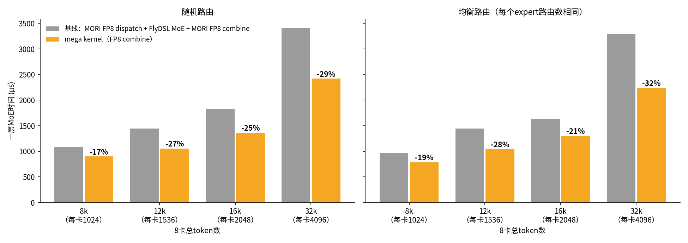
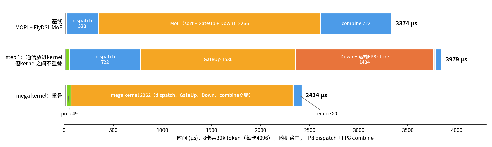
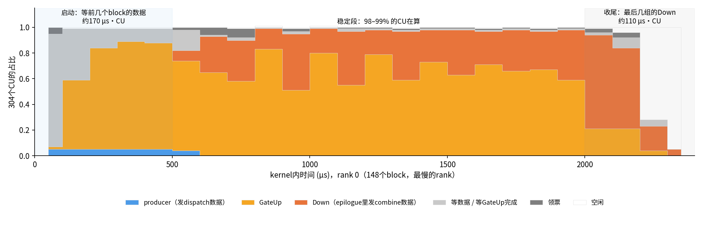

# FP8 combine、token扫描，以及32k下哪些通信被藏住了

适用：8×MI300X（gfx942），MiMo-V2.6-Flash MoE层（H=4096，I=2048，256 expert，top-8，每卡32个local expert），FP8 128×128 block scale。设计见 [mega_moe_ep8_design.md](mega_moe_ep8_design.md)。

## 1. 结论

- 2026-11-12 的当前版本：每卡256–4096 token、两种combine、两种路由下，mega都比基线快，14%–30%（第4.1节）。下面其余
  的数字是第一次扫描时的版本。
- dispatch和combine都用FP8时，mega kernel比基线（MORI FP8 dispatch + FlyDSL MoE + MORI FP8 combine）快 **17%–32%**。token越多，快得越多：8卡共32k token时随机路由快29%，均衡路由快32%。
- 32k token、随机路由时：
  - 基线 3374 µs。
  - 把通信放进kernel、但kernel之间不重叠（step 1）：3979 µs，比基线还慢。
  - mega kernel：2434 µs。
- 不重叠时通信要花约 **1360 µs**，mega kernel里只露出 **60–70 µs**，**约95%被藏住**。
- 还没藏住、可以继续做的，按收益大小：
  1. rank之间负载不均：随机路由比均衡路由慢约180 µs。
  2. kernel收尾：约110 µs·CU。
  3. 启动时等前几个block的数据：约170 µs·CU，但功耗墙下只有一部分能变成时间。
  4. FP8 combine在源rank上的求和：80 µs，现在是单独的kernel，排在最后。
  5. kernel前面的quant和prep：约70 µs。

## 2. 测试设置

| 项 | 内容 |
|---|---|
| token | 8卡合计8k / 12k / 16k / 32k，即每卡1024 / 1536 / 2048 / 4096 |
| 随机路由 | 每个token从256个expert里随机取top-8 |
| 均衡路由 | token t取一个随机排列里第8t到8t+7项（模256），每个expert从每个rank收到的路由数完全相同 |
| 基线 | per-1x128 FP8 quant → MORI IntraNode FP8 dispatch（80 block × 16 warp） → aiter `fused_moe`（FlyDSL hook） → MORI combine，`quant_type="fp8_blockwise"`（即SGLang的`SGLANG_MORI_COMBINE_DTYPE=fp8`）。MORI容量 = 每卡token数 |
| mega | FP8 dispatch（和之前一样） + FP8 combine（见下） |
| 计时 | 每种配置连续跑100次，取每个rank的中位数，再取最慢的rank。每次跑之前和之后GPU都是空闲的 |

`MORI_FP8_COMBINE_SCALE_DIM`默认是56，对应H=7168。H=4096要设成32，才是每128列一个scale；bench里已经自动设置。

mega kernel的FP8 combine：

- Down的4x2布局里，每个wave正好负责每行的一个128列scale组。
- epilogue把“路由权重 × 结果”按行求absmax，量化成FP8，加一个FP32 scale。然后用P2P store写到源rank的`comb[token][slot]`。
- 每行在源rank上只写一次，所以不需要原子加。数据量是每条路由4 KB + 128 B，比BF16原子加少一半。
- `ep_finish`之后，`ep_combine_fp8`按slot顺序把8个slot加起来写成BF16。所以结果是确定的。

运行：

```
torchrun --nproc_per_node=8 tests/contrib/moe/ep8/bench_ep8_mori_flydsl.py --mode both --combine fp8 --routing random --tokens 4096
torchrun --nproc_per_node=8 tests/contrib/moe/ep8/bench_ep8_mori_flydsl.py --mode mega --ep-mode step1 --combine fp8
torchrun --nproc_per_node=8 tests/contrib/moe/ep8/profile_ep8_mega_overlap.py --combine fp8 [--ep-mode step1]
torchrun --nproc_per_node=8 tests/contrib/moe/ep8/trace_ep8_mega.py --combine fp8 --save trace.pt
```

## 3. 正确性

| 对比 | calc_diff | 说明 |
|---|---|---|
| mega FP8 vs step 1 FP8（A、B输入交替） | **0** | 逐位相同 |
| mega FP8 vs BF16 combine | 3.35e-4 | 每条路由的FP8舍入误差 |
| mega FP8 vs 基线 FP8 | 6.85e-4，最大绝对误差 ≤ 3.75（输出绝对值最大约70） | 两边都有FP8误差，量化的位置不同：MORI在本卡把一个token的几条路由先加起来再量化，mega按路由量化 |

## 4. token扫描

### 4.1 当前版本（2026-11-12）：每卡256–4096 token，BF16和FP8 combine

代码是转置A scale、全局发送顺序、去掉waterfall循环之后的版本（a1b23eb）。基线和mega用同一种combine数据类型
（`--combine`），每种配置`--mode both`跑100次（warmup 20），取每个rank的中位数，再取最慢的rank；每次跑之前和之后GPU
都空闲。单位µs：

| 每卡token（8卡合计） | 路由 | 基线 BF16 | mega BF16 | mega更快 | 基线 FP8 | mega FP8 | mega更快 |
|---|---|---|---|---|---|---|---|
| 256（2k） | 随机 | 615 | 523 | 15% | 611 | 525 | 14% |
| 256（2k） | 均衡 | 619 | 527 | 15% | 616 | 519 | 16% |
| 512（4k） | 随机 | 734 | 601 | 18% | 793 | 584 | 26% |
| 512（4k） | 均衡 | 737 | 596 | 19% | 795 | 598 | 25% |
| 1024（8k） | 随机 | 1062 | 877 | 17% | 1054 | 845 | 20% |
| 1024（8k） | 均衡 | 900 | 743 | 18% | 888 | 728 | 18% |
| 2048（16k） | 随机 | 1794 | 1353 | 25% | 1758 | 1343 | 24% |
| 2048（16k） | 均衡 | 1667 | 1190 | 29% | 1618 | 1143 | 29% |
| 4096（32k） | 随机 | 3171 | 2392 | 25% | 3025 | 2359 | 22% |
| 4096（32k） | 均衡 | 3064 | 2149 | 30% | 2871 | 2103 | 27% |

- 每卡256 token时也快约15%。这时每个本地expert只收到约64条路由，每卡32个block都只有约1/4是有效行；一层里固定开销
  （quant、prep 34–41 µs、finish 24–40 µs）占比大。
- token越多收益越大，2048以上稳定在22%–30%；均衡路由比随机路由收益大（随机路由下最忙的rank决定总时间，4096时
  mega的finish 258–317 µs，均衡路由只有119–156 µs）。
- 同一种路由下FP8 combine的mega总是更快（4096：2392 → 2359、2149 → 2103 µs），包括单独的`ep_combine_fp8`（约80 µs）。
- 结果：`/tmp/doc_refresh/sweep_*.json`（没有放进仓库），汇总脚本是一次性的。

### 4.2 第一次扫描（FP8 combine，转置A scale和全局发送顺序之前）



| 8卡总token（每卡） | 路由 | 基线 µs | 其中 dispatch / MoE / combine | mega µs | mega更快 |
|---|---|---|---|---|---|
| 8k（1024） | 随机 | 1081 | 109 / 780 / 216 | 900 | 16.7% |
| 12k（1536） | 随机 | 1446 | 144 / 1025 / 291 | 1052 | 27.2% |
| 16k（2048） | 随机 | 1822 | 180 / 1304 / 359 | 1366 | 25.1% |
| 32k（4096） | 随机 | 3410 | 366 / 2270 / 806 | 2419 | 29.1% |
| 8k（1024） | 均衡 | 974 | 110 / 625 / 212 | 788 | 19.1% |
| 12k（1536） | 均衡 | 1446 | 147 / 1022 / 288 | 1042 | 28.0% |
| 16k（2048） | 均衡 | 1641 | 192 / 1094 / 357 | 1300 | 20.8% |
| 32k（4096） | 均衡 | 3288 | 388 / 2053 / 836 | 2236 | 32.0% |

基线的三项分别取最慢的rank，所以加起来不等于合计。

- token少时收益小。prep、源rank求和、等最慢的rank、启动和收尾都是固定开销，8k时占比大。8k时每卡只有32–48个block，每个队列4–6个，交错的流水线很短。
- 12k的收益比16k大。均衡路由下，两者每卡都是64个block（每个expert 2个），但12k时每个expert只有384条路由，四分之一的行是空的。
  - 从12k到16k，基线的MoE只多了7%（1022 → 1094 µs），mega多了25%（1042 → 1300 µs）。
  - 原因还没细查，可能和这几点有关：空行的数据是0，功耗低；空行不用发combine数据；每个队列只有8个block，流水线短。
- 32k时，均衡路由比随机路由快约180 µs（2236 vs 2419）。随机路由下最忙的rank有148个block，最闲的有139个，最慢的rank决定总时间。

## 5. 32k：基线 → kernel之间不重叠 → mega kernel



图和下表取的是关键路径上的rank，也就是最后等待最少的那个。单位µs：

| 阶段 | 基线 | step 1（通信在kernel里，kernel之间不重叠） | mega kernel |
|---|---|---|---|
| quant | 20 | 17 | 20 |
| 计数交换和排序 | 在MoE里（sort等约150） | prep 39 | prep 49 |
| dispatch | 328（MORI，同一rank只发一次） | 722（按路由发，134 MB） | 在kernel里，和GateUp重叠 |
| GateUp | MoE合计 2266 | 1580 | **2262**：dispatch、GateUp、Down和combine的发送都在这一个kernel里 |
| Down + 发送combine | | 1404 | |
| combine | 722（MORI FP8） | | |
| 等最慢的rank | 在combine里 | 19 | 8 |
| 源rank上把8个slot加起来 | 在combine里 | 63 | 80 |
| **合计** | **3374** | **3979** | **2434** |

### 5.1 通信藏住了多少

方法见设计文档第7节：把dispatch数据和/或combine的写换到本卡scratch，同步不变，只少了xGMI流量。每种模式100次 × 4轮，取最快的一轮。

| 模式 | step 1 一层 µs | step 1 各阶段的变化 | mega 一层 µs |
|---|---|---|---|
| p2p（正常） | 4025 | dispatch 727，GateUp 1565，Down 1376 | 2424–2432 |
| local-dispatch | 3637（**−389**） | dispatch 727 → 387，GateUp 1565 → 1508 | 2384–2389（**−35~−48**） |
| local-combine | 3329（**−696**） | Down 1376 → 731 | 2410–2417（**−7~−22**） |
| local | 2668（**−1358**） | dispatch → 450，GateUp → 1322，Down → 675 | 2364（**−60~−68**） |

- **dispatch**
  - step 1：dispatch是单独一段，xGMI上的时间（约340 µs）全部露在外面。
  - mega：只露出35–48 µs。
- **combine**
  - step 1：Down从731涨到1376 µs，远端store约650 µs全部露在外面。
  - mega：只露出7–22 µs。
- **step 1的GateUp也被拖慢了约240 µs。** 各rank进度不一样，别的rank的Down正在往本卡写combine数据，抢本卡的显存带宽。
- 合计：不重叠时通信要花约1360 µs，mega只露出60–70 µs，**约95%被藏住**。
- 和基线比：
  - 基线的通信是串行的两段：MORI dispatch 328 + combine 722。
  - mega里这两段基本消失了。另外，sort、转置、计数、清零（约150 µs）换成了prep（约50 µs）。

### 5.2 mega kernel内部的时间去哪了



rank 0（148个block，最慢）一次调用的trace：span 2314 µs。CU时间里：

| 用途 | 占比 |
|---|---|
| GateUp | 58% |
| Down（epilogue里发combine数据） | 25% |
| producer（发dispatch数据） | 1% |
| 等数据 / 等GateUp完成 | 9% |
| 领票 | 2% |
| 空闲 | 4% |

没在计算的时间约15%，折合每个CU约350 µs：

| 时间段 | 每个CU丢掉的时间 | 原因 |
|---|---|---|
| 启动，0–500 µs | 约170 µs | 前几个block要等8个源rank的数据都到。前100 µs里88%的CU在等 |
| 稳定段，500–2000 µs | 约40 µs | 领票和零星的等待。这一段98–99%的CU在算 |
| 收尾，2000 µs以后 | 约110 µs | 最后两组block的Down要等它们的GateUp。剩下的任务不够304个CU分 |

另外，8个rank的kernel时间在2039–2314 µs之间，差了275 µs。原因有两个：

- 随机路由下各rank的block数不同（139–148）。
- 功耗墙下各GPU的时钟不同：这次trace里是1057–1185 MHz。

最快的rank要在`ep_finish`里等最慢的rank。

### 5.3 哪些已经藏住，哪些还没有

| 项 | 基线 | mega | 状态 |
|---|---|---|---|
| dispatch的数据传输 | 328 µs，串行 | 露出35–48 µs | **已藏住**。producer只占16个WG，和GateUp同时跑 |
| combine的数据传输 | 722 µs，串行 | 露出7–22 µs | **已藏住**。分散在每个Down任务的epilogue里 |
| GateUp → Down的kernel边界 | 两个kernel的尾部都有空闲CU | 任务混在一起领，稳定段98–99%的CU在算 | **已消除** |
| sort / 转置 / 计数 / 清零 | 约150 µs | prep约50 µs | 变短了，但仍然是串行的 |
| 启动时等数据 | — | 约170 µs·CU | **部分露出**。dispatch真正露出的只有35–48 µs，因为等待时功耗低，后面时钟能高一点 |
| kernel收尾 | — | 约110 µs·CU | **露出** |
| 源rank上把8个slot加起来 | 在MORI combine里 | 80 µs，单独一个kernel | **露出** |
| quant | 20 µs | 20 µs | **露出** |
| rank之间不均衡 | 在combine里等 | 在`ep_finish`里等，随机比均衡多约180 µs | **露出**，kernel自己解决不了 |
| GEMM本身 | | 功耗墙下的时钟约1.06–1.19 GHz | 重叠不会再省时间，只能省能量（见设计文档5.6） |

### 5.4 还能继续做的（按收益排序）

1. **rank之间负载不均（约180 µs）**
   - 原因在路由。均衡路由下32k快了180 µs。
   - 在模型层面做expert的放置或复制（类似EPLB），让各rank的block数接近。
   - kernel里没法从别的rank拿任务：权重只在本卡。
2. **kernel收尾（约110 µs·CU）和源rank求和（80 µs）**
   - 两者可以合起来做。source rank给每个token一个计数，Down写完一条路由就把对应token的计数加1（远端原子加）。
   - 收尾时空出来的CU去加已经凑齐8个slot的token。这样求和就不用排在最后，空闲的CU也用上了。
   - 也可以把最后两组block的Down按K或N再切小，减少最后一轮的空闲。
3. **启动时等数据（约170 µs·CU，真正露出的约35–48 µs）**
   - dispatch按(token, 目标rank)去重，数据量少约34%。
   - 先发本卡的路由，让本卡的block先凑齐。
   - 在模型层面，让上一层（或另一个micro-batch）的计算和这里重叠（two-batch overlap）。
   - 注意：之前试过让producer发得更快，总时间反而变慢（设计文档5.6）。功耗墙下要一起看时钟。
4. **kernel前面的quant和prep（约70 µs）**
   - quant可以放进producer：读BF16的x，就地量化。
   - 计数交换只依赖路由结果，可以提前到路由刚算完的时候。
5. **源rank求和kernel本身**
   - 现在80 µs，读写约172 MB，只有约2.1 TB/s。
   - 如果不并进mega kernel，单独优化到约4 TB/s，也能省30–40 µs。
