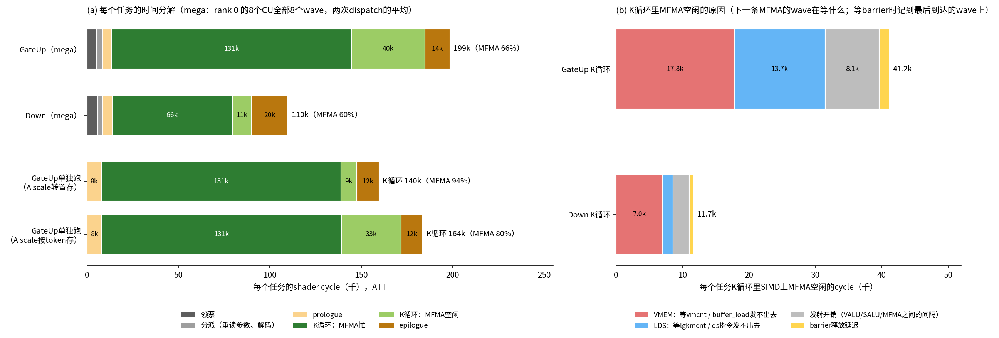

# EP8 mega MoE：ATT 分析和后续优化方向

适用：8×MI300X（gfx942），MiMo-V2.6-Flash MoE 层（H = 4096，I = 2048，256 expert，top-8，每卡 32 个本地 expert），
8 卡共 32k token，均匀路由，BF16 combine。kernel 的结构见 [mega_moe_ep8_impl.md](mega_moe_ep8_impl.md)。

## 1. 结论

- **K 循环没有想象中高效。** 单独跑同样的 GateUp（128 个满 block）时 K 循环的 MFMA 效率是 93%，在 mega 里只有 73–79%；
  Down 是 83–86%（单独跑也是约 93%）。
  - GateUp 的差距主要来自 A 的 scale 布局：mega 读按 token 存的 `recv_scale`，每条 scale load 碰 16 个不同的 cache line。
    同一个 GateUp 单独跑、只换这一个布局，K 循环从 140k 变成 164k cycle（93.0% → 79.5%）。已改成每个 block 转置一次，
    mega 里 GateUp K 循环到 91%，一层快 74–100 µs（第 4.2 节）。
  - GateUp / Down 是否在同一个 XCD 上混跑、xGMI 上有没有流量，对 K 循环几乎没有影响（lag = 8 和 local 模式下都还是约 170k）。
- **K 循环里 MFMA 空闲的直接原因**（GateUp 每个任务约 41k cycle）：等 barrier 时最后到达的那个 wave，要么在等自己的
  global load（`vmcnt`）或者 load 发不出去（VMEM 发射口忙），约 43%；要么在等 LDS 指令完成（`lgkmcnt`），约 33%；
  其余约 20% 是指令发射本身的间隔。
- **每个任务的固定开销**：GateUp 的领票 + 分派 + prologue + epilogue 约 27k cycle，是它 MFMA 时间的 21%；
  Down 约 34k cycle，是它 MFMA 时间的 52%。Down 的 epilogue（18–21k）里，远端 BF16 原子加发不出去就占 8–17k。
- **producer 卡在 VMEM 发射上**：store 发不出去的 stall 每个 wave 190–330k cycle。同一个 SIMD 上的第二个 wave
  （slot 1）比第一个慢约 40%，整个 producer WG 要多等约 200 µs。
- **启动最贵**：前 288 个 GateUp 任务平均等数据 334 µs。均匀路由下每个 producer slice 只装各 expert 的同一个 block，
  队列位置 0–3 的数据都排在每个 slice 的前 8 个 chunk 里，要等最慢的 wave 发完 8 个 chunk。把 producer 加到 32 个没用
  （dispatch 受 xGMI 带宽限制，一层反而慢了 100 µs）；该改的是发送顺序。
- 按收益和改动量综合排序：发送顺序（约 9% 的 CU 时间，改 `ep_prep` / `ep_plan` 和 producer 的读法）、GateUp 的 A scale
  布局（约 6%）、任务之间的 prologue / epilogue 重叠（最多约 10%，改动最大）、领票和收尾（约 5%）。功耗墙下，去掉 stall
  换来的时间少于省下的 cycle，去掉空闲段更接近一比一。

## 2. 方法

### 2.1 采集

rank 0 在 rocprofv3 下跑，其他 7 个 rank 正常跑（torchrun `--no-python` 加一个包装脚本）：

```bash
cat > att_wrap.sh << 'EOF'
#!/bin/bash
if [[ "$LOCAL_RANK" == "0" ]]; then
  exec rocprofv3 --att --att-library-path /tmp/att_decoder --att-target-cu 1 \
    --att-shader-engine-mask "${ATT_SE_MASK:-0xffff}" --att-simd-select "${ATT_SIMD:-0x1}" --att-buffer-size 0x40000000 \
    --kernel-include-regex mega_kernel --kernel-iteration-range "[30, 31]" -d "${ATT_OUT:-att}" -o att -- python "$@"
else
  exec python "$@"
fi
EOF
chmod +x att_wrap.sh
ATT_SIMD=0xf ATT_SE_MASK=0xff ATT_OUT=att4 torchrun --nproc_per_node=8 --no-python ./att_wrap.sh \
    tests/contrib/moe/ep8/bench_ep8_mori_flydsl.py --mode mega --routing balanced --iters 40 --warmup 5
python tests/contrib/moe/ep8/att_mega_phases.py att4/ui_output_agent_*_dispatch_* --json att4.json
```

- 采了两份：(a) 16 个 SE 各取 CU 1 的 SIMD 0（每个 CU 2 个 wave）；(b) 8 个 SE 各取 CU 1 的全部 4 个 SIMD（每个 CU 8 个
  wave，用来找每个 barrier 是谁最后到）。各采第 30、31 次调用，两份结果一致，下面主要用 (b)。
- 解码库 `librocprof-trace-decoder.so` 的安装见 [profile-gpu.md](../profile-gpu.md)。
- ATT 会拖慢 kernel（被采的 CU 慢一些，别的 rank 也跟着等），只看 cycle 和占比，不看绝对时间。采样期间时钟 1.10–1.27 GHz。

### 2.2 分析（[att_mega_phases.py](../../tests/contrib/moe/ep8/att_mega_phases.py)）

- 从代码里找标志：persistent 循环是最长、最常走的回跳；两个 K 循环是带 MFMA 的长回跳（GateUp 的 epilogue 以 SiLU 的
  `v_exp_f32` 开头）；两个自旋等待是 `s_sleep` 所在的短循环；producer 循环是不带 MFMA、带 `buffer_store` 的长回跳。
- 每个 persistent 循环迭代是一个任务，分成：领票（上个任务的领票 barrier → 本任务开始）、分派（重读参数、解码票号）、
  等待（自旋和之后的 barrier）、prologue（→ 进入 K 循环）、K 循环、epilogue（→ 下一次领票的 barrier）。
- 一条指令在 attempt + stall 时发射；MFMA 从发射起占 SIMD 16 cycle。一个 `s_barrier` 有两条记录：到达和放行，等待时间
  记在放行那条的 stall 上。
- K 循环的 MFMA 效率：同一个 SIMD 上两个 wave（G0、G1 各一个）的 MFMA 窗口取并集，除以两个 wave 都在循环里的时间。
- MFMA 空闲的归因：空闲区间记到“下一条 MFMA 的那个 wave”当时在干什么；如果它在等 barrier，就记到这个 barrier 最后
  到达的那个 wave 当时在干什么（需要 8 个 wave 都采到）。

### 2.3 单独跑 GateUp 的对照

[att_gateup_scale_layout.py](../../tests/contrib/moe/ep8/att_gateup_scale_layout.py)：一张卡、同样的 128 个满 block，
只换 A scale 的布局，用 [bench_fused_moe_a2a_gfx942.py](../../tests/contrib/moe/bench_fused_moe_a2a_gfx942.py) 的 `phases`
算 prolog / mainloop / epilog（16 个 SE 各取 CU 1 的 SIMD 0，第 3 次调用）。

## 3. 结果



### 3.1 每个任务的阶段（cycle，千；两次 dispatch）

| 阶段 | GateUp | Down | 说明 |
|---|---|---|---|
| 领票 | 2.4 / 8.2 | 5.5 / 6.4 | 从上个任务到达领票 barrier 起：等同一个 WG 里最慢的 wave、wave 0 读票、两个 barrier |
| 分派 | 3.4 / 2.8 | 2.8 / 2.4 | 重读 kernel 参数、解码票号、读 `expected` |
| 等待 | 58 / 39 | 0.6 / 0.5 | GateUp 等数据（平均值被启动时的长等待拉高），Down 基本不等 |
| prologue | 4.8 / 5.5 | 5.0 / 5.6 | 读行号和 scale、装第一个 K block |
| K 循环 | 167 / 179 | 76 / 79 | 一个 SIMD 上：GateUp 165.6 / 176.9k，MFMA 效率 78.6% / 73.5%；Down 74.7 / 77.7k，86.4% / 83.1% |
| epilogue | 13.9 / 13.6 | 21.3 / 18.4 | GateUp：SiLU、量化、经 LDS 写 `a2`、`vmcnt(0)`、`done` 原子加；Down：乘权重、LDS 转置、远端原子加 |

MFMA 本身每个 GateUp 任务 131k、每个 Down 任务 65.5k cycle。不算等待，GateUp 任务 199k、Down 110k，MFMA 分别占 66% 和 60%。

### 3.2 K 循环里 MFMA 为什么空闲（每个任务、一个 SIMD，cycle，千）

| 原因 | GateUp | Down |
|---|---|---|
| VMEM：等 `vmcnt`（数据没回来），或 `buffer_load` 发不出去 | 17.8（43%） | 7.0（60%） |
| LDS：等 `lgkmcnt`，或 `ds_*` 发不出去 | 13.7（33%） | 1.5（13%） |
| 发射间隔（VALU / SALU / MFMA 之间） | 8.1（20%） | 2.5（21%） |
| barrier 放行延迟 | 1.6 | 0.7 |
| 合计 | 41.2 | 11.7 |

- 其中约一半的空闲是“记到最后到达 barrier 的 wave 上”的：被采的 SIMD 上两个 wave 都到了 barrier，在等别的 SIMD 上的
  wave。同一个 WG 的 8 个 wave 每个 stage 都要过 barrier，最慢的那个决定所有 SIMD 的节奏。
- 单独跑的 GateUp（A scale 转置存）K 循环只空闲约 9k cycle，和 mega 里“发射间隔”一项差不多大；mega 多出来的约 30k
  主要在 VMEM 和 LDS 两项。

### 3.3 A scale 布局：单独跑 GateUp 的对照

| A scale 布局 | prolog | K 循环 | K 循环 MFMA 效率 | epilog | 每个 WG | 普通计时（20 次） |
|---|---|---|---|---|---|---|
| 转置存 [K/128, T]（单 kernel 路径） | 7.8k | 139.8k | 93.0% | 12.1k | 159.7k | 1197 µs |
| 按 token 存 [T, K/128]（mega 读 `recv_scale` 的方式） | 8.1k | 163.6k | 79.5% | 12.0k | 183.7k | 1234 µs |

- 2x4 布局下，每个 wave 每个 K block 读 8 个 M slice 的 A scale，每条 `buffer_load_dword` 的 16 个行在 16 个不同的 cache line
  上（行距 128 B）；同一个 wave_m 的 4 个 wave 读完全相同的值。每个 CU 每个 K block 约 1024 次 cache line 访问，比 A、B
  数据本身（64 KB，512 个 line）还多一倍。转置存时一条 load 只碰 1 个 line。
- K 循环少了 24k cycle（−15%），时间只少 3%：功耗墙下 stall 少了，功耗上去，时钟降了（ATT 时 1.04 vs 1.14 GHz）。
- 这解释了 mega GateUp K 循环比单独跑多出来的约 26–37k cycle 里的大部分。剩下的几千 cycle 来自 mega 里的其他访存。

### 3.4 Down 的 epilogue

- 每个 Down 任务的 epilogue 18–21k cycle，其中 `global_atomic_pk_add_bf16` 发不出去的 stall：wave 0 和 G0 每个 wave 8–11k，
  G1 每个 wave 11–17k。256 行 × 256 列的 BF16 原子加要发到 8 个 rank，VMEM 发射口被堵住。
- G1 的 wave 更晚发完，下一次领票的 barrier 要等它，所以 Down 之后的“领票”也比 GateUp 之后长（5.5–6.4k vs 2.4–8.2k）。
- profile 里 combine 改写本卡（local-combine）时 Down 的 epilogue 从 16.6k 降到 10.2k cycle。

### 3.5 producer

8 个 wave 都采到的两个 producer WG（每个 wave 32 个 chunk）：

| | slot 0 的 4 个 wave | slot 1 的 4 个 wave |
|---|---|---|
| 发完的时刻（从任务开始，cycle） | 497–500k | 679–702k |
| `buffer_store` 发不出去 | 189–203k | 298–332k |
| `buffer_load` 发不出去 | 74–82k | 149–183k |
| 等 `vmcnt` | 90–103k | 73–79k |
| 等 barrier（等 slot 1 的 wave） | 186–207k | — |

- 每个 SIMD 上两个 wave 抢同一个 VMEM 发射口，第二个总是吃亏。一个 slice 的最后几个 chunk 要等 slot 1 的 wave，
  producer WG 也要多占 CU 约 200 µs（trace 里浅蓝色那一段）。
- 写本卡时（local-dispatch）producer 从约 554 µs 降到约 300 µs；把 producer 从 16 个加到 32 个，producer wave 0 的时间只从
  约 575 降到约 470 µs（每个 wave 的路由少了一半），一层反而从 2336 变成 2438 µs。所以 dispatch 受 xGMI 带宽限制
  （约 250–300 GB/s），多加 producer 只是多占 CU。

### 3.6 启动等数据（trace + 发送顺序模拟）

- trace：队列位置 0–3 的 block 在 250–350 µs 才到齐，位置 4–5 在约 610 µs；前 288 个 GateUp 任务平均等 334 µs。
- 原因在发送顺序。`ep_plan` 的 slice 是连续的 32 个 token，而均匀路由下每个 expert 正好隔 32 个 token 来一条路由，
  `route_idx`（本卡发给这个 expert 的第几条）≈ slice 号，所以 slice j 只装各 expert 的第 j // 32 个 block。
  每个 slice 先发的 64 条（8 个 chunk）就是队列位置 0、1、2 或 3 的数据，要等最慢的 wave 发完 8 个 chunk。
- 按 `ep_plan` 的规则模拟（一次性的 Python 脚本：用同样的路由算出每条路由的目标行和 key，按 slice 排序，看每个 block 的
  最后一条路由排在第几个 chunk），队列位置 p 的 block 在第几个 chunk 之后到齐（8 个源 rank 里最慢的）：

| 发送顺序 | p0 | p1 | p2 | p3 | p4 | p5 | p6 | p7 |
|---|---|---|---|---|---|---|---|---|
| 现在（slice 内按 key 排序），均匀路由 | 8 | 8 | 8 | 8 | 16 | 16 | 16 | 16 |
| 现在，随机路由 | 5 | 8 | 9 | 10 | 12 | 15 | 17 | 18 |
| 全局按 key 排序后轮流发给 128 个 wave，均匀路由 | 2 | 4 | 6 | 8 | 10 | 12 | 14 | 16 |
| 同上，随机路由 | 2 | 4 | 6 | 8 | 9 | 11 | 13 | 15 |

## 4. 优化方向（按预计收益排序）

收益按 rank 0 每个 CU 的时间估算（kernel span 2336 µs）。功耗墙下 stall 换成时间要打折扣，空闲段接近一比一。
已经采纳的改动（4.1、4.2 和第 5.2 节）汇总记录在 [mega_moe_ep8_design.md](mega_moe_ep8_design.md) 第 8 节。

### 4.1 发送顺序：让队列头的 block 先到（启动等数据 345 µs → 估计约 100–150 µs）

**已实现**（[实现文档](mega_moe_ep8_impl.md)第 3.4 节，2026-11-12）：全局按 key 排序，16 个 producer WG 轮流取 chunk，WG 内的
wave 用 LDS 计数领。BF16 combine，ABBA 各 300 次：均匀路由一层 2250 → 2150 µs，随机路由 2406 → 2395 µs（在噪声内）。
均匀路由下 GateUp 平均等数据约 55 → 18 µs；producer 跑得更久（约 610 → 650–730 µs，GateUp 更早开始和它抢资源）。
一个全局计数让 128 个 wave 一起领，测下来和 LDS 计数一样快；只静态轮流分配（不动态领）单次测量慢约 20–35 µs。下面是实现之前的分析。

- 现在：每个 producer wave 只排自己 slice 内的顺序，队列位置 0 的数据要等每个 slice 的前 8 个 chunk。
- 做法：每个源 rank 把全部路由按 key 全局排序，再把第 i 条分给 wave i % 128。所有 wave 第一个 chunk 就开始发位置 0，
  位置 0 在第 2 个 chunk 后到齐，位置 1 在第 4 个之后。
  - 全局排序需要每个 key 的全局前缀和。可以在 `ep_prep`（已经算完计数矩阵和行号所需的一切）里算 key 的直方图和前缀，
    `ep_plan` 的各 WG 用原子加在每个 key 的区间里占位置；producer wave 按步长 128 读，而不是读连续的一段。
- 配合：producer wave 动态领 chunk（每个 producer WG 一个计数），让 slot 1 的 wave 少做一些，整个 WG 同时结束。
- 不要做的：单纯加 producer（32 个时更慢）。dispatch 总时间受 xGMI 带宽限制，改的是先发什么。
- 风险：均匀路由下收益最大，随机路由下也有（位置 0 从第 5 个 chunk 提前到第 2 个）。要用交替输入的正确性测试回归。

### 4.2 GateUp 的 A scale（K 循环 380 µs 里的约 150 µs）

**已按做法 1 实现**（[实现文档](mega_moe_ep8_impl.md)第 2.5 节，2026-11-12）：GateUp K 循环 174k → 144k cycle（MFMA 效率
75% → 91%），tile 0 的转置每次约 5k cycle；一层快 74–100 µs（3.0%–4.4%）。下面是实现之前的分析。

- 现在：K 循环每个 K block 读 8 个 M slice 的按 token 存的 scale，cache line 访问是数据的两倍。
- 做法（任选其一）：
  1. 每个 block 的第一个 GateUp tile（N0）在等到数据后，把这个 block 的 256 × 32 个 scale 转置写到本卡的 `[32][s_cap]`
     （32 KB，512 个线程约 2–3 µs），写一个 per-block 标志；其余 15 个 tile 再等这个标志（它们的票号都比 N0 大，
     不会死锁），然后按转置布局读。
  2. producer 直接把 scale 转置写到目标 rank：每条路由 32 次 4 B 的远端写，xGMI 上小写入效率低，不推荐。
  3. 每条 load 读 2 或 4 个 K block（dwordx2 / x4），请求数减半或减到四分之一；但要多 8–24 个 VGPR，现在已用到 250。
- 预计：K 循环约 −24k cycle / GateUp 任务，按 1.11 GHz 是每个 CU 约 150 µs 的 CU 时间（6%）。单独跑的对照里时间只少 3%。

### 4.3 任务之间的 prologue / epilogue（245 µs，现在 0% 被藏住）

- 一个 CU 只有一个 WG，任务的 prologue、epilogue 期间 MFMA 全空。Down 尤其贵（固定开销是 MFMA 时间的 52%）。
- 做法（改动从小到大）：
  1. 在 epilogue 开头就解码预领到的票，并发出下一个任务第一个 K block 的 global load（放进暂存寄存器，epilogue 用完 LDS
     之后再写 LDS）。能藏住分派和 prologue（每个任务约 8k cycle，每个 CU 约 100 µs）。
  2. Down 改用 FP8 combine：每条路由写一次 FP8 行（store 而不是原子加，字节数减半），epilogue 的 VMEM 堵塞减轻；代价是
     `ep_finish` 之后多一个约 80 µs 的求和 kernel。2026-11-12 实测（均匀路由 32k）：Down 的 epilogue 14.9 → 8.0 µs，
     一层约 2339 → 2261 µs（−78 µs），见 [mega_moe_ep8_impl.md](mega_moe_ep8_impl.md) 第 9 节。
  3. 让一个 CU 同时跑两个任务（LDS 和寄存器各减半，例如 BM128 的 tile），一个任务的 epilogue 和另一个的 K 循环自然重叠。
     改动最大，K 循环本身的效率也要重新调。
- 上限：245 µs 全部藏住约 10% 的 CU 时间。
- 2026-11-12 试过的小改动都没有收益（第 5.3 节）：prologue 的关键路径是一次访存往返加上几百条指令的发射，
  只有跨任务重叠（做法 1、3）才能再大幅缩短。kernel 已经用到 256 个 VGPR，做法 1 要先给暂存寄存器腾出位置。

### 4.4 K 循环里的 LDS 等待（GateUp 约 14k cycle / 任务）

- 最后到达 barrier 的 wave 常在等 `lgkmcnt`。单独跑（A scale 转置存）时这一项很小，所以多半和 A scale 的 load 挤占
  有关；改完 4.2 再看还剩多少，再按指令（哪条 `ds_read` / `ds_write`）细分。

### 4.5 领票、分派和收尾（约 120 µs）

- 领票：三个 barrier 可以减到一个（预领到的票直接在 epilogue 里解码好，只广播一次）；分派：`ep_plan` 顺手给每个队列写一张
  任务表（kind、block、tile、expert），kernel 里一次 load 就够，不用每个任务重算。
- 收尾（81 µs）：最后两组只剩 Down。可以把最后几组的 Down 按 N 再切小，或让最后的 GateUp 组提前（lag 只在前面起作用）。

## 5. 复测（2026-11-12，转置 A scale 和全局发送顺序之后）

### 5.1 采集和每个任务的阶段

和第 2 节一样采（8 个 SE 各取 CU 1 的全部 4 个 SIMD，第 30、31 次调用），均匀路由，BF16 combine，代码是全局发送顺序那一版
（修 waterfall 之前）。下表是两次 dispatch 里 wave 0 的均值（cycle，千）：

| 阶段 | GateUp | Down |
|---|---|---|
| 领票 | 2.3 / 3.6 | 3.4 / 4.4 |
| 分派（tile 1–15 含等 `scaled`，见下） | 16.2 / 17.6 | 2.6 / 2.7 |
| prologue | 6.6 / 7.0 | 5.1 / 5.3 |
| K 循环（MFMA 效率） | 144.7 / 149.4（90.9% / 88.0%） | 78.6 / 82.2（83.7% / 79.9%） |
| epilogue | 13.4 / 14.0 | 19.2 / 18.0 |

- GateUp 现在有两个自旋等待：tile 0 等 `arrived`，tile 1–15 等 `scaled`。`att_mega_phases.py` 只认代码里最后一个
  （`arrived`），所以 tile 1–15 等 `scaled` 的时间算进了“分派”。单独统计：等 `scaled` 的中位数 460 cycle，均值 14k 由启动时
  少数等了 130k–185k 的任务拉高。稳定段 tile 0 的转置不让其它 tile 多等。
- 按上一个任务的种类分：Down 之后的 Down，均值上分派 +3k、K 循环 +6–9k、epilogue +3–8k；中位数几乎一样（K 循环
  70.5–73.6k vs 70.5–74.5k），是少数任务特别慢。Down 之后的分派主要在等 barrier（2.4–3.2k）：同一个 WG 里 G1 的 wave
  还在发远端原子加；读 `expert` 的 `vmcnt` 等待（要等前面的原子加完成）只有 0.3–0.6k。

### 5.2 GateUp 里的 waterfall 循环（已修）

- 现象：GateUp prologue 的 12 条 `gu_ids` load，和 K 循环里每次迭代 10 条 A scale load，各自包在 waterfall 循环里
  （`v_readfirstlane` 拼描述符或 soffset、`s_and_saveexec`、`s_cbranch_execnz`）。prologue 里这 12 条就要约 1.1k cycle。
- 原因：tile 0 的转置（第 4.2 节）算了和 GateUp 相同的 `rows_cap` 乘积（`rows_cap × 4` 等）。LLVM 把转置分支和另一条
  路径上的同一个值合成一个 phi，当成 divergent 放进 VGPR，用到它的 buffer 描述符和 soffset 就只能逐 lane 做。
  `--token-major-scales`（不转置）编出来是 0 个。
- 修法：转置里用 `rows_cap` 的一个不透明副本（`s_mov_b32` 内联汇编），LLVM 不再合并，waterfall 循环 22 → 0。自旋循环
  改成 wave-uniform 的退出、lane 0 的原子加去掉分支，都没有消掉它们。
- 效果（trace）：GateUp prologue 6.8k → 4.6–5.4k cycle，K 循环约 −3k；BF16 combine ABBA：均匀路由 2148 → 2139 µs，
  随机路由 2398 → 2393 µs。
- 检查方法：`FLYDSL_DUMP_IR=1 FLYDSL_DUMP_DIR=...` 只在 rank 0 上跑一次，数 `*_final_isa.s` 里的 `s_cbranch_execnz`。

### 5.3 试过但没有收益的改动

都是 BF16 combine，ABBA 各 300 次，和当时的基线比（均匀 / 随机路由，一层 µs）：

| 改动 | 均匀 | 随机 | trace / 备注 |
|---|---|---|---|
| GateUp、Down 的 prologue 不读行号（行是连续的，有效行数就是 `expected`） | +4 | +11 | GateUp prologue 没变，Down 少 0.4k |
| prologue 一次发出 held 操作数的 4 个 packet 和 scale（一次往返，不是两次） | −1.5 | +6 | prologue 基本没变 |
| Down K 循环把 W2 packet 提前两个 stage 发（同样的寄存器） | −14 | −3 | Down K 循环没变；多了 1 个 VGPR 的 spill |
| 一个 unit 里 GateUp、Down 每 2 个任务交替（而不是先 32 个 GateUp 再 32 个 Down） | +8 | +71 | |
| 4 个 block（而不是 2 个）共享一个权重 tile | +53 | +3 | |

- prologue：修完 waterfall 之后 GateUp 约 4.6k、Down 约 3.7k cycle，其中等 `vmcnt` 约 2k（一次访存往返），其余主要是
  几百条地址计算等指令的发射。两个 prologue 改动只换了等哪条 load，没有缩短往返。
- Down K 循环：一个 Down stage 只有约 1k cycle（GateUp 的一半），等得最久的是每个 K block stage 1 写 W2 packet 之前
  的 `vmcnt`（约 1.2k cycle / 次）。提前发也没有缩短 K 循环，可能卡在带宽或排队上，不是单纯的延迟。
- 以上改动都已撤回。

## 6. 数据和脚本

- 第 5 节的 ATT 原始数据在 `/tmp/opt1/att4_new`（全部 SIMD），ISA 在 `/tmp/opt1/isa_*`，没有放进仓库。
- 本文数据：2026-11-11，8×MI300X，GPU 测前测后都空闲。ATT 原始数据在 `/tmp/mega_doc/att`（SIMD 0）、`/tmp/mega_doc/att4`
  （全部 SIMD）、`/tmp/mega_doc/att_gu0`、`att_gu1`（单独跑 GateUp），没有放进仓库。
- 采集和分析：第 2 节的命令；`att_mega_phases.py`；`att_gateup_scale_layout.py`；`bench_fused_moe_a2a_gfx942.py phases`。
- trace 的 K 循环划分：`trace_ep8_mega.py` 现在多记两个字：K 循环开始、结束时的 shader clock（相对等待结束）。只在
  `trace=True` 编译的 kernel 里有，正常 kernel 的机器码不变。
