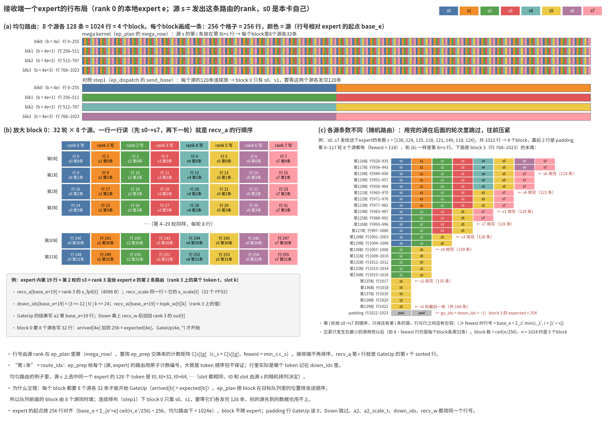
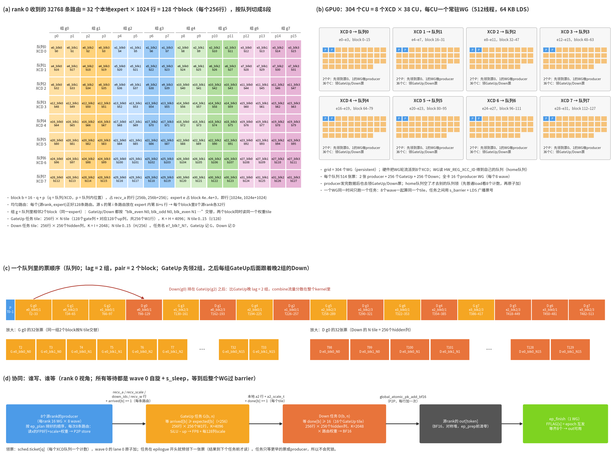
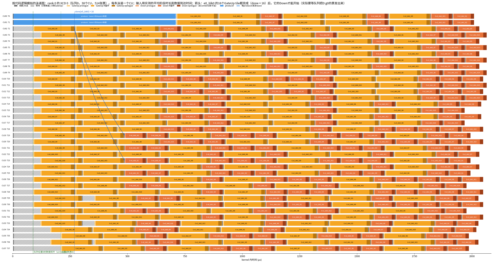
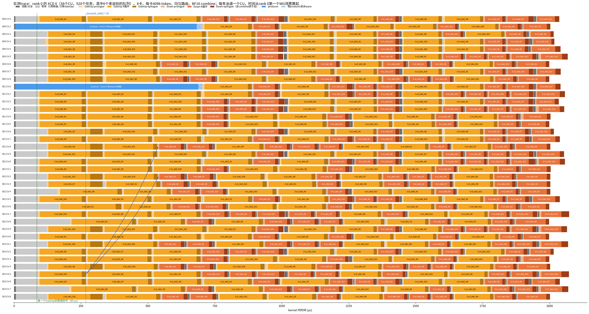
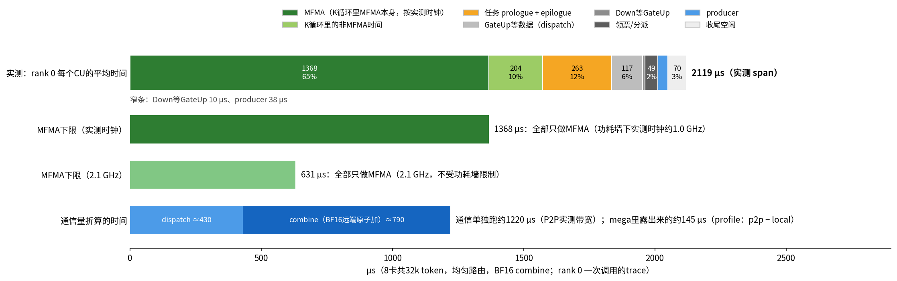

# gfx942 EP8 mega MoE：实现设计（MiMo，8卡共32k token，均匀路由，以 rank 0 为例）

这份文档写给要照着做一遍实现的开发者：数据放在哪里、任务怎么切、304 个 CU 怎么分工和互相等待、有哪些同步变量、
代码按什么顺序执行，以及这个 kernel 离理论极限还有多远。设计的来龙去脉和历次实测见
[mega_moe_ep8_design.md](mega_moe_ep8_design.md)，FP8 combine 和 token 扫描见
[fp8_sweep_overlap_analysis.md](fp8_sweep_overlap_analysis.md)，ATT 分析和后续优化方向见
[mega_moe_ep8_att.md](mega_moe_ep8_att.md)。本文与代码不一致时以代码为准。

| 文件 | 内容 |
|---|---|
| [ep_moe_gfx942.py](../../src/contrib/flydsl/ep_moe_gfx942.py) | `EPMoEGfx942`：分配对称堆 buffer，`forward()` 按顺序发各个 kernel |
| [ep_moe_comm_gfx942.cpp](../../src/contrib/flydsl/ep_moe_comm_gfx942.cpp) | HIP kernel：`ep_prep`（交换计数）、`ep_plan`（发送顺序、block 表）、`ep_finish`、`ep_combine_fp8` |
| [ep_moe_mega_gfx942.py](../../src/contrib/flydsl/ep_moe_mega_gfx942.py) | mega kernel（FlyDSL）：领票、producer、GateUp 任务、Down 任务 |
| [moe_gateup_a8w8_blockscale_gfx942_lds.py](../../src/contrib/flydsl/moe_gateup_a8w8_blockscale_gfx942_lds.py) / [moe_down_a8w8_blockscale_gfx942_lds.py](../../src/contrib/flydsl/moe_down_a8w8_blockscale_gfx942_lds.py) | 一个 GateUp / Down 任务的代码（`gateup_task_emitter` / `down_task_emitter`），和单独跑的 kernel 共用 |
| [tests/contrib/moe/ep8/](../../tests/contrib/moe/ep8/) | bench、trace、通信遮盖 profile、ATT 分析脚本 |

图由 [images/mega_moe_impl.py](images/mega_moe_impl.py) 生成（`python docs/megamoe_ep8_942/images/mega_moe_impl.py /tmp/fonts`，
字体目录里放 NotoSansSC-*.otf）。实测 trace 的数据在 [images/data/](images/data/)。

## 0. 一页总结

- 一次 MoE 层调用在同一个 stream 上依次发：量化 → `out` 清零 → `ep_prep` → `ep_plan` → **mega kernel** → `ep_finish`，
  中间不经过 host 同步。dispatch、GateUp、Down 和 combine 全部在 mega kernel 里。
- mega kernel 是 persistent 的：304 个 WG，每个 CU 一个（64 KB LDS，512 线程）。每个 XCD 一个任务队列，WG 用原子加
  领“票”，票号决定做什么：前 2 张票是 producer（把本卡的路由 P2P 写到目标卡），其余是 GateUp 或 Down 任务。
- 任务之间的等待：GateUp(b) 的 tile 0 等 block b 的数据到齐（`arrived[b]`，由 8 个源 rank 的 producer 累加），把这个 block
  的 A scale 转置后置 `scaled[b]`，其余 15 个 tile 等 `scaled[b]`；Down(b) 等 block b 的 16 个 GateUp tile 做完（`done[b]`）。
  任务只等更早的票或 producer，producer 不等任何东西，所以不会死锁。
- 例子（均匀路由，BF16 combine，2026-11-12 的当前版本）：一层 2132–2146 µs，其中 mega kernel 约 2017–2019 µs。
  kernel 里每个 CU 的时间（rank 0 的 trace，span 2119 µs）：MFMA 本身 65%，K 循环里的非 MFMA 时间 10%，任务的
  prologue/epilogue 12%，GateUp 等数据 6%，其余 7%。比最初的版本（2336 µs）快了约 200 µs：GateUp 的 A scale 每个 block
  转置一次（第 2.5 节）、dispatch 全局按 key 发送（第 3.4 节）。
- 通信约 88% 被藏住（单独跑约 1220 µs，露出约 145 µs）。prologue/epilogue 完全没有被藏住（一个 CU 同时只跑一个任务）。
  理论极限和还能拿回多少见第 8 节。
- combine 有两种：BF16（默认，远端原子加进源 rank 的 `out`）和 FP8（每条路由一行 FP8 store 到源 rank，`ep_finish` 之后
  按 slot 求和）。同日实测 FP8 一层快约 50 µs，而且结果确定。同一 token 落在同一 rank 上的几条路由先加起来能少约 1/3 的
  combine 字节，但在 mega kernel 里要跨任务归约，暂不做；dispatch 侧去重更值得评估。见第 9 节。

## 1. 例子参数、每卡的数量和 buffer

### 1.1 例子参数和每卡的数量

MiMo-V2.6-Flash 的一个 MoE 层：H = 4096，I = 2048，256 个 expert，top-8，FP8 128×128 block scale。EP8：rank d 持有
global expert 32d .. 32d+31（本地 expert e = 0..31）。每卡 4096 个 token，8 卡共 32768 个。

**均匀路由**（`--routing balanced`）：token t 取一个随机排列里第 8t .. 8t+7 项（模 256）。于是每个 (源 rank, expert)
正好 128 条路由，每卡的每个本地 expert 正好收到 8 × 128 = 1024 条。下表是 rank 0 的数量（其他 rank 一样）：

| 项 | 数量 | 说明 |
|---|---|---|
| 本卡发出的路由 | 4096 × 8 = 32768 | 7/8 去别的卡，1/8 写本卡 |
| 本卡收到的路由 | 32 × 1024 = 32768 | 来自 8 个源 rank，每个 4096 |
| 每个本地 expert 的行数 | 1024 = 4 个 block | 起点按 256 行对齐，这里没有 padding |
| block（256 行） | 128 个 | block b = 4e + blk，expert e 的第 blk 块 |
| GateUp 任务 | 128 × 16 = 2048 | N tile = 128 个输出列，I / 128 = 16 个 |
| Down 任务 | 128 × 16 = 2048 | N tile = 256 个 hidden 列，H / 256 = 16 个 |
| producer 任务 | 16 | 每个 XCD 队列 2 个，每个 8 个 wave |
| 每个队列的票 | 2 + 256 + 256 = 514 | 共 4112 |
| dispatch 发送量 | 约 139 MB | 每条路由 4096 B FP8 行 + 128 B scale + 8 B id/权重 |
| combine 发送量 | 约 268 MB | 每条路由一行 BF16（4096 × 2 B），远端原子加；FP8 combine 约 138 MB（第 9 节） |
| 计算量 | 1.65 TFLOP | GateUp 2048 × 2·256·256·4096 + Down 2048 × 2·256·256·2048 |

### 1.2 buffer 一览

本卡的 buffer 按接收容量 `s_cap` 分配，不是按实际行数（本例实际收到 32768 行 = 128 个 block，见 `num_valid`）：

- `s_cap` = 2 × Tcap × topk + 32 × 256 = 2 × 4096 × 8 + 8192 = 73728 行（288 个 block）。Tcap × topk = 32768 是每卡平均
  收到的行数；乘 2 留给路由不均（随机路由下最忙的 rank 要约 37.9k 行）；32 × 256 是每个 expert 补齐到 256 行的 padding 上限。
- 超出 `s_cap` 的路由不发送（`ep_plan` 把它的 info 记为 −1），`status[1]` 记下实际需要的行数，`rows_needed()` 可查。
  容量只占显存，kernel 只处理 `num_valid` 内的 block。
- 「对称堆」是 MORI shmem 分配的 buffer：8 个 rank 上大小和偏移一样，别的 rank 可以直接写（P2P）。每个对称 buffer 有一张
  peer 表（8 个 rank 上它的地址）作为 kernel 参数；「本地」的 buffer 只有本卡读写。

| buffer | 形状（大小） | 在哪 | 谁写 | 用处 |
|---|---|---|---|---|
| `x_fp8` / `x_scale` | [T, 4096] FP8 / [T, 32] FP32 | 调用方 | aiter per-1x128 量化 | 本卡 token 的激活和每 128 列的 scale；producer 读来发给目标 rank |
| `topk_ids` / `topk_w` | [T, 8] i32 / [T, 8] FP32 | 调用方 | 路由 | 每个 token 的 8 个 global expert 和路由权重；`ep_prep` / `ep_plan` 读 ids，producer 读权重 |
| `recv_a` | [73728, 4096] FP8（302 MB） | 对称堆 | 源 rank 的 producer（P2P） | GateUp 的 A：第 r 行是本卡收到的第 r 条路由的 token 激活（行布局见第 2.1 节） |
| `recv_scale` | [73728, 32] FP32（9.4 MB） | 对称堆 | 源 rank 的 producer | `recv_a` 每行每 128 列的 scale，按行存（和源 rank 量化时一样）。每个 block 的 GateUp tile 0 把它转置到 `recv_scale_t` |
| `recv_scale_t` | [32, 73728] FP32（9.4 MB） | 本地 | GateUp(b, 0) | GateUp 的 A scale：`recv_scale` 按 block 转置成 [K/128, 行]，K 循环里一条 scale load 的 16 行在同一个 cache line（第 2.5 节） |
| `down_ids` | [73728] i32 | 对称堆 | producer（有效行）、`ep_plan`（padding 行写 −1） | 每行的结果要加到哪里：源 rank、token、slot。Down 的 epilogue 用（第 1.3 节） |
| `recv_w` | [73728] FP32 | 对称堆 | producer | 每行的路由权重，Down 乘到结果上再加回源 rank（第 1.3 节） |
| `gu_ids` | [73728] i32 | 本地 | `ep_plan` | GateUp 的行表：有效行 r 写 r，padding 行写 −1。GateUp 据此读 `recv_a` 第 r 行，padding 行补 0 |
| `expert_ids` | [288] i32 | 本地 | `ep_plan` | 每个 block 的本地 expert，GateUp / Down 据此选 W1[e] / W2[e] |
| `num_valid` | [1] i32 | 本地 | `ep_prep` | 本卡实际行数（不超过 `s_cap`）；mega kernel 用它算 block 数和队列划分 |
| `a2` | [73728, 2048] FP8（151 MB） | 本地 | GateUp 任务 | GateUp 的输出 SiLU(gate)·up（FP8），也是 Down 的 A；行号和 `recv_a` 一一对应 |
| `a2_scale_t` | [16, 73728] FP32（4.7 MB） | 本地 | GateUp 任务 | `a2` 每行每 128 列的 scale，按列组转置存：Down 读 scale 时一条 load 只碰一个 cache line |
| `out` | [4096, 4096] BF16（33.5 MB） | 对称堆 | 各 rank 的 Down 任务（远端原子加） | 本卡 token 的 MoE 输出；调用前清零，`forward()` 返回 `out[:T]` |
| `comb` / `comb_scale` | [32768, 4096] FP8 / [32768, 32] FP32 | 对称堆 | 各 rank 的 Down 任务 | 只在 FP8 combine 时分配：每条路由一行 FP8 结果，`ep_combine_fp8` 按 slot 求和写进 `out` |
| `ws` | [2072 + 288] i32 | 对称堆 | `ep_prep`、producer、`ep_finish` | 跨卡的计数矩阵、各 rank 的 flag、每个 block 的 `arrived` 计数（第 1.4 节） |
| `sched` | [16 + 3 × 288] i32 | 本地 | `ep_prep`、`ep_plan`、mega kernel | 队列的票计数、每个 block 的 `expected`、`done` 和 `scaled`（第 1.5 节） |
| `route_idx` / `send_route` / `send_info` / `plan` | [32768] / [32768] / [32768] / [848] i32 | 本地 | `ep_prep` / `ep_plan` | 发送计划：每条路由发到哪一行、按什么顺序发（第 1.6 节） |
| `status` | [8] i32 | 本地 | `ep_prep` | [1] 本卡需要的行数（检查容量），[2..4] 时间戳（trace 对齐用），[0] 只有 step1 用 |

### 1.3 `down_ids` 和 `recv_w`：Down 的行写回哪里

- 有效行 r（本卡收到的第 r 条路由）由源 rank 的 producer 和这一行的数据一起写过来（lane 0 写，sc0 sc1 nt）：
  - `down_ids[r] = (src_rank << 12 | token) | slot << 24`：低 24 位是「源 rank × 4096 + 源 rank 上的 token 号」
    （Tcap = 4096 = 2^12，token_shift = 12），高 8 位是这条路由在 top-8 里的序号。
  - `recv_w[r] = topk_w[token][slot]`（源 rank 上这条路由的权重）。
- padding 行（每个 expert 补齐到 256 的部分）：`ep_plan` 把 `down_ids` 写成 −1（token 字段 0xFFFFFF、slot 255，都超出范围），
  `recv_w` 不写。
- Down 任务 D(b, n) 在 epilogue 里读 block b 每一行的 `down_ids` 和 `recv_w`：
  - token 字段 ≥ 8 × 4096 或 slot ≥ 8 的行是 padding，跳过；
  - 其余行：结果 × `recv_w[r]` → BF16，原子加到 `out_table[token >> 12]`（源 rank 的 `out` 基址）里第 `token & 4095`
    行的第 256n .. 256n+255 列；
  - FP8 combine 时改为写到源 rank `comb` 的第 `(token & 4095) × 8 + slot` 行。
- GateUp 不读这两个 buffer，它用 `gu_ids` 区分有效行和 padding 行。

### 1.4 `ws`：跨卡的计数和 flag（对称堆，int32）

| 偏移 | 内容 | 谁写 | 谁读 / 等 | 生命周期 |
|---|---|---|---|---|
| [0, 2048) | 计数矩阵 C[s][g]：源 rank s 发给 global expert g 的路由数，第 s 行（256 个）由 rank s 写 | 各 rank 的 `ep_prep`：把自己那一行 P2P 写到所有 rank | 本卡 `ep_prep`（算行号和 block 表）、`ep_plan`（压紧时的行号） | 每次调用整行覆盖 |
| [2048, 2056) | CFLAG[s] = epoch：rank s 的计数行已经写到本卡 | rank s 的 `ep_prep` | 本卡 `ep_prep` 等 8 个都等于本次 epoch | 不清零 |
| [2056, 2064) | DFLAG[s]：step1 的 dispatch 完成 | rank s 的 `ep_dispatch` | `ep_dispatch` | mega 路径不用 |
| [2064, 2072) | FFLAG[s] = epoch：rank s 的 mega kernel 已结束（它往各卡 `out` 的加都完成了） | rank s 的 `ep_finish` | 本卡 `ep_finish` 等 8 个都等于本次 epoch | 不清零 |
| [2072, 2072 + 288) | arrived[b]：本卡 block b 已经写到的路由数 | 8 个源 rank 的 producer：每条路由的数据写完后系统范围原子加 1 | 本卡 GateUp(b, *) 等到 ≥ expected[b] | 本卡 `ep_prep` 在发 CFLAG 之前清零 |

- 一次调用里的顺序：`ep_prep` 清 arrived → 写计数行 → 发 CFLAG → 等齐 8 个 CFLAG；mega kernel 里 producer 加 arrived、
  GateUp 等 arrived；最后 `ep_finish` 发 FFLAG、等齐 8 个 FFLAG。
- arrived 清零不会和别的 rank 的加撞上：别的 rank 的 producer 在它自己的 mega kernel 里，而它的 mega kernel 要等它的
  `ep_prep` 看到本卡的 CFLAG 之后才启动；本卡在发 CFLAG 之前就清零了。
- CFLAG、FFLAG 不清零：每次调用 epoch + 1，等的是“等于本次 epoch”，上一次留下的值不会被误认。
- kernel 用 peer 表 `tables["ws"]` 写对端的 C、CFLAG、FFLAG 和 arrived；读和等都只用本卡的 `ws`。

### 1.5 `sched`：本卡的队列和依赖计数（本地，int32）

| 偏移 | 内容 | 谁写 | 谁读 / 等 | 生命周期 |
|---|---|---|---|---|
| [0, 8) | ticket[q]：XCD 队列 q 已经发出的票数 | mega kernel 每个 WG 的 wave 0 lane 0：原子加 1，返回值就是票号（领票和预领） | 领票前用普通 load 看哪些队列还有票 | `ep_prep` 清零 |
| [8, 16) | 保留 | — | — | `ep_prep` 清零 |
| [16, 16 + 288) | expected[b]：block b 应收到的路由数（满 block 256，expert 的最后一个 block 可能不满） | `ep_plan` | GateUp(b, *) 读，作为 arrived[b] 的目标值 | 每次调用重写 |
| [16 + 288, 16 + 576) | done[b]：block b 已完成的 GateUp tile 数 | GateUp(b, n) 写完 `a2` 后设备范围原子加 1 | Down(b, *) 等到 ≥ 16 | `ep_prep` 清零 |
| [16 + 576, 16 + 864) | scaled[b]：block b 的 A scale 已经转置到 `recv_scale_t` | GateUp(b, 0) 转置写完后设备范围原子加 1 | GateUp(b, 1..15) 等到 ≥ 1 | `ep_prep` 清零 |

- 票号 ≥ 514（队列里的任务数）表示队列已空。计数会超过 514（预领和偷票都会多加），不影响正确性。
- done、scaled 只在本卡用，放在本地的 `sched`；arrived 要被别的 rank 加，所以放在对称堆的 `ws` 里。
- 288 = s_cap / 256 是按容量分配的，只有前 `num_valid / 256` 个 block 的 expected / done / scaled 有意义。
- 同步语义（用哪种范围的原子、等到之后失效哪一级缓存）见第 5 节。

### 1.6 发送计划：`route_idx`、`plan`、`send_route`、`send_info`

- `route_idx[r]`（`ep_prep`）：本卡第 r 条路由（token r // 8、slot r % 8）是本卡发给同一个 global expert 的第几条。
  目标行 = expert 在目标 rank 上的起始行 + 8 × route_idx + 本卡 rank（第 2.1 节）。
- `plan`（`ep_prep` 写给 `ep_plan`）：每个 global expert 的总路由数、8 个源里最少的路由数、在目标 rank 上的起始行，
  每个目标 rank 的总行数，每个目标 rank 8 个队列的起始 block，以及每个 key 在 `send_route` 里的起始位置（本卡发往这个
  key 的路由数的前缀和）和 `ep_plan` 占位置用的游标。
- `send_route[k]` / `send_info[k]`（`ep_plan`）：producer 的发送顺序，整个数组按 key 排好（同一个 key 里的顺序每次调用
  可能不同）。每 8 项是一个 chunk，producer WG p 发第 p、p + 16、p + 32……个 chunk（第 3.4 节）：
  - `send_route[k]` = 路由号 r（token = r >> 3，slot = r & 7）；
  - `send_info[k]` = 目标行 | global expert << 17（目标 rank = expert >> 5）；超出 `s_cap` 时为 −1，这条路由不发。
- `send_base`（[256]）只给 step1 的 `ep_dispatch` 用：每个源的路由在 expert 里连续排，不交错。

## 2. 数据放在哪里，任务的 tile

### 2.1 接收端的行布局

- rank d 上，本地 expert e 占 `recv_a` 的一段连续行，起点 `base_e = Σ_{e'<e} ⌈n_{e'}/256⌉·256`（n 是 8 个源 rank
  发给它的路由数之和）。均匀路由下 base_e = 1024e，expert e 占 block 4e .. 4e+3。
- 一个 expert 的行里，源 rank s 的第 i 条路由放在第 8i + s 行（某个源的路由用完以后往前压紧，见下图）。所以每个 block 里
  8 个源 rank 各 32 行，所有源都要发到，block 才完整；但每个源只需要发自己那 32 条。
- 行号由源 rank 自己算（`ep_plan` 里的 `mega_row`），它需要全部 8 个源的计数矩阵，这就是 `ep_prep` 先交换计数的原因。
  接收端不再排序：`recv_a` 第 r 行就是 GateUp 的第 r 个 sorted 行（`gu_ids[r] = r`）。
- 每行 4096 B，block b 是 `recv_a` 的字节 [b·1 MiB, (b+1)·1 MiB)。expert 起点按 256 行对齐，一个 block 的数据不会和
  别的 expert 共用 cache line。



- 图 (a)：均匀路由下一个 expert 的 4 个 block，8 个源按轮交错，每个 block 各 32 条。下面对照 step1 的连续排布：
  block 0 只有 s0、s1，要等这两个源各发完 128 条。
- 图 (b)：放大 block 0。第 i 轮的 8 行依次是 8 个源的第 i 条路由。i 就是 `route_idx`：`ep_prep` 里按原子计数编号，
  大致是 token 顺序但不保证；行里实际是哪个 token 记在 `down_ids` 里。
- 图 (c)：各源条数不同时，第 i 轮只排还有第 i 条的源，行与行之间没有空洞。i ≥ fewest 时行号 =
  base_e + Σ_s' min(c_s', i + [s' < s])（就是 `mega_row` 的公式），末尾不满 256 行的部分是 padding。

### 2.2 GateUp 任务 G(b, n)

| 项 | 内容 |
|---|---|
| 输入行 | `recv_a` 的 block b：256 行 × 4096 B（FP8），scale 是 `recv_scale_t[k][256b .. 256b+255]`（tile 0 先从 `recv_scale` 转置过来） |
| 权重 | W1[e] 的 gate 行 n·128 .. n·128+127 和 up 行 2048 + n·128 .. +127，共 256 行，K = H = 4096（32 个 K block） |
| tile | 256 行 × 256 个权重行（输出 128 列），2x4 wave（2 个沿 M，4 个沿 N），每个 wave 128 VGPR 累加器 |
| 计算 | FP8 MFMA 16x16x32，块缩放用 FP32 累加；SiLU(gate)·up；每行每 128 列一个 FP8 scale |
| 输出 | **本卡** `a2[256b + r][128n .. 128n+127]`（FP8）和 `a2_scale_t[n][256b + r]`（FP32），写穿透（sc1） |
| 结束 | `s_waitcnt vmcnt(0)` + barrier 后 `done[b] += 1` |

GateUp 的输出留在本卡：同一个 block 的 Down 任务也在本卡（同一个队列）。`a2` 用写穿透（sc1），所以 Down 任务即使被
别的 XCD 领走，也能在 `done[b]` 之后直接读到，不需要写回整个 L2。

K 循环、LDS 布局、两组 wave 错开一个 barrier 的流水线和单独跑的 BM256 GateUp 一样，见
[moe_gateup_a8w8_blockscale_gfx942.md](../moe_942_ep8/moe_gateup_a8w8_blockscale_gfx942.md)（带图的版本是
`luwei/942-fp8-blockwise` 分支上的 `docs/design_moe_a8w8_blockscale_gfx942.md` 第 3 节）。mega 里的区别：A 的 scale
由源 rank 按行写进 `recv_scale`，每个 block 的 tile 0 先把它转置到 `recv_scale_t`（第 2.5 节）。

### 2.3 Down 任务 D(b, n)

| 项 | 内容 |
|---|---|
| 输入行 | 本卡 `a2` 的 block b：256 行 × 2048 B，scale `a2_scale_t[k][256b + r]` |
| 权重 | W2[e] 的行 n·256 .. n·256+255，K = I = 2048（16 个 K block） |
| tile | 256 行 × 256 个 hidden 列，4x2 wave（4 个沿 M，2 个沿 N） |
| 输出 | 每行乘路由权重 → BF16，`global_atomic_pk_add_bf16` 加到**源 rank** 的 `out[token][256n .. 256n+255]`（P2P） |
| 行的去向 | `down_ids[256b + r]` = `(src << 12 \| token) \| slot << 24`；`recv_w[256b + r]` = 路由权重；padding 行（−1）跳过 |

一个 token 的 8 条路由分散在持有这些 expert 的几个 rank（最多 8 个）的 Down 任务里，各自原子加进源 rank 的同一行，
所以 `out` 要先清零，加的顺序
不固定（BF16 原子加，结果有 0.5–0.75 的抖动，和 MORI 基线同级）。`--combine fp8` 时改成每条路由写一行 FP8 到源 rank 的
`comb[token][slot]`，`ep_finish` 之后再按 slot 顺序求和，结果确定（见 [fp8_sweep_overlap_analysis.md](fp8_sweep_overlap_analysis.md)）。
两种方式的对比和取舍见第 9 节。

### 2.4 任务命名

本文和图里的任务名是 `e{本地expert}_blk{expert内第几个block}_N{N tile}`，前面加 G（GateUp）或 D（Down）：

- `G e0_blk1_N3`：expert 0 的第 1 个 block（rank 上的 block 1，行 256–511），W1 的 gate/up 第 3 个 128 列 tile。
- `D e5_blk2_N15`：expert 5 的第 2 个 block（block 22），hidden 列 3840–4095。
- 均匀路由下 block b = 4e + blk；一般情况下用 `expert_ids[b]` 查 expert。

### 2.5 GateUp 的 A scale：每个 block 转置一次

- **为什么**：源 rank 把每条路由的 32 个 scale 连续写进 `recv_scale` 的一行。GateUp 的 K 循环每个 K block 要读
  256 行各一个 scale，按 token 存时一条 load 的 16 行落在 16 个 cache line 上，每个 CU 每个 K block 约 1024 次 cache line
  访问，比 A、B 数据本身还多一倍（[ATT 文档](mega_moe_ep8_att.md)第 3.3 节）。单独的 MoE 算子读的是转置过的 scale。
- **做法**：block b 的 tile 0 等到 `arrived[b]` 之后，先把这个 block 的 256 × 32 个 scale 转置写到本卡的
  `recv_scale_t[k][256b + r]`（padding 行写 0，sc1 写穿透），`s_waitcnt vmcnt(0)` + barrier 之后 `scaled[b] += 1`。
  线程 t 负责第 t % 256 行的一半 K block：4 条 dwordx4 load，16 条 dword store。
- 其余 15 个 tile 不再等 `arrived[b]`，改等 `scaled[b] ≥ 1`（置位时数据已经到齐）。tile 0 的票号更小，不会死锁（第 3.5 节）。
- 所有 tile 的 K 循环按转置布局读 scale，一条 load 只碰 1 个 cache line，和单独的 MoE 算子一样。
- **效果**（2026-11-12，均匀路由，BF16 combine，trace）：GateUp K 循环 174k → 144k cycle（MFMA 效率 75% → 91%），
  tile 0 的转置每次约 5k cycle。一层的时间（两种版本按 ABBA 各跑 300 次，最慢 rank 的中位数）：

| 配置 | 按 token 读 | 每个 block 转置 | 变化 |
|---|---|---|---|
| 均匀路由，BF16 combine | 2341 µs | 2250 µs | −91 µs（−3.9%） |
| 均匀路由，FP8 combine | 2287 µs | 2186 µs | −100 µs（−4.4%） |
| 随机路由，BF16 combine | 2478 µs | 2404 µs | −74 µs（−3.0%） |

- 正确性：FP8 combine 下和 step1 路径（单独的 GateUp kernel）交替输入逐位相同；BF16 combine 下 calc_diff 1.2e-5（原子加顺序）。
- 省下的 K 循环时间没有全部变成一层的时间：GateUp 变快以后，启动段等 dispatch 数据更久（GateUp 平均等待 44 → 63 µs，
  稳定段只多 0.4 µs），producer 也慢了（约 480 → 615 µs），时钟也低了一些（GateUp 约 1090 → 1030 MHz）。
  dispatch 的发送顺序（第 3.4 节、第 8.4 节第 3 项）因此更重要了。
- bench / trace 加 `--token-major-scales` 回到按 token 读，用来做 A/B。
- 注意：转置里算 `rows_cap` 的乘积要用一个不透明副本（`s_mov_b32` 内联汇编）。否则 LLVM 把它和 GateUp 里相同的乘积合成
  一个 phi，当成 divergent 放进 VGPR，GateUp 的 12 条行号 load 和 K 循环每次迭代的 10 条 scale load 都会包进 waterfall
  循环。改掉以后 GateUp prologue 约 6.8k → 5k cycle，一层再快约 5–9 µs（[ATT 文档](mega_moe_ep8_att.md)第 5.2 节）。

## 3. GPU0 的 304 个 CU 怎么分工



### 3.1 XCD、队列和 home 队列

- MI300X 有 8 个 XCD，每个 38 个 CU。grid = 304 个 WG，每个 WG 512 线程、64 KB LDS，所以每个 CU 正好一个常驻 WG。
- 有 8 个队列，队列 q 放 block 的一段连续区间：`[blocks·q/8, blocks·(q+1)/8)`。这里每个队列 16 个 block
  （4 个 expert × 4 个 block）：队列 q = expert 4q .. 4q+3。
- WG 读 `HW_REG_XCC_ID` 得到自己所在的 XCD，先领这个 XCD 的队列（home 队列）。同一个 block 的 16 个 GateUp tile 都读
  同一份 A（1 MiB），在一个 XCD 的 L2 里共享。
- home 队列空了，WG 才去别的队列领（先用普通 load 看 8 个票计数，只对还有票的队列做原子加）。均匀路由下这种“偷”
  只发生在最后，rank 0 一次调用里 XCD 0 上有 19 个任务来自别的队列。

### 3.2 一个队列里的票顺序

队列 q 共 514 张票。票号 t 到任务的映射（`run_task`，`lag = 2`，`pair = 2`，`NG = ND = 16`）：

| 票号 | 任务 |
|---|---|
| t = 0, 1 | producer：`produce(q·2 + t)` |
| index = t − 2 < 64 | GateUp，组 index // 32（头两组，“head”） |
| 64 ≤ index < 64 + 6 × 64 | 第 u = (index − 64) // 64 个 unit：slot < 32 → GateUp 组 u + 2；否则 Down 组 u（比 GateUp 晚 2 组） |
| 之后 | Down，组 6、7（“tail”） |

- **组**：队列里相邻 2 个 block（block 2g、2g+1，同一个 expert）。组内 32 个任务按 `sub = 0..31` 排：
  block = 2g + sub % 2，N tile = sub // 2。所以顺序是 `e0_blk0_N0, e0_blk1_N0, e0_blk0_N1, e0_blk1_N1, …`，
  两个 block 同时读同一个权重 tile，B 在 L2 里共享。
- **lag**：Down(g) 排在 GateUp(g + 2) 之后。Down 的 epilogue 往外发 combine 数据，这样 combine 流量分散在整个 kernel 里，
  而且 Down(g) 被领走时，组 g 的 32 个 GateUp 一般已经做完，不用等。
- 队列 0 的前几张票：T0、T1 producer；T2 `G e0_blk0_N0`，T3 `G e0_blk1_N0`，T4 `G e0_blk0_N1` … T33 `G e0_blk1_N15`；
  T34–T65 `G e0_blk2/blk3`；T66–T97 `G e1_blk0/blk1`；T98 `D e0_blk0_N0`，T99 `D e0_blk1_N0` … T129 `D e0_blk1_N15`；
  T130–T161 `G e1_blk2/blk3`；T162–T193 `D e0_blk2/blk3` …；T482–T513 `D e3_blk2/blk3`。

### 3.3 领票

`take_ticket`（每个 WG 一个任务领一次）：

1. 上一个任务结束后，全部 wave 先过一个 `s_barrier`（上个任务的 LDS 读都完成了，才能改写 LDS 里的票号）。
2. wave 0：如果上个任务的 epilogue 里预领到了 home 队列的票，且票号 < 514，就用它；否则用普通 load 读 8 个计数，
   从 home 队列开始，对还有票的队列做 lane 0 原子加，领到有效票为止。
3. wave 0 把 (队列, 票号) 写进 LDS；`s_waitcnt lgkmcnt(0)`，barrier；全部 wave 读出来；再一个 barrier。
4. 票号 < 0（所有队列都空）就退出。

**预领**：GateUp / Down 任务在 epilogue 开头（K 循环刚结束）就对 home 队列做原子加，结果到下一次 `take_ticket` 才读。
这时任务已经不再等任何东西，持票不会挡住别人；原子加的延迟藏在 epilogue 里。领票平均约 3.4 µs（从上一个任务
的 wave 0 到达领票 barrier 算起，大部分是等同一个 WG 里最慢的 wave）。

原子加只由 lane 0 做，地址经过一个不透明的 VGPR：否则 LLVM 的 atomic optimizer 会生成 64 步循环，并立刻读回结果。

### 3.4 producer

- 16 个 producer WG × 8 wave = 128 个 wave。`ep_plan` 把本卡的 32768 条路由按 **key** 全局排好：key = 这条路由的目标
  block 在目标队列里的位置（0..62；更靠后的和超出 `s_cap` 的都是 63）。每 8 条一个 chunk，共 4096 个。
- producer WG p 发第 p、p + 16、p + 32……个 chunk，WG 里的 8 个 wave 用 LDS 里的一个计数轮流领下一个。
  - 所有 producer 一起先发各目标队列第 0 个 block 的数据，再发第 1 个……：队列位置 0 的 block 在每个源发完约 2 个
    chunk 后就到齐，不用等每个 wave 先发完自己那段的前 8 个 chunk（第 8.4 节）。
  - 同一个 SIMD 上第二个 wave 发得慢，少领几个 chunk，一个 WG 的 8 个 wave 一起结束。
  - 用一个全局计数让 128 个 wave 一起领，测下来一样快；LDS 计数不和票计数挤同一个 cache line。
- 每次 8 条路由（一个 chunk）：
  1. lane 0–7 读 8 条路由的 `send_route` / `send_info`（目标行、global expert）。
  2. 对每条路由读本卡 `x` 的 FP8 行（4 × `buffer_load_dwordx4`，4 KB）、scale（lane 0–7 各 16 B）、路由权重。
  3. P2P 写到目标 rank：`recv_a` / `recv_scale` 行、`down_ids`、`recv_w`。缓存位 sc0 nt sc1，写穿透到目标显存。
  4. `s_waitcnt vmcnt(0)`：这 8 条路由的 store 都完成了。
  5. lane i（i < 8）对目标 rank 的 `arrived[该路由的 block]` 做系统范围原子加 1。
- producer 只往外写，不等任何人；发完以后也去领 GateUp / Down 票。

### 3.5 为什么不会死锁

- GateUp(b, 0) 等的是 producer 写的数据，producer 一定会写完。
- GateUp(b, 1..15) 等 GateUp(b, 0) 置 `scaled[b]`；tile 0 在队列里排在同一个 block 的其他 tile 前面，票号更小。
- Down(b) 等的是 GateUp(b, *)，它们的票号都更小（同一队列里 GateUp(g) 的票都在 Down(g) 之前）。
- 更小的票已经在某个正在运行的 WG 手里；持票的 WG 要么在跑这个任务，要么在 epilogue（不再等待），跑完就做它。
- grid 不超过 CU 数，WG 都常驻。前提是同一时间没有别的进程占着这块 GPU。

## 4. 术语表

| 术语 | 含义（本文和代码里的用法） |
|---|---|
| rank、源 rank、目标 rank | EP 的一张卡。源 rank 发出路由（token 在它那里），目标 rank 持有路由的 expert |
| 路由（route）、slot | 一个 token 的 top-8 里的一项；slot = 它在 top-8 里的序号（0..7） |
| 本地 expert e | 目标 rank 上的 expert 0..31（global expert = 32·rank + e） |
| 行（sorted 行） | `recv_a` 的一行 = 一条路由。expert 的行按 256 对齐，源 s 的第 i 条在 expert 内第 8i+s 行 |
| block | 256 个连续行，属于同一个 expert。均匀路由下每个 expert 4 个 block（blk 0..3），rank 上 128 个 |
| N tile | 输出列方向的切分。GateUp：128 个输出列（256 个 W1 行），16 个；Down：256 个 hidden 列，16 个 |
| tile / 任务 | 一个 WG 一次做的一块：GateUp 256 行 × 一个 N tile，Down 256 行 × 一个 N tile。任务名 `G/D e?_blk?_N?` |
| 队列（queue） | 每个 XCD 一个，放一段连续的 block 和它们的全部任务（514 张票） |
| home 队列 | WG 所在 XCD 的队列，优先领 |
| 票（ticket） | 队列计数原子加的返回值，按票号顺序决定任务（第 3.2 节）。≥ 514 表示这个队列已空 |
| 预领 | 在当前任务 epilogue 开头就领下一张票 |
| 偷（steal） | home 队列空了以后去别的队列领票（trace 里记为 stolen） |
| 组（group）、pair | 队列里相邻 2 个 block（同一 expert），GateUp / Down 各 32 个任务，按 N tile 交替两个 block |
| unit | 一组 GateUp（32 个）加一组 Down（32 个），队列中段按 unit 排 |
| lag | Down 比 GateUp 晚几组，默认 2。lead = min(组数, lag) |
| head / tail | 队列开头只有 GateUp 的 lead 组；最后只有 Down 的 lead 组 |
| producer / consumer | 前 2 张票的 WG 发 dispatch 数据，其余任务（GateUp / Down）都是 consumer 的活 |
| slice | `ep_plan` 的一个 WG 处理的一段本卡路由（128 个 WG，每段最多 1024 条） |
| chunk | 发送顺序里连续的 8 条路由；producer wave 一次发一个（load → P2P store → vmcnt(0) → arrived 原子加） |
| key | 发送顺序的排序键：目标 block 在目标队列里的位置（0..62，更靠后或丢掉的为 63） |
| expected[b] | block b 应收到的路由数（满 block 为 256），`ep_plan` 写 |
| arrived[b] | block b 已经写到的路由数，8 个源 rank 的 producer 原子加 |
| done[b] | block b 做完的 GateUp tile 数，到 16 后 Down(b) 才能开始 |
| scaled[b] | block b 的 A scale 已由 GateUp(b, 0) 转置到 `recv_scale_t`，GateUp(b, 1..15) 等它 |
| epoch | host 每次调用加 1；跨卡 flag 存 epoch，比较相等，不用清零 |
| G0 / G1 | 一个任务里 wave 0–3 / 4–7；K 循环中两组错开一个 barrier |
| relaxed | 默认的同步方式：GateUp 写 `a2` 用 sc1 写穿透，等待之后只 invalidate L1（`buffer_inv sc0`） |
| prologue / K 循环 / epilogue | 一个任务里：等到之后装第一个 K block / 主循环 / 循环之后的收尾（SiLU、量化、写出、原子加） |

## 5. 同步与原子变量

`ws`、`sched` 的布局见第 1.4、1.5 节。下表补充每个变量用什么范围的原子、等到之后怎么保证看到数据。

| 变量 | 含义 | 清零 / 初值 | 谁写（怎么写） | 谁等 | 等到多少 | 说明 |
|---|---|---|---|---|---|---|
| `ws.C[s][g]` | 源 rank s 发给 global expert g 的路由数 | 每次覆盖 | rank s 的 `ep_prep`：对 8 个 rank 的 `ws` 做 relaxed 系统范围 store | 不直接等，由 CFLAG 保护 | — | 每个 rank 读全矩阵算行号和 block 表 |
| `ws.CFLAG[s]` | rank s 的计数行已经写到我这里 | 不清零，存 epoch | rank s 的 `ep_prep`：`__threadfence_system` 后系统范围 release store | 每个 rank 的 `ep_prep`（1 个 WG，8 个线程各等一个 s） | == epoch（8 个都到） | 也给 `out` 清零加了顺序：`ep_prep` 的系统 fence 把清零写回显存，别的 rank 看到 CFLAG 之后才可能往 `out` 加 |
| `ws.arrived[b]` | 本卡 block b 已写到的路由数 | 本卡 `ep_prep` 写 0，在发 CFLAG 之前 | 8 个源 rank 的 producer：一个 chunk 的 P2P store `s_waitcnt vmcnt(0)` 之后，每条路由一次系统范围原子加 1 | 本卡 GateUp(b, 0) 的 wave 0：系统范围 load 自旋（`s_sleep 2`），等到后 `buffer_inv sc0`，WG barrier | ≥ `expected[b]`（满 block 为 256） | 源 rank 要先等齐 8 个 CFLAG 才会启动 mega kernel，所以不会加在清零之前 |
| `sched.ticket[q]` | 队列 q 的下一张票 | `ep_prep` 写 0 | 任何 WG 的 wave 0 lane 0：设备范围原子加 1（领票和预领） | 没人等；领票前用普通 load 看哪些队列还有票 | < 514 才有效 | 每个 XCD 一个计数，避免全卡一个热点 |
| `sched.expected[b]` | block b 应收的路由数 | `ep_plan` 写 | `ep_plan`（普通 store） | GateUp 任务读（不等） | — | 只等自己这个 block，不等整个 expert |
| `sched.done[b]` | block b 已完成的 GateUp tile 数 | `ep_prep` 写 0 | GateUp(b, n) 的 wave 0 lane 0：`a2` 写穿透、`s_waitcnt vmcnt(0)`、barrier 之后，设备范围原子加 1 | 本卡 Down(b, *) 的 wave 0：设备范围 load 自旋，等到后 `buffer_inv sc0`，WG barrier | ≥ 16（NG） | 数据都在本卡显存，本卡 L2 对本卡显存靠 probe 保持一致，所以只需失效 L1 |
| `sched.scaled[b]` | block b 的 A scale 已转置到 `recv_scale_t` | `ep_prep` 写 0 | GateUp(b, 0) 的 wave 0 lane 0：转置写穿透、`s_waitcnt vmcnt(0)`、barrier 之后，设备范围原子加 1 | 本卡 GateUp(b, 1..15) 的 wave 0：设备范围 load 自旋，等到后 `buffer_inv sc0`，WG barrier | ≥ 1 | tile 0 置位前已经等到 `arrived[b]`，所以其余 tile 不用再等 `arrived` |
| `ws.FFLAG[s]` | rank s 的 mega kernel 已结束（它往各卡 `out` 的原子加都完成了） | 不清零，存 epoch | rank s 的 `ep_finish`：`__threadfence_system` 后对 8 个 rank 系统范围 release store | 每个 rank 的 `ep_finish`（8 个线程） | == epoch（8 个都到） | 之后 `out` 可以用 |
| LDS 票号 | WG 内广播 (队列, 票号) | — | wave 0 写 LDS | 全部 wave | barrier | 前后各一个 barrier，避免和任务的 LDS 冲突 |
| `ws.DFLAG[s]`、`status[0]` | step1 的 dispatch 完成标志、完成的 WG 数 | | `ep_dispatch` | `ep_dispatch` 的最后一个 WG | | mega 路径不用 |

内存一致性要点：

- 写到别的卡的数据（producer 的行、Down 的 BF16 原子加）都用系统一致的写法（sc0 sc1，原子加带系统范围），`s_waitcnt vmcnt(0)`
  之后它们已经落在目标显存，再发计数或 flag。
- 等待方读计数用系统 / 设备范围的原子 load（sc1），读到以后只失效 L1：被等的数据都在本卡显存里，同一次调用里在它
  写好之前没人读过。
- epoch 让 CFLAG、FFLAG 不用清零；`arrived`、`done`、票计数每次调用由 `ep_prep` 清零，`expected` 由 `ep_plan` 重写。
  这些都在 device 上做，整个调用可以被 CUDA graph 捕获。
- gfx942 上 load 和 store / 原子共用 `vmcnt`：Down 任务 epilogue 发出的远端原子加，会让下一个任务第一次等 `vmcnt` 时一起等完。

## 6. 代码流程

### 6.1 一次调用（host，`EPMoEGfx942.forward`）

```text
epoch += 1
quant: x(BF16) -> x_fp8 [T, 4096], x_scale [T, 32]        # aiter per-1x128，调用方做
out[:T].zero_()                                           # BF16 combine 才需要
ep_prep  <<<1, 1024>>>                                    # 计数、交换、block 表
ep_plan  <<<128, 256>>>                                   # 每条路由的目标行和发送顺序，本卡的 block 表
mega     <<<304, 512>>>                                   # dispatch + GateUp + Down + combine
ep_finish<<<1, 64>>>                                      # 8 个 rank 互发 FFLAG
(ep_combine_fp8)                                          # 只在 FP8 combine 时
return out[:T]
```

### 6.2 `ep_prep`（每个 rank 1 个 WG）

```text
arrived[0 .. s_cap/256) = 0                               # 必须在发 CFLAG 之前
for route r (按 8192 条一批): route_idx[r] = atomicAdd(hist[topk_ids[r]], 1)   # 本卡发给每个 global expert 的第几条
for peer p, expert g: ws_p.C[me][g] = hist[g]             # relaxed 系统 store
threadfence_system;  for p: ws_p.CFLAG[me] = epoch (release)
wait ws.CFLAG[0..7] == epoch
total[g] = Σ_s C[s][g];  fewest[g] = min_s C[s][g];  expert_base[g] = 目标 rank 上的起始行（256 对齐）
sched.ticket[0..16) = 0;  sched.done[] = 0;  sched.scaled[] = 0;  num_valid = 本卡行数;  plan 表（队列起点等）
for 本卡路由的每个 (expert g, 目标 block):  key_hist[key] += 本卡发到这个 block 的路由数   # 行号随 idx 递增，按区间算
plan.key_base[k] = Σ_{k'<k} key_hist[k'];  plan.key_cursor[] = 0
```

### 6.3 `ep_plan`（128 个 WG，每个 WG 一段路由）

```text
slice j = 本卡路由 [per·j, per·j + per)，per = ⌈路由数 / 128⌉ ≤ 1024
for 每条路由 r:  g = topk_ids[r];  row = mega_row(g, route_idx[r])        # base[g] + 8·idx + me（用完的源往前压紧）
                 info = row | g << 17（超出 s_cap 为 −1）;  key = row 所在 block 在目标队列里的位置
                 rank_in_wg = atomicAdd(key_count[key], 1)                  # LDS
for key k:  start[k] = plan.key_base[k] + atomicAdd(plan.key_cursor[k], key_count[k])   # 每个 WG 在 key 的区间里占一段
send_route[start[key] + rank_in_wg] = r;  send_info[...] = info
for 本卡 block b（各 WG 分摊）: expert_ids[b], expected[b] = 行数, gu_ids[256b + t] = 行号或 −1, padding 行 down_ids = −1
```

### 6.4 mega kernel（每个 WG）

```text
queue, ticket = take_ticket()
while ticket >= 0:
    reload kernel args through an opaque pointer             # 否则 LLVM 把各任务的地址计算提到循环外，寄存器溢出
    if ticket < 2:  produce(queue·2 + ticket); next = −1
    else:
        kind, block, tile = decode(queue, ticket)            # 第 3.2 节
        if kind == G:
            expected = sched.expected[block]
            if tile == 0: wave 0: spin until ws.arrived[block] >= expected; buffer_inv sc0
            else:         wave 0: spin until sched.scaled[block] >= 1; buffer_inv sc0
            barrier
            if tile == 0:                                    # 第 2.5 节
                recv_scale_t[k][256·block + r] = recv_scale[256·block + r][k]   # padding 行写 0，sc1
                s_waitcnt vmcnt(0); barrier; wave 0 lane 0: atomic_add(sched.scaled[block], 1)
            gateup_tile(block, tile)                         # A scale 读 recv_scale_t；K 循环结束时预领下一张票 -> next
            s_waitcnt vmcnt(0); barrier; wave 0 lane 0: atomic_add(sched.done[block], 1)
        else:
            wave 0: spin until sched.done[block] >= 16; buffer_inv sc0
            barrier
            down_tile(block, tile)                           # 预领 -> next；epilogue: BF16 atomics -> out[src][token]
    queue, ticket = take_ticket(after_task, next)

produce(p): LDS count = 0; barrier
  for wave w: chunk = p + 16 · (LDS count++); while chunk < 4096: (8 routes of send_route[8·chunk ..])
    load 8 routes' x rows (4 KB), scales (128 B), weights
    P2P store rows / scales / down_id / weight to the destination (sc0 nt sc1)
    s_waitcnt vmcnt(0)
    lane i < 8: system atomic_add(dest.ws.arrived[row_i / 256], 1)
    chunk = p + 16 · (LDS count++)             # issued at the chunk's start
```

GateUp / Down 的 tile 内部（prologue 装第一个 K block、每个 K block 4 个 stage、两组 wave 错开一个 barrier、epilogue 经
LDS 写出）和单独跑的 kernel 是同一段代码（`gateup_task_emitter` / `down_task_emitter`）。

### 6.5 `ep_finish` 和 FP8 combine

```text
ep_finish: threadfence_system; thread p < 8: ws_p.FFLAG[me] = epoch (release); wait ws.FFLAG[p] == epoch
ep_combine_fp8（FP8 combine）: out[t] = BF16(Σ_slot comb[t][slot] · scale)，按 slot 顺序
```

## 7. 泳道图

### 7.1 按代码逻辑模拟



图是按第 3 节的规则模拟一个队列（XCD 0 的 38 个 CU、514 张票）：

- 每个 CU 第一次在 t ≈ 0 领票；之后在每个 GateUp / Down 任务的 epilogue 开头预领下一张，producer 在结束时领。
- GateUp 等它的 block 数据到齐，Down 等它的 block 的 16 个 GateUp 都结束。
- 输入用实测的平均值（rank 0 trace）：GateUp prologue / K 循环 / epilogue = 5.3 / 159.1 / 15.6 µs，Down = 3.7 / 74.3 /
  14.5 µs，领票 3.4 µs，producer 705 µs；队列位置 0–3 的数据在 89–210 µs 到齐，位置 5 在约 356 µs，更后面的位置在用到
  之前就到了。

从图上可以读出这个设计的几个特点：

1. **启动**：36 个 CU 一开始就领到了 GateUp 票（e0_blk0..3），全部在等数据，直到第一批 block 到齐。这段时间只有 2 个
   producer CU 在干活。全局按 key 发送以后，队列位置 0 的 block 在约 90 µs 就到齐了（之前是约 300 µs）。
2. **稳定段**：GateUp 和 Down 交替。Down(g) 被领走时，组 g 的 GateUp 早就做完了，所以 Down 基本不等。
3. **收尾**：最后两组只剩 Down，任务少、时间短，各 CU 结束时间参差，留下几十 µs 的空闲。

### 7.2 实测 trace



`trace_ep8_mega.py --routing balanced --save` 记下每个任务的领票时刻、等到的时刻、K 循环开始和结束（shader clock，按
任务的平均时钟换算成 µs）、结束时刻和所在的 CU。图是 rank 0 的 XCD 0。和模拟一致的地方：

- 第一个 GateUp 的数据在 84 µs 到齐，第一轮的 288 个 GateUp 任务平均等了约 110 µs（全局发送顺序之前是第一个
  321 µs、平均约 330 µs）。
- producer WG 的 8 个 wave 一起领 chunk，650–765 µs 一起发完，之后 8–22 µs 就开始做 GateUp / Down（之前 wave 0
  发完以后还要等同一个 WG 里的其他 wave 约 200 µs）。
- Down 任务几乎不等（平均 1.5 µs）；GateUp 任务稳定段等数据也只有约 2 µs。
- 最后约 130 µs 里各 CU 陆续结束；XCD 0 有 6 个任务是从别的队列偷来的。

## 8. 理论极限和遮盖率

### 8.1 下限

| 口径 | 每卡时间 | 怎么算 |
|---|---|---|
| MFMA 下限，2.1 GHz | **631 µs** | 每个 CU 1.325M 个 SIMD cycle：GateUp 2048 × 131072 + Down 2048 × 65536，除以 304（每个 K block 每个 SIMD 4096 cycle） |
| MFMA 下限，实测时钟 | **约 1370 µs** | 功耗墙（750 W）下实测时钟约 1.0 GHz（GateUp 953 MHz、Down 1028 MHz）；K 循环里 stall 少了、功耗高了，时钟比最初的版本（约 1.11 GHz）低 |
| 通信量（BF16 combine） | 约 1220 µs | dispatch 的 FP8 行 134 MB / 约 312 GB/s ≈ 430 µs，combine 268 MB / 约 339 GB/s ≈ 790 µs（P2P 实测带宽），可以和计算重叠 |
| 通信量（FP8 combine） | 约 830 µs | combine 每条路由 4 KB + 128 B |
| 实测：mega kernel | 2017–2019 µs | 300 次调用的中位数（最慢的 rank），一层 2132–2146 µs（含量化 20、prep 63、finish 119–127） |

所以这个 kernel 现在大约是“实测时钟下 MFMA 下限”的 1.5 倍。通信不是瓶颈：它比 MFMA 下限还短，而且 88% 已经藏住了。

### 8.2 时间花在哪



rank 0 一次调用的 trace，304 个 CU 的平均（kernel span 2119 µs）：

| 用途 | 每个 CU | 占比 | 说明 |
|---|---|---|---|
| MFMA | 1368 µs | 64.5% | K 循环里 MFMA 本身（按每个任务实测的时钟换算） |
| K 循环里的非 MFMA | 204 µs | 9.6% | GateUp K 循环的 MFMA 效率约 90%（单独跑的 GateUp 是 93%），Down 约 82%；见 ATT 文档第 5 节 |
| prologue + epilogue | 263 µs | 12.4% | GateUp 每个任务 5.3 + 15.6 µs，Down 3.7 + 14.5 µs（Down 的 epilogue 发 combine 原子加） |
| 等数据（GateUp） | 117 µs | 5.5% | 大部分在启动时：第一轮的 288 个 GateUp 平均等 110 µs |
| 收尾空闲 | 70 µs | 3.3% | 最后的 Down 任务 |
| 领票 / 分派 | 49 µs | 2.3% | 每个任务约 3.4 µs |
| producer | 38 µs | 1.8% | 16 个 CU 各约 705 µs |
| 等 GateUp（Down） | 10 µs | 0.5% | lag = 2 让 Down 基本不用等 |

### 8.3 遮盖率

| 项 | 单独做要多久 | mega 里露出来的 | 遮盖率 | 依据 |
|---|---|---|---|---|
| dispatch 数据传输（xGMI） | 约 430 µs | 60 µs | 约 86% | profile：p2p 2138 vs local-dispatch 2079 µs |
| combine 数据传输（xGMI） | 约 790 µs | 109 µs | 约 86% | p2p vs local-combine 2030 µs |
| 两者合计 | 约 1220 µs | 145 µs | 约 88% | p2p vs local 1994 µs（两者不完全可加） |
| 启动时等第一批数据 | — | 第一轮 288 个任务平均 110 µs | — | trace；全局发送顺序之前是约 330 µs |
| 任务 prologue / epilogue | 每个 CU 263 µs | 263 µs | 0% | 一个 CU 只有一个 WG，任务之间串行；只有领票的原子加藏在 epilogue 里 |
| K 循环内的访存 | — | 204 µs | — | 属于主循环本身的效率，见 ATT 文档 |

（上面的露出是均匀路由、BF16 combine；FP8 combine 时 18 / 46 / 69 µs（第 9.2 节）。更早版本的随机路由数据见
[mega_moe_ep8_design.md](mega_moe_ep8_design.md) 第 7 节和 [fp8_sweep_overlap_analysis.md](fp8_sweep_overlap_analysis.md)。）

### 8.4 还能拿回多少

按 CU 时间算，离实测时钟下的 MFMA 下限还差约 750 µs，主要是四项：

1. **prologue / epilogue（263 µs）**：现在完全串行。试过的小改动（prologue 不读行号、一次往返装第一个 K block）都没有
   收益（ATT 文档第 5.3 节）。要藏住需要让下一个任务的 prologue 和当前任务的 epilogue 重叠（例如 epilogue 期间先发
   下一个 tile 的第一个 K block 的 load，但 kernel 已经用到 256 个 VGPR），或者让一个 CU 同时有两个任务。
2. **K 循环效率（204 µs）**：GateUp 已经到约 90%（第 2.5 节的转置，并去掉了它带来的 waterfall 循环）。Down 约 82%，
   等的是每个 stage 写 W2 之前的 `vmcnt`；把 W2 提前两个 stage 发没有缩短 K 循环（ATT 文档第 5.3 节）。
3. **启动时等数据（117 µs）**：**已实现**全局按 key 发送（第 3.4 节），第一个 block 从 321 µs 提前到 84 µs，
   等数据从 345 降到 117 µs，一层快约 100 µs。剩下的是第一轮任务等每个源发完头几个 chunk。
4. **收尾和领票（约 120 µs）**。

另外，combine 改用 FP8 已经实现：实测一层快约 50 µs，结果确定，代价是每条路由多一次 FP8 量化（第 9 节）。

注意功耗墙：GPU 在 750 W 上限运行，K 循环里的 stall 本身耗电少，去掉 stall 时钟会降一些，省下的 cycle 不会全部变成
时间（单独跑的 GateUp：K 循环少 14% 的 cycle，时间只少 3%）。启动和收尾的空闲段功耗低，去掉它们更接近一比一地省时间。
逐项的 ATT 证据和优化方向见 [mega_moe_ep8_att.md](mega_moe_ep8_att.md)。

## 9. combine：BF16 还是 FP8，本 rank 上要不要先加

### 9.1 两种 combine

两种 combine 只在 Down 的 epilogue 和之后的求和上不同。dispatch、GateUp、Down 的主循环一样，路由权重也都在 Down 的
epilogue 里乘上（× `recv_w`）。代码在 [moe_down_a8w8_blockscale_gfx942_lds.py](../../src/contrib/flydsl/moe_down_a8w8_blockscale_gfx942_lds.py)
epilogue 的 `atomic` / `fp8_routes` 两个分支，以及 [ep_moe_comm_gfx942.cpp](../../src/contrib/flydsl/ep_moe_comm_gfx942.cpp) 的
`ep_combine_fp8`。

| | BF16 combine（默认） | FP8 combine（`--combine fp8`） |
|---|---|---|
| Down epilogue 怎么处理每一行 | y·w 转成 BF16 | y·w 每 128 列求 absmax，转成 FP8，另带一个 FP32 scale |
| 写到哪里、怎么写 | 源 rank 的 `out[token]`，远端原子加 `global_atomic_pk_add_bf16`；一个 token 的 8 条路由加进同一行 | 源 rank 的 `comb[token·8 + slot]`，普通 store（`sc0 sc1 nt`）；每个槽位只写一次 |
| 每条路由的数据量 | 8 KB | 4 KB + 128 B |
| 本例每卡的 combine 量 | 约 268 MB | 约 138 MB |
| 在哪里求和 | 目的端内存上做 BF16 原子加：每加一次舍入一次，顺序不固定 | `ep_finish` 之后 `ep_combine_fp8` 按 slot 顺序用 FP32 累加，只舍入一次 |
| 结果是否确定 | 不确定：同一输入重复调用，最大差 0.625–0.75（输出绝对值最大约 70） | 确定：重复调用差 0，和 step1 路径逐位相同 |
| 精度 | 8 次 BF16 舍入 | 每条路由一次 FP8 量化；和 BF16 combine 比 calc_diff 3.35e-4 |
| 额外开销 | 调用前 `out` 清零 | `ep_combine_fp8` 约 79 µs（读约 138 MB、写 33.5 MB），在 `ep_finish` 之后，不和 mega kernel 重叠；对称堆多约 138 MB |
| 限制 | 无 | Down 只能用 4x2 布局（一个 wave 正好拿到一行的一个 128 列 scale 组）；topk ≤ 8 |

已知问题（还没修）：FP8 combine 下，超出 `s_cap` 被丢掉的路由不会写它的 `comb` 槽位，`ep_combine_fp8` 会把上一次调用
留在那里的值加进来；BF16 combine 只是少加这一条。bench 断言了不溢出，所以测试没有覆盖到。修法之一是让 `ep_plan` 把被丢掉
路由的 `comb_scale` 行写成 0。

### 9.2 实测对比

2026-11-12，当前版本（转置 A scale、全局发送顺序、去掉 waterfall 循环），均匀路由，8 卡共 32k token，GPU 测前测后都空闲。

一层的时间：bench 按 BF16、FP8、FP8、BF16 的顺序跑 4 次，每次 300 次调用，取每个 rank 的中位数，再取最慢的 rank。每格两个数
是同一种 combine 的两次；各行分别取最慢的 rank，所以加起来不等于一层。

| | BF16 | FP8 |
|---|---|---|
| 一层 | 2146 / 2132 µs | 2084 / 2093 µs |
| prep（BF16 含 `out` 清零） | 63 / 63 | 56 / 56 |
| mega kernel | 2019 / 2017 | 1887 / 1894 |
| finish | 127 / 119 | 143 / 155 |
| `ep_combine_fp8` | — | 80 / 80 |

Down 任务：profile 每种模式跑 100 次 × 4 轮，取最快一轮之后的一次 trace，8 个 rank 平均；cycle 按各自的实测时钟换算成 µs。
“写本卡”是 profile 的 local-combine 模式：combine 的目标换成本卡的 scratch，同步不变，只少了 xGMI 流量。

| | 时钟 | prologue / K 循环 / epilogue | 一个 Down 任务 |
|---|---|---|---|
| BF16，远端原子加 | 1037 MHz | 3.5 / 72.4 / 15.0 µs | 91 µs |
| BF16，原子加写本卡 | 976 MHz | 3.6 / 73.3 / 10.9 µs | 88 µs |
| FP8，远端 store | 1014 MHz | 3.4 / 70.4 / 8.5 µs | 82 µs |
| FP8，store 写本卡 | 988 MHz | 3.4 / 71.9 / 6.4 µs | 82 µs |

通信露出（profile 的一层时间，µs）。FP8 的各个模式都包含 `ep_combine_fp8`，所以 FP8 的露出不含这 80 µs：

| | p2p | local-dispatch | local-combine | local | 露出：dispatch / combine / 两者 |
|---|---|---|---|---|---|
| BF16 | 2138 | 2079 | 2030 | 1994 | 60 / 109 / 145 |
| FP8 | 2084 | 2067 | 2038 | 2015 | 18 / 46 / 69 |

- BF16 的代价在远端原子加：epilogue 从写本卡时的 10.9 µs 涨到 15.0 µs。
- FP8 的远端 store 只让 epilogue 多约 2 µs，每个 Down 任务比 BF16 少约 9 µs。mega kernel 快约 130 µs，扣掉
  `ep_combine_fp8` 的 80 µs 和更长的 finish，一层净快约 50 µs（2.4%）。改成全局发送顺序以后 BF16 的通信露出也少了
  （224 → 145 µs），FP8 的优势比之前（约 78 µs）小。
- 取舍：FP8 更快、结果确定，代价是每条路由一次 FP8 量化（calc_diff 3.35e-4）。精度能接受的话可以默认用 FP8。

### 9.3 同一 rank 上的几条路由要不要先加起来

现在每条路由各自回传一行（BF16 原子加，或 FP8 的一个槽位）。MORI 的做法相反：dispatch 时一个 token 对同一个 rank 只发
一次，`fused_moe` 在本卡把它的几条路由加权加起来，combine 时每个 (token, rank) 只回传一行。mega 里权重已经在 expert 这边
乘过了，这里要回答的只是：同一 token 落在同一 rank 上的几条路由，要不要先在本 rank 加成一行再发。

**能省多少。** 用 bench 的路由（`make_routes`，seed 0，8 个 rank）在 CPU 上统计：

| | 随机路由 | 均匀路由 |
|---|---|---|
| 一个 token 的 8 条路由平均落在几个 rank 上 | 5.30 | 5.32 |
| (token, rank) 对里有 1 / 2 / 3 / 4 条路由的比例 | 60% / 30% / 8% / 1% | 60% / 30% / 8.5% / 1% |
| 每个 token 跨卡回传的行数：现在 → 先加 | 7.0 → 4.64（× 0.66） | 7.0 → 4.69（× 0.67） |

解析值：一个 token 落在 $8\,(1-\binom{224}{8}/\binom{256}{8}) = 5.29$ 个 rank 上。也就是说 combine 的 xGMI 字节能少约 1/3，
而 60% 的路由在同一个 rank 上还有别的路由。按这个比例估收益上限：

- BF16：露出的 152 µs 的 1/3，约 50 µs。
- FP8：露出的 74 µs 的 1/3 约 25 µs；`ep_combine_fp8` 每个 token 读的行从 8 降到约 5.3，按字节约 79 → 57 µs；合计约 45 µs。
  精度也更好：和 MORI 一样先加后量化，每个 token 量化约 5.3 次而不是 8 次。

**为什么在 mega kernel 里不划算。**

- 任务内部没有可加的：同一 token 在一个 rank 上的几条路由属于不同 expert，在不同的 block、不同的 Down 任务里，由不同 CU
  在不同时间算完。一个 Down 任务只有一个 expert，同一个 token 在里面最多一行。
- 只能跨任务归约，例如：
  1. Down tile 把加权后的结果写到本卡的暂存区；
  2. 给 (源 rank, token, N tile) 的计数器做带返回值的原子加，判断自己是不是最后一个；
  3. 最后一个把这个 token 的几行读回来，按 slot 顺序加起来，再发回源 rank。
- 代价：
  - Down epilogue 多一条串行链：写 → release → 带返回值的原子加 → 读其它几行 → 求和 → 发送。一个 CU 同时只跑一个任务，
    这条链藏不住；每个 CU 约 6.7 个 Down 任务，估计要多几十 µs，和收益同一个量级。
  - 发送推迟到这个 token 在本 rank 上的最后一条路由算完：60% 的路由要等别的任务，combine 流量整体往后挪，而现在露出来
    的通信主要在尾部。
  - 目的端要知道每个 (源 rank, token) 的其它几行在哪里，这要等 producer 写过来才知道，需要再加一张表；本卡还多一份
    暂存区的写和读（每条路由 8 KB）。
- 结论：combine 侧先不做。净收益估计最多二三十 µs（约 1%），复杂度和尾部的风险都高。

**更值得做的。**

1. 精度能接受的话，默认用 FP8 combine：已经实现，一层快约 50 µs，结果确定（第 9.2 节）。
2. 把 `ep_combine_fp8`（79 µs）挪进 mega kernel 的收尾：收尾时各 CU 陆续空闲（第 8.2 节，约 81 µs），可以先加已经到齐的
   token。需要每个 token 的到达计数；最后一批 Down 写的 token 仍然要等到最后，只能藏住一部分。
3. dispatch 侧去重。同样的冗余在 dispatch 也有：一个 token 平均被发到同一个 rank 1.5 次，dispatch 的约 139 MB 里约 1/3
   是重复发送。去重只改索引，不需要跨任务归约：
   - producer 对每个 (token, rank) 只发一次数据，接收行号直接用 `src × 4096 + token`，正好是 `down_ids` 的低 24 位；
     接收 buffer 最多 8 × 4096 行（134 MB，现在的 `recv_a` 按 `s_cap` 分配是 302 MB）；
   - 每条路由照常写自己的 `down_ids` / `recv_w`，并给所在 block 的 `arrived` 加 1；
   - GateUp 按 `down_ids` 找 A 行和 A scale，不再用 `gu_ids`。

   收益是 producer 的 store 少约 1/3（producer 现在受 VMEM 发射限制），启动时等数据的时间（每个 CU 约 117 µs，第 8.2 节）
   会缩短。风险是一个 block 的 256 行 A 从连续的 1 MB 变成散在 134 MB 里，可能有 TLB 问题（Down 的 `sorted_a2` 就是为了
   避开 A 行分散带来的 TLB 抖动），要实测。

比这几项更大的优化见第 8.4 节和 [mega_moe_ep8_att.md](mega_moe_ep8_att.md)。

## 10. 复现

```bash
export PYTHONPATH=/tmp/pyhip_path:$PYTHONPATH            # /tmp/pyhip_path/pyhip -> src
# 一层的时间（只跑 mega；--check-alt 和 step1 路径比对交替输入的结果）
torchrun --nproc_per_node=8 tests/contrib/moe/ep8/bench_ep8_mori_flydsl.py --mode mega --routing balanced --iters 300 --warmup 20 --check-alt
# 任务级 trace（第 7.2 节、第 8.2 节的数据）
torchrun --nproc_per_node=8 tests/contrib/moe/ep8/trace_ep8_mega.py --routing balanced --save /tmp/trace.pt
python docs/megamoe_ep8_942/images/mega_moe_impl.py /tmp/fonts --from-trace /tmp/trace.pt
# 通信遮盖（第 8.3 节）
torchrun --nproc_per_node=8 tests/contrib/moe/ep8/profile_ep8_mega_overlap.py --routing balanced
# 两种 combine 的对比（第 9.2 节）：BF16、FP8、FP8、BF16 各跑一次，再分别 profile
for c in bf16 fp8 fp8 bf16; do
  torchrun --nproc_per_node=8 tests/contrib/moe/ep8/bench_ep8_mori_flydsl.py --mode mega --routing balanced --combine $c --iters 300 --warmup 20
done
torchrun --nproc_per_node=8 tests/contrib/moe/ep8/profile_ep8_mega_overlap.py --routing balanced --combine fp8
# A scale 的 A/B（第 2.5 节）：加 --token-major-scales 是按 token 读的旧路径
torchrun --nproc_per_node=8 tests/contrib/moe/ep8/bench_ep8_mori_flydsl.py --mode mega --routing balanced --iters 300 --warmup 20 --token-major-scales
```

第 0–9 节的数据（2026-11-12，当前版本：转置 A scale、全局发送顺序、去掉 waterfall 循环；8×MI300X，每次运行前后 GPU
都空闲）：

- bench（BF16、FP8、FP8、BF16 各 300 次）：BF16 一层 2146 / 2132 µs（quant 20，prep 63，mega kernel 2019 / 2017，
  finish 127 / 119），FP8 2084 / 2093 µs。交替输入和 step1 比：BF16 calc_diff 1.2e-5，FP8 逐位相同。
- profile（100 次 × 4 轮，取最快的一轮）：BF16 p2p 2138，local-dispatch 2079，local-combine 2030，local 1994 µs。
- trace（rank 0）：span 2119 µs；GateUp 平均跑 180 µs、等 17 µs；Down 平均跑 93 µs、等 1.5 µs；时钟 953 / 1028 MHz。
- 日志在 `/tmp/doc_refresh`（没有放进仓库）；路由统计（第 9.3 节）用 bench 的 `make_routes`（seed 0，8 个 rank）在 CPU 上算。
- MORI 基线和 token 扫描见 [fp8_sweep_overlap_analysis.md](fp8_sweep_overlap_analysis.md) 第 4.1 节。

第 2.5 节的 A/B（按 token 读 vs 转置）：2026-11-12，发送顺序改之前的版本，ABBA 日志和 trace 在 `/tmp/scale_t`。
