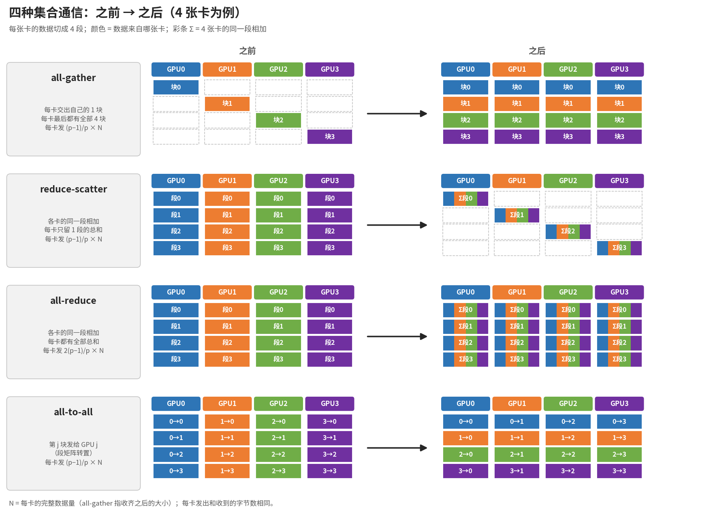
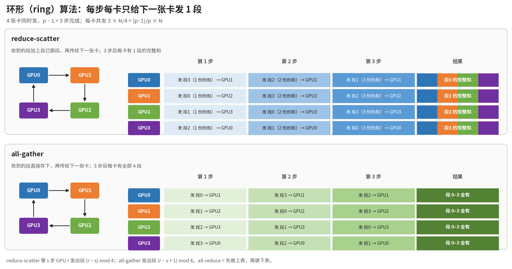
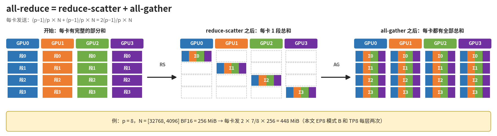
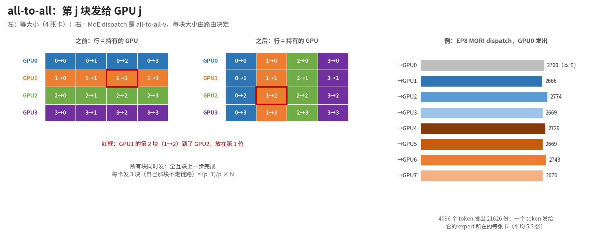
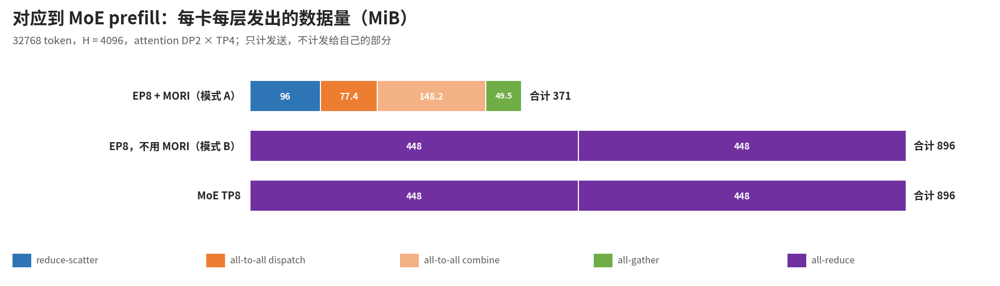

# 集合通信图解：all-gather、reduce-scatter、all-reduce、all-to-all

配合 [moe_ep8_prefill_wiki.md](moe_ep8_prefill_wiki.md) 第 3 节阅读。原理图用 4 张卡说明，MoE 的例子用 8 张卡（MI300X，32768 token，H = 4096）。

## 1. 一页总结



**段（块）是什么**：把每张卡上要通信的张量按行平均切成 p 份，其中一份叫一段。所有卡的张量形状相同，所以"第 j 段"在每张卡上都是同样的行，只是数值不同（各卡的部分和）。

```
8 卡 all-reduce，每张卡上的张量 [32768, 4096] BF16（256 MiB）按行切成 8 段：
行 0      4096     8192             28672    32768
  │  段0   │  段1   │  ...  │  段7   │
每段 = 4096 行 × 4096 列 × 2 B = 32 MiB
```

- reduce-scatter：8 张卡的"段 j"逐元素相加，结果只留在 GPU j 上，也就是第 4096j 到 4096j + 4095 这 4096 个 token。
- ring 算法每一步每张卡发 1 段，这里就是 32 MiB。
- 模式 A 的 attention TP4 reduce-scatter 把 [16384, 4096] 切成 4 段，每段 4096 行，这就是"每卡 4096 个 token"的来历（SGLang 用 `tensor_split(attn_tp_size)[attn_tp_rank]` 取本卡那段）。
- 图里 all-gather、all-to-all 的"块"也是 1/p 份；all-to-all 的块按目标卡划分，第 j 块发给 GPU j。

| 操作 | 每卡之前 | 每卡之后 | 每卡发送量 | 本 MoE 里在哪用 |
|---|---|---|---|---|
| all-gather | 1 块（N/p） | 全部 p 块（N） | (p−1)/p × N | 模式 A：下一层 attention 前，DP 组内收回 16384 个 token |
| reduce-scatter | 完整的部分和（N） | 1 段的总和（N/p） | (p−1)/p × N | 模式 A：attention 之后，DP 组内每卡拿到 4096 个 token |
| all-reduce | 完整的部分和（N） | 完整的总和（N） | 2(p−1)/p × N | 模式 B 和 TP8：MoE 前后各一次，8 卡 [32768, 4096] |
| all-to-all | p 块，第 j 块要给 GPU j | p 块，第 i 块来自 GPU i | (p−1)/p × N | 模式 A：MORI dispatch 和 combine（all-to-all-v） |

- N 是每卡的完整数据量。每卡发出和收到的字节数相同。
- 没有标准的 "all-scatter"：
  - 和 all-gather 相对的是 reduce-scatter，它在分发前多了"相加"。
  - 普通的 scatter / gather 是一张卡（root）发给所有卡 / 从所有卡收，MoE 里没用到。
  - SGLang 的 `dp_scatter` 只是在本卡上按行取出本 DP 组的部分，不走链路。

## 2. ring 算法：reduce-scatter 和 all-gather



- 数据切成 p 段，p 张卡连成环。每一步每张卡只给下一张卡发 1 段，p 张卡同时发。
- reduce-scatter：收到的段加上自己的同一段，再往下传。p − 1 步后，每张卡有 1 段的完整和。
- all-gather：收到的段存下，再往下传。p − 1 步后，每张卡都有全部段。
- 每卡共发 (p − 1) × N/p。卡越多越接近 N，但不会超过 N。
- 全互联上也可以直接发：每卡同时把 N/p 发给其他 p − 1 张卡，一步完成，总字节数一样。

## 3. all-reduce = reduce-scatter + all-gather



- 先 reduce-scatter，再 all-gather，每卡发送 2(p − 1)/p × N，约为数据量的 2 倍。
- p = 8、N = 256 MiB 时，每卡发 448 MiB。
- 数据很小时（例如 decode）常用 one-shot：每卡直接读其他所有卡的数据再相加。只要一步，延迟低，但每卡要收 (p − 1) × N，数据大时不划算。

## 4. all-to-all



- 每张卡把第 j 块发给 GPU j，相当于把"卡 × 块"的矩阵转置。
- MI300X 8 卡是全互联（每卡 7 条 xGMI 链路），各块可以同时发。每卡发 (p − 1)/p × N，自己那块不走链路。
- MoE 用的是 all-to-all-v：每块大小不同，由路由决定。
  - dispatch：GPU0 的 4096 个 token 按 expert 所在的卡复制成 21626 份发出（右图）。
  - combine：方向相反，把结果送回来源卡并相加。
  - 只传真正有路由的 token，这是它比 all-reduce 省传输的原因。

## 5. 对应到 MoE prefill



| 方式 | 用到的通信 | 每卡每层发送 |
|---|---|---:|
| EP8 + MORI（模式 A） | reduce-scatter（4 卡）+ all-to-all dispatch、combine（8 卡）+ all-gather（4 卡） | 约 371 MiB |
| EP8，不用 MORI（模式 B） | all-reduce（8 卡）× 2 | 896 MiB |
| MoE TP8 | all-reduce（8 卡）× 2 | 896 MiB |

- 每一项怎么算见 [moe_ep8_prefill_wiki.md](moe_ep8_prefill_wiki.md) 3.6 和 3.7 节。
- 这些是按上面公式估算的字节数，不是实测时间：
  - 4 卡组内的通信每卡只用到 3 条链路，8 卡的能用 7 条；
  - 实际速度还取决于 RCCL、MORI 的实现，以及和计算的重叠。

图由 [images/collectives.py](images/collectives.py) 生成：`python docs/moe_942_ep8/images/collectives.py <字体目录>`，目录里要有 notofonts/noto-cjk 的 `NotoSansSC-{Regular,Medium,Bold}.otf`。
