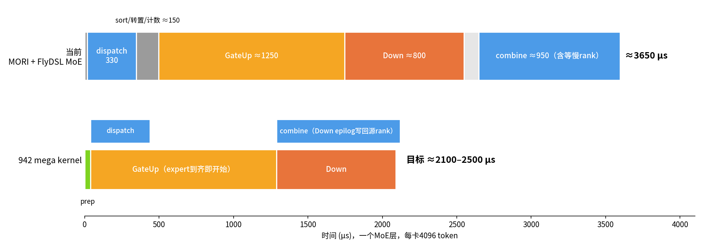
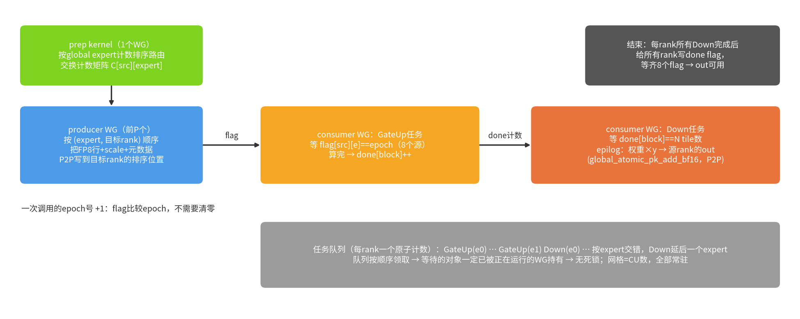

# MegaMoE（aiter）在EP下的优化思路，以及gfx942 EP8 mega kernel设计

适用：8×MI300X（gfx942），MiMo-V2.6-Flash MoE层（H=4096，I=2048，256 expert，top-8，每卡32个local expert），FP8 128×128 block scale。

参考代码：`/mywork/aiter`（ROCm/aiter main 51ca4216f）的`aiter/ops/flydsl/kernels/mega_moe/`，提交a060781a9“MegaMoEV2: fuse Dispatch, GEMM1, GEMM2 and Combine into one kernel”。

## 1. 结论

- 当前EP8一层MoE（每卡4096 token）总共约**3650 µs**：dispatch 330 + MoE 2280 + combine 950 + quant 18。通信和计算是串行的，GEMM主循环以外的部分占了约40%。
- MegaMoE的核心思路有三条：
  1. **通信写进计算kernel**：dispatch由producer WG直接P2P写到对端，GEMM2的epilog直接把结果写回源rank，没有单独的all2all kernel。
  2. **按到达顺序算**：数据一到就开始GEMM，靠flag同步，不等整个dispatch结束。
  3. **去掉中间步骤**：不在接收端再做一次sort，不经过host。
- 942上按同样思路做，预算是**约2100–2500 µs**，比现在快30%以上（时间减少31%–42%）。
- 实测（step 3，见5.5）：mega约**2450 µs**，同一进程里的基线约3540 µs，**快30–31%**。GPU在功耗墙下运行（5.6），再往下主要靠省能量。



## 2. 当前基线（实测）

测试脚本：[tests/contrib/moe/ep8/bench_ep8_mori_flydsl.py](../../tests/contrib/moe/ep8/bench_ep8_mori_flydsl.py)。

- 8卡torchrun，每卡4096个token，路由是256个expert里随机选top-8。
- 整条路径按sglang `moriep.py` 的方式调用：
  - 量化：per-1x128 FP8量化。
  - dispatch：MORI IntraNode，80 block × 16 warp，FP8数据加FP32 scale。
  - MoE：`aiter.fused_moe`，设`AITER_FMOE_FP8_BLOCKSCALE_FLYDSL=1`，走FlyDSL hook。
  - combine：MORI BF16，不带权重。
- 每卡收到约21700个token，对应约32700条local路由。

表中是各阶段中位数，单位µs，取8个rank里的最大值：

| MORI容量（每rank） | 接收buffer行数 | quant | dispatch | MoE | combine | 一层合计 |
|---|---|---|---|---|---|---|
| 4096 | 32768 | 19 | 332 | 2366 | 1002 | **3674** |
| 8192 | 65536 | 19 | 444 | 2342 | 998 | 3702 |

说明：

- MoE这一项包括sort（约77）、a1_scale转置（39）、counts（12）、zero（21）、GateUp和Down。
- 8卡同时跑时，MoE约2.25–2.37 ms，比单卡测的2.01 ms慢。原因是各rank进度不一样，combine要等最慢的rank。
- 容量16384（接收buffer 131072行）时，FlyDSL hook会回退到asm：a2中间结果约2.16 GB，超过buffer描述符2 GB的上限。这时MoE约3.1 ms。所以基线取容量4096。

### 2.1 P2P能跑多快（实测）

脚本：[tests/contrib/moe/ep8/p2p_microbench.py](../../tests/contrib/moe/ep8/p2p_microbench.py)。8卡同时做all-to-all，第r行写到第(me+r)%8卡。

| 测试 | WG数 | 时间 µs | 每卡带宽 GB/s |
|---|---|---|---|
| put 4 KB行，88.6 MB（dispatch量） | 32 / **64** / 304 | 489 / **284** / 328 | 181 / **312** / 271 |
| put 8 KB行，267 MB（按路由combine） | 32 / **64** / 304 | 1391 / **801** / 933 | 192 / **334** / 287 |
| 远端 `global_atomic_pk_add_bf16`，267 MB | 128 / **304** / 1216 | 1253 / **788** / 818 | 214 / **339** / 327 |
| 本地 `global_atomic_pk_add_bf16`（对照） | 304 / 1216 | 449 / 207 | 595 / 1291 |

结论：

- 每卡all-to-all写带宽上限约330 GB/s，64个WG就能跑满。WG再多反而略降。
- 远端BF16原子加和普通store一样快：304个WG时达到339 GB/s。所以combine可以直接用原子加写到源rank，不需要在源rank上再做一次reduce。
- 由此算出通信本身要多久：
  - dispatch约280 µs。MORI实测330 µs，已经接近这个下限，靠单独优化dispatch收益不大。
  - 按路由的combine约800 µs，和Down的计算时间（约715 µs）差不多。
  - 所以必须让通信和计算重叠，不能指望把通信单独做快。

## 3. MegaMoE V2做了什么

### 3.1 kernel结构

主路径一共3个kernel：

1. **prepare kernel**
   - BF16 → FP8量化（gfx950上是MXFP，1×32 E8M0 scale）。
   - 统计“每个(目标rank, expert)有多少条路由”，写成计数矩阵`COUNT_MATRIX`。
   - 把计数矩阵P2P发给所有rank。
2. **fused Stage1（persistent）**：dispatch和GEMM1（gate+up、SiLU、再量化）在一个kernel里。
   - 前`num_dispatch_cu`个WG是producer，例如32个。它们把token行P2P写到目标rank，写完就转去做GEMM。
   - 其余WG是consumer，从原子工作队列里领GEMM1 tile。
3. **Stage2**：GEMM2加上`p2p_scatter_epilog`。
   - epilog里每行乘上路由权重，P2P写回源rank的combine输入buffer。每个(token, slot)占一个位置，格式是BF16，或1×32 FP8。
   - 源rank再把top-k个slot加起来。

大M路径（`AITER_MEGA_LARGE_M`）把dispatch、GEMM1、GEMM2、combine合成**一个persistent kernel**。量化仍然是单独的kernel。

- GEMM2的每个m block所有n block做完以后，由最后完成的WG给源rank的`tok_ready[token]`做一次系统级原子加。
- 源rank在同一个kernel里等`tok_ready`到齐，再把top-k个slot累加成BF16（见`_c_accum_step`）。

### 3.2 通信方式

- 用`mori.shmem`的对称堆。每块buffer在每个rank上大小、偏移都一样：
  - 用`mori_shmem_create_tensor`分配。
  - 用`shmem_ptr_p2p(ptr, me, peer)`拿到对端地址，做成一个8项的i64指针表传给kernel。
- 采用push模式：发送方直接store到接收方显存，接收方不需要拷贝。
- 计数矩阵、tile计划、ready flag全部在device上算，不需要host同步。所以整个流程能被CUDA graph捕获。

### 3.3 dispatch和GEMM1的重叠

- 接收端每个tile有一个`TILE_READY`计数。producer写完一段payload就做一次release，再把计数加1。
- consumer等计数到期望值再开始算这个tile。
- compact模式下还有一个ready-order队列：哪个tile先到齐就先排进队列，consumer按这个顺序领。
- 效果：GEMM1不用等整个dispatch结束，只等它自己要用的那部分数据。

### 3.4 GEMM2和combine的重叠

- combine不是单独的kernel，而是GEMM2每个tile的epilog的一部分：
  1. CShuffle到LDS。
  2. 乘路由权重。
  3. 按行查出源rank和源token。
  4. 用`buffer_store`直接写到源rank。
- 写对端的store用cache modifier 19（sc0 sc1 nt，系统级一致的写穿透）。所以每个wave只需要`s_waitcnt vmcnt(0)`，再做一个workgroup范围的release，加一次barrier，就可以发flag。不用每个tile都把L2写回一次。
- 后面tile的计算可以掩盖前面tile写回的延迟。

### 3.5 同步

源码在`communication_ops_utils.py`：

- 跨卡flag：
  - 写flag用系统范围（`one-as`）的release store或原子加。
  - 读flag用volatile monotonic load做自旋，每轮`s_sleep(1)`，读到之后再做acquire。
- epoch和计数器：
  - 每次调用翻转一个parity。flag和期望的计数都带着parity，所以不用在两次调用之间清零。
  - 最后完成的WG负责把计数器减回0（“closer self-clears”）。
  - 这样CUDA graph可以直接重放。
- 不死锁的条件：
  1. 网格大小等于CU数，所有WG同时常驻。
  2. 工作队列用原子领取，领不到就退出，不会在队列上自旋。
  3. producer不等待任何consumer。

### 3.6 收益（bench里的PERF_GUARD）

对照组是online MORI dispatch + fused_moe + MORI combine，模型参数是DeepSeek-V4（7168/3072，384 expert，top-6，EP8）。表中是bench要求的最低加速：

| 场景 | 最低加速 |
|---|---|
| decode 512 token，均匀路由 | 2.4×（+140%） |
| decode 512 token，rank混合倾斜 | 2.1×（+110%） |
| prefill 8192 token，均匀路由 | 1.5×（+50%） |
| prefill 8192 token，倾斜路由 | 1.4×（+40%） |

### 3.7 不能直接用在942上的地方

- GEMM用的是gfx950的scaled MFMA（FP8×FP4，E8M0 scale），量化格式是MXFP（a8w4、a4w4）。我们的是128×128 FP32 block scale。
- small-M和large-M两条路径都要求256个CU。主路径没有为gfx942调过参数。
- aiter main要求FlyDSL 0.4.2。这台机器系统里装的是0.3.2；pyhip的kernel在0.3.2和0.4.0上都能编译。
- 结论：只借鉴思路和同步方式，GEMM主循环继续用pyhip现有的GateUp和Down LDS kernel。

## 4. 942 EP8 mega kernel设计



### 4.1 数据放在哪里（按路由、按expert排好）

每个目标rank上，第e个local expert占一段连续的行，起点按256行对齐：

- `base_e = Σ_{e'<e} ⌈n_{e'}/256⌉·256`，其中`n_e`是所有源rank发给expert e的路由数之和。
- 源rank s的路由排在`base_e + Σ_{s'<s} C[s'][e]`开始的位置，`C`是计数矩阵。

发送方按路由逐行写到目标rank的对应位置，一条路由写一行：

| buffer（对称堆） | 每行内容 | 写的人 |
|---|---|---|
| `recv_a [S, 4096] FP8` | token的FP8行 | 源rank的producer |
| `recv_scale [S, 32] f32` | 按token存的1×128 scale，GateUp直接读这个布局，不用再转置 | 源rank的producer |
| `down_ids [S] i32` | `(src_rank·Tcap + src_token) | slot<<24` | 源rank的producer |
| `recv_w [S] f32` | 路由权重 | 源rank的producer |
| `gu_ids [S]`、`expert_ids [S/256]`、`num_valid` | GateUp用的行号（就是行的位置），padding行标成无效 | 目标rank自己，用计数矩阵算出来 |
| `flag[src][e]` | 本次调用的epoch号 | 源rank写完(e, 目标rank)这一段之后写 |
| `out [Tcap, 4096] BF16` | 源rank自己的输出，在prep里清零 | 各目标rank的Down用原子加写进来 |

为什么按路由发，不按token去重：

- **代价**：dispatch的数据量从89 MB变成134 MB，P2P时间从约280 µs变成约400 µs。但这段时间和GateUp重叠，大部分被掩盖。
- **好处**：
  - 每一段(src, expert)的数据都是独立的。写完一段就能发一个flag，不需要等别的段，也就不需要跨WG排序。
  - GateUp读的A行是连续的，接收端不用再sort。
  - 原来的sort、a1_scale转置、counts、zero四个kernel（约150 µs）都不需要了。
- 对齐要求：每个expert的起点按256行对齐。这样不同expert的数据不会落在同一个cache line里。前一个expert读进L2的行，不会把后一个还没写到的数据一起缓存成旧值。

### 4.2 kernel划分

1. **prep kernel**（每rank 1个WG，约20–40 µs）
   - 按global expert对本rank的32768条路由做计数排序。
   - 把`out`清零，再做系统范围的release。
   - 把本rank那一行计数`C[me][256]`写到所有rank，然后写flag。
   - 等齐另外7个rank的行。
   - 算出本rank的`gu_ids`、`expert_ids`、`num_valid`，以及自己发往每个(目标rank, expert)段的起始位置。
2. **mega kernel**（persistent，网格 = 304 CU，每CU 1个WG，64 KB LDS）
   - **producer**（前P个WG，P≈64）
     - 按(expert, 目标rank)的顺序写数据，expert 0先发给所有rank。这样每个rank都能尽早开始算。
     - 写完一段：`s_waitcnt vmcnt(0)`，WG barrier，系统范围release，然后写`flag[me][e] = epoch`。
     - 发完以后转去做consumer。
   - **consumer**：从本rank的原子队列里领任务。队列顺序是：
     ```
     GateUp(e0)，GateUp(e1)，Down(e0)，GateUp(e2)，Down(e1)，…
     ```
     Down比GateUp晚一个expert，这样combine流量能分散在整个kernel里，不会全挤在最后。
     - GateUp任务：先等8个`flag[s][e] == epoch`，再按原来的流程算，算完把`done[block]`加1。
     - Down任务：先等`done[block] == N tile数`。epilog把结果乘上权重，用`global_atomic_pk_add_bf16`直接加到源rank的`out`里，地址 = 指针表[src_rank] + src_token·H·2。
   - **收尾**
     - 本rank所有任务完成后，由最后一个完成的WG写回L2，然后给所有rank写`done_flag = epoch`。
     - 再等齐8个rank的`done_flag`，kernel结束，这时`out`就可以用了。

### 4.3 为什么不会死锁

- 网格不超过CU数，每个CU只放1个WG（64 KB LDS），所以所有WG都同时常驻。前提是同一时间没有别的进程占用这块GPU。
- producer只往外写，不等待任何东西。
- consumer按队列顺序领任务。每个任务要等的东西只有两类：
  - GateUp等的是别的rank上producer写的数据。producer一定会写完。
  - Down等的是同一个rank上更早被领走的GateUp任务。这些任务已经在某个正在运行的WG手里，而GateUp本身不会等Down。
  - 所以等待关系里没有环。

### 4.4 内存一致性（gfx942）

- 写对端的数据用sc0 sc1，写到系统一致的位置。flag的store用系统范围release。
- 对端写进来的数据不经过本卡的L2，所以本卡L2里可能还留着上一次调用的旧行。处理方法：
  - 每次调用开始时，每个WG先做一次`buffer_inv sc1`。
  - 在本次调用里，等到flag之后才去读这些行。
  - 因为每个expert的起点按256行对齐，“读的时候把还没写到的行一起缓存成旧值”的情况不会出现。
- `out`由各目标rank用远端原子加写入，所以源rank在发计数之前，要先把清零写回内存（`buffer_wbl2 sc0 sc1`）。
- 上面这几点都要用“连续多次调用、每次换输入”的测试来验证。

### 4.5 时间预算

| 项 | 现在 µs | mega kernel µs | 说明 |
|---|---|---|---|
| quant | 19 | 19 | 仍然用aiter的per-1x128量化（后面可以合进producer） |
| dispatch | 332 | 约0（被掩盖） | 400 µs的P2P在GateUp计算期间进行，只露出第一个expert到齐前的几十µs |
| sort / 转置 / counts / zero | 约150 | prep 20–40 | 由计数矩阵直接算出位置 |
| GateUp | 约1250 | 约1160–1250 | 不变 |
| Down + combine | 约800 + 1002 | 约800–900 | combine的800 µs P2P和Down重叠，Down可能被带宽拖慢一些 |
| 等最慢的rank | 包含在combine里 | 收尾barrier | 仍然存在 |
| **合计** | **3674** | **约2100–2500** | 时间减少32%–43%，即1.47×–1.75× |

### 4.6 分步实现

1. **step 1（不重叠，先保证正确）**
   - prep kernel，加上一个独立的dispatch kernel。
   - GateUp改成直接读按token存的scale。
   - Down的epilog改成远端原子加，再加收尾barrier。
   - 去掉了MORI、sort、转置、combine，预计约2.4 ms。
2. **step 2**：把dispatch并进persistent的GateUp，用producer/consumer加flag。预计约2.1 ms。
3. **step 3**：GateUp和Down合成一个persistent kernel，任务交错，combine流量均匀分布。

## 5. 当前进度

- [x] MegaMoE分析
- [x] 基线和P2P实测
- [x] step 1：结果正确，但比基线慢。下面是实测和原因。
- [x] step 2：没有单独做，直接并进了step 3。
- [x] step 3：一个persistent mega kernel，**比基线快约30–31%**（5.4–5.6）。

### 5.1 step 1实测（8卡，每卡4096 token）

代码：

- [src/contrib/flydsl/ep_moe_gfx942.py](../../src/contrib/flydsl/ep_moe_gfx942.py)
- [src/contrib/flydsl/ep_moe_comm_gfx942.cpp](../../src/contrib/flydsl/ep_moe_comm_gfx942.cpp)
- GateUp新增`a_scale_token_major`。
- Down新增`remote_token_shift`和`moe_down_remote_a8w8_blockscale_gfx942_lds`。

运行：
```
torchrun --nproc_per_node=8 tests/contrib/moe/ep8/bench_ep8_mori_flydsl.py --mode both
```

正确性：

- 和基线（MORI + FlyDSL）比，8个rank的calc_diff都约为8.6e-6，最大绝对误差0.5–0.75（输出绝对值最大约70）。
- 这个误差和BF16原子加的顺序误差同一量级：基线自己重复跑一次，差异也有0.25–0.5。
- 连续多次调用、每次换数据，结果都正确，没有出现读到旧数据的情况。

单GPU验证：

- GateUp读按token存的scale，结果和读转置scale逐位相同，耗时也一样（1330 µs）。
- Down的远端模式把地址表指向本地时，结果和本地原子加一致（calc_diff 5.7e-8），耗时739 µs，本地原子加是720 µs。

8卡实测，各阶段中位数取8个rank里的最大值，单位µs：

| | prep | dispatch | GateUp | Down + combine | 等齐（finish） | 一层合计 |
|---|---|---|---|---|---|---|
| step 1 | 130–178 | 700 | 1530–1660 | 1560–1915 | 6–500 | **≈4550** |
| 对照：Down只加到本地（结果不对，只用来看时间） | | | | 784 | | |
| 基线 MORI + FlyDSL | | 332 | MoE 2266 | combine 923 | | **≈3550** |

### 5.2 结论：分开的kernel赢不了

**Down + combine**

- 远端原子加使Down从784 µs变成约1700 µs。
- 按路由的combine要传267 MB，带宽上限下也要约790 µs，和Down的计算时间差不多。
- 在gfx942上，load和store/atomic共用同一个`vmcnt`计数器。下一个tile的K循环一旦等`vmcnt`，就要等前面的远端原子加完成。gfx950也一样（都是GFX9）；只有gfx12（gfx1250）有单独的`storecnt`。aiter MegaMoE在gfx950上也是每个GEMM2 tile结束时`s_waitcnt vmcnt(0)`，把远端写全部等完再发flag。
- 非persistent的kernel里，WG在原子加完成之前也让不出CU。
- 所以这一段通信和计算基本是串行的。

**dispatch**

- 按路由发送要传134 MB，测得700 µs。
- 它没有和计算重叠，全部暴露在时间线上。

**能不能先把单个kernel做快**

- 把它们单独做快也赢不了基线：dispatch最多约430 µs，token级combine最多约520 µs。
- 通信总量（约0.9–1.2 ms）和计算（约1.9 ms）在同一个量级。只有让通信藏到计算后面，才能比基线快30%。

### 5.3 下一步（step 2/3要解决的问题）

1. **dispatch和GateUp放进同一个kernel**
   - 前P个WG先按“expert优先”的顺序发送，每个expert在目标rank上有一个计数。
   - 发送方每写完一段数据：先做系统范围的release，再对计数做远端原子加，加的值是这段的路由数。
   - GateUp任务等到这个计数等于`n_e`，再开始计算。
2. **GateUp和Down放进同一个persistent kernel，任务交错排列**
   - 这样combine流量分布在整个约2 ms的时间里，平均只需约200 GB/s（上限约330）。
3. **把远端写和GEMM的`vmcnt`分开**
   - 做法：Down的epilog先把加权结果写到本地，由专门的sender WG去做远端原子加。
   - 代价：本地多读写一次，约267 MB，并占用少量CU。
   - 也可以考虑：先在本地按token归约，再发送（流量降到177 MB）；或者像MegaMoE那样用FP8发送combine数据（流量减半，但数值会变）。
4. **prep并行化**：现在是单个WG，130–178 µs。改成多个WG，并把out清零也放进去。
5. **GateUp变慢的原因还没查清**：8卡并发时比单卡慢（1600 vs 1330 µs）。基线的MoE在8卡并发时也比单卡慢约11%。（step 3里查清了：是功耗墙降频，见5.6。）

### 5.4 step 3实现

代码：[src/contrib/flydsl/ep_moe_mega_gfx942.py](../../src/contrib/flydsl/ep_moe_mega_gfx942.py)，`ep_prep`/`ep_plan`在[ep_moe_comm_gfx942.cpp](../../src/contrib/flydsl/ep_moe_comm_gfx942.cpp)。

每次调用3个kernel：`ep_prep`（1个WG，交换计数、算各expert的起点）→ `ep_plan`（每个producer wave一个slice，排好发送顺序、写`gu_ids`/`expert_ids`/每个block的期望路由数）→ mega kernel。和第4节设计不同的地方，以及每一步的效果：

| 做法 | 为什么 | 效果 |
|---|---|---|
| 每个XCD一个任务队列（8个），队列里是连续的一段block；先领本XCD的队列，空了再去别的队列领 | 一个block的16个GateUp tile在同一个XCD的L2里共享A | |
| 相邻两个同expert的block为一对，GateUp tile按“block0 tile0, block1 tile0, block0 tile1…”交替 | 两个block同时读同一个B tile，B在L2里共享 | G_run 230 → 165–185 µs |
| Down比GateUp晚`lag=2`组 | combine流量分散到整个kernel | |
| 到达计数按block（每256行一个），不是按(src, expert) | GateUp只等自己这个block的约2个源的数据 | |
| 每个block的行按源rank交错排列；发送顺序按“目标队列里第几个block”排，同一个key里混合不同目标rank | 每个block的数据尽早到齐，链路负载均匀 | G_wait 30 → 13–20 µs；P_run回到约400 µs |
| relaxed同步：GateUp写a2用sc1（写穿透），两种等待只invalidate L1（`buffer_inv sc0`） | 等的数据都在本卡显存，本卡L2对本卡显存由probe保持一致，不需要每个任务写回/失效整个L2 | GateUp快约7% |
| 领票前先用普通load看8个队列计数，只对还有票的队列做原子加 | 空WG对热点计数器做原子加会严重拖慢正在运行的任务 | 省约700 µs |
| `ep_plan`改成多WG | 单WG的prep在计数交换后还要90–120 µs | kernel启动延迟约15 µs |
| persistent：每CU 1个WG循环领票；每个任务从kernarg段重新读参数（经过不透明值） | 循环不变量会被LLVM提到循环外，寄存器溢出；重读后主循环和非persistent一样（712 / 745条指令） | 去掉WG重启间隙（3.6 → 0.3 µs） |
| 下一张票在当前任务的epilogue开头就领（原子加的结果到下个任务前才读） | 此时当前任务已经不再等任何东西，持票不会造成死锁；原子加的延迟藏在epilogue里 | 领票 6.5–9 → 2.9 µs |
| 领票、done计数的原子加只由lane 0做，地址经过一个不透明的VGPR | 否则LLVM的atomic optimizer会生成64步的循环，并立刻读回结果 | |

不会死锁的理由（4.3）在persistent下仍成立：一个任务只等同一队列里更早领走的票，或者等producer（producer不等任何东西）；而持有这些票的WG要么正在跑这个任务，要么当前任务已经进入epilogue、不会再等待，跑完就会去跑它。

### 5.5 step 3实测

运行（默认就是persistent；`--relaunch`是一个WG只跑一个任务的旧方式）：
```
torchrun --nproc_per_node=8 tests/contrib/moe/ep8/bench_ep8_mori_flydsl.py --mode both --iters 300 --warmup 10
torchrun --nproc_per_node=8 tests/contrib/moe/ep8/bench_ep8_mori_flydsl.py --mode mega --check-alt   # 正确性
torchrun --nproc_per_node=8 tests/contrib/moe/ep8/trace_ep8_mega.py                                   # 任务时间线
```

正确性：和基线比calc_diff约8.9e-6，最大绝对误差0.5–0.75；和step 1在交替输入下比，calc_diff约1.2e-5。

同一进程里先跑基线再跑mega，各300次，取8个rank里最慢的那个，单位µs：

| | 基线 MORI + FlyDSL | mega | mega更快 |
|---|---|---|---|
| 第1次 | 3563.5 | 2458.4 | 31.0% |
| 第2次 | 3541.8 | 2469.6 | 30.3% |
| 第3次（最终默认参数） | 3534.2 | 2449.4 | 30.7% |

参数扫描（只跑mega，300次）：

| 参数 | 结果 µs |
|---|---|
| lag = 1 / **2** / 3 | 2483 / **2449** / 2448 |
| producers = 8 / **16** / 24 | 2555 / **2449** / 2478 |
| relaunch / **persistent + 预领票** | 2488–2499 / **2466** |

trace（最终版本）：span 2090–2440 µs，CU忙碌比例0.93–0.95；每个GateUp任务约165–178 µs，Down约76–85 µs；GateUp平均等数据22–27 µs（主要是前500 µs）；领票约2.9 µs。

### 5.6 功耗墙

- 持续跑mega时，GPU 0的socket功耗736 W（上限750 W），GFX利用率97%，各XCD时钟只有约1150–1200 MHz（最高2100 MHz）。
- trace里用`s_memtime`（按当前核心时钟计数）记了每个任务跑了多少个时钟：一个GateUp任务约18.7万个时钟，基本不变；任务时间的差别几乎全部来自时钟高低（不同时段、不同GPU在960–1220 MHz之间）。
- 所以现在是**功耗墙限制**，不是延迟限制。几个直接后果：
  - 去掉空闲时间（persistent、预领票）只换来约1%：更忙 → 功耗更高 → 时钟更低。
  - 把dispatch做快反而更慢：试过让上一块的store和下一块的load重叠，P_run 420–460 → 350–372 µs，但总时间从2460变成2490 µs。前500 µs里GateUp和更快的producer争内存带宽和功耗。
  - 8卡同时跑比单卡慢（5.3第5条），也是这个原因。
- 剩下能做的主要是省能量，而不是省时间：
  - dispatch按(token, 目标rank)去重：top-8分到8个rank，平均每个token只到约5.25个rank，xGMI数据量减少约34%。
  - GateUp/Down主循环本身的能耗（MFMA以外的VALU反量化、LDS读）。
  - rank间负载不均（这次的路由下148 vs 139个block），加上不同GPU在功耗墙下的时钟不同，最慢的rank决定总时间。


重新生成图：`python docs/moe_942_ep8/images/mega_moe.py /tmp/fonts`。
