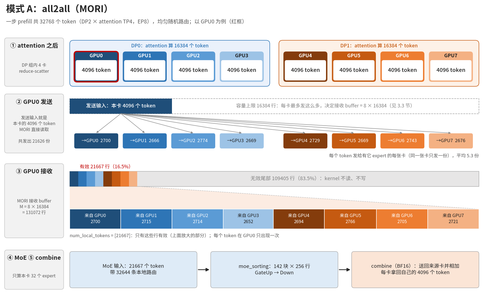
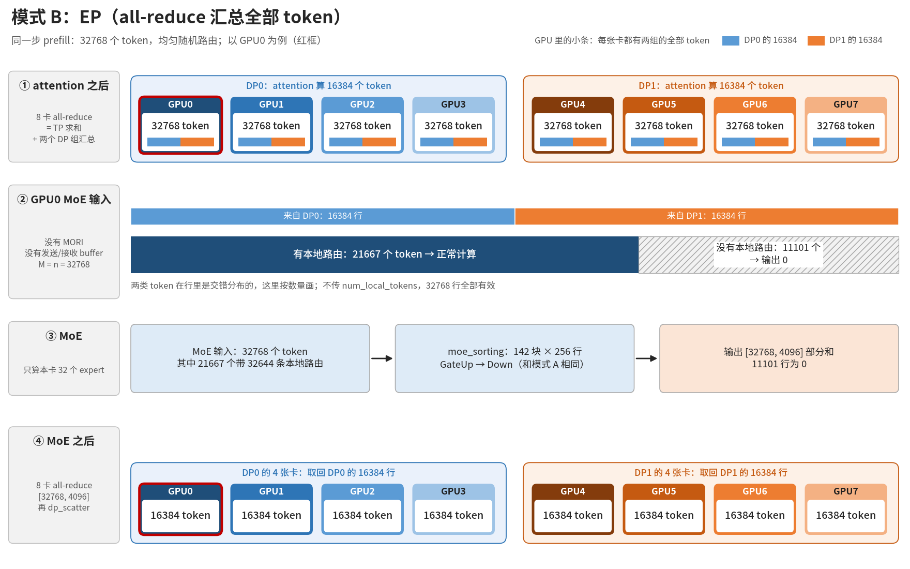
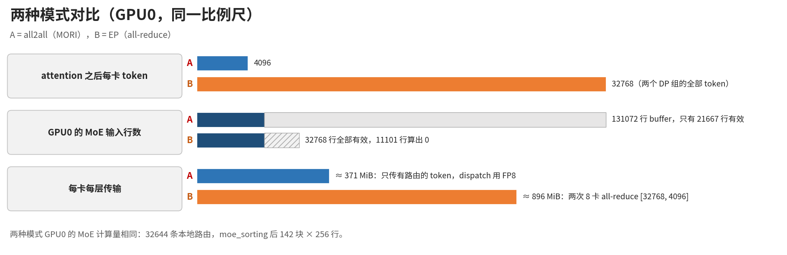
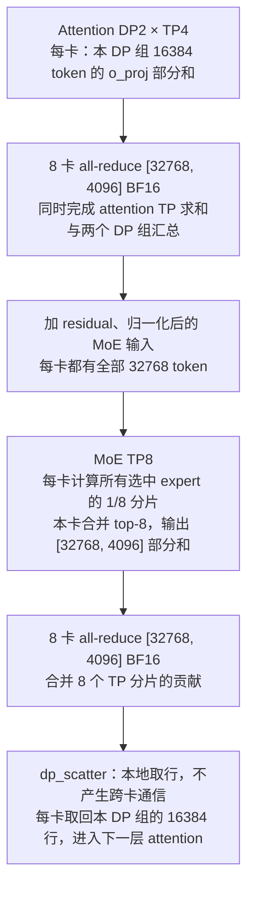

# MiMo-V2.6-Flash EP8 prefill MoE：EP 两种模式、有效 token 与 FlyDSL kernel

适用：8×MI300X（gfx942），SGLang 0510（`mimo-opt-mxfp4-dflash`），aiter `integration/mimo-fp4-dflash`，pyhip FlyDSL MoE（`AITER_FMOE_FP8_BLOCKSCALE_FLYDSL=1`，FlyDSL 0.3.2）。只讲 prefill。kernel 本身的优化过程见 [moe_a8w8_blockscale_gfx942.md](moe_a8w8_blockscale_gfx942.md)。

全文用同一个例子：**一步 prefill 共 32768 个 token，路由均匀随机**。没有特别说明时，数字都是 GPU0 的。

1. 一页总结
2. 示例场景
3. EP 两种模式及 TP8 对比
4. expert_mask 与 num_local_tokens
5. moe_sorting：输出、大小、num_valid_ids、怎么识别有效
6. token 经过每个 kernel 的变化
7. 无效数据怎么读写
8. 任务划分
9. buffer 大小
10. 性能
11. 开关与注意事项
12. 每个 kernel 一张图
13. 附录：数字怎么算

## 1. 一页总结

```
32768 token ─▶ 每卡 4096 ─MORI dispatch─▶ GPU0 收到 21667 个（放在 131072 行的 buffer 里）
  ─▶ 32644 条本地路由 ─sort─▶ 142 块 × 256 行 ─GateUp─▶ a2 ─Down─▶ out 前 21667 行 ─combine─▶ 送回各卡
```

- EP8：256 个 expert 分到 8 张卡，每卡 32 个。
- EP 有两种模式：
  - **all2all**（MORI，本部署用的）：把 token 送到 expert 所在的卡。
  - **EP**：每卡拿到两个 DP 组的全部 token（attention 输出加 residual，用一次 8 卡 all-reduce 汇总），只算本卡的 expert，最后再做一次 8 卡 all-reduce。

  两种模式下每卡 MoE 的计算量一样（32644 条路由）。
- MORI 的接收 buffer 按容量分配（8 × 16384 = 131072 行），实际最多只会收到 32768 个 token（见 3.3），这一步只有前 21667 行有效。aiter 靠两个输入区分有效数据：
  - `num_local_tokens`：前 n 行是有效 token。
  - `expert_mask`：哪些 expert 在本卡。
- `moe_sorting` 把本地路由按 expert 排好，每个 expert 补齐到 256 行的倍数，输出 `num_valid_ids = [36352, 21667]`，即前 36352 个排序行（142 块）有效。
- kernel 在 GPU 上读 `num_valid_ids` 决定做多少。补齐行读到 0、不写输出；buffer 尾部完全不读写。
- 性能（整次 `aiter.fused_moe`）：base asm 3019 µs → FlyDSL 2067 µs（1.46×）。buffer 截到 32768 行时 FlyDSL 为 2013 µs。
- MoE 改成 TP8、attention 仍为 DP2×TP4 时，当前 prefill 路径的估算传输量与模式 B 相同，约为 MORI 模式 A 的 2.4 倍；这不是实测耗时比（见 3.7）。

## 2. 示例场景

| 项 | 值 |
|---|---|
| GPU | 8 × MI300X，每卡 304 个 CU |
| SGLang 启动参数 | `--tp-size 8 --dp-size 2 --enable-dp-attention --ep-size 8 --moe-a2a-backend mori --moe-runner-backend aiter` |
| MoE 层 | 256 个 expert，top-8，H = 4096，I = 2048。权重 FP8，每 128×128 一个 scale（加载时由 MXFP4 转换，`SGLANG_MXFP4_TO_FP8_128BLOCK=1`） |
| EP8 | GPU r 拥有 expert [32r, 32r+32)，GPU0 是 expert 0..31 |
| 一步 prefill | `CHUNKED_PREFILL_SIZE=32768`，每个 DP 组 16384。模式 A 下 attention 之后在 DP 组内 reduce-scatter，每卡 4096 |
| 路由 | 均匀随机 top-8（`PERFORMANCE_MODE=1`，即 `--ep-dispatch-algorithm fake`） |
| MORI | 容量按每卡 16384 个 token 分配（`SGLANG_MORI_NUM_MAX_DISPATCH_TOKENS_PER_RANK`），本配置实际每卡最多发 4096 个（见 3.3）；FP8 dispatch，BF16 combine |

| 量（GPU0） | 实际 | 理论期望 |
|---|---:|---:|
| 收到的 token 数 n | 21667（66.1%） | 32768 × 66.2% = 21687 |
| 本地路由数 R | 32644 | 32768 × 8 / 8 = 32768 |
| 每个本地 expert 的路由数 | 939–1099 | 1024 |
| 只有 1 条本地路由的 token | 13111（60.5%） | |
| 有 2 条及以上本地路由的 token | 8556（39.5%），合计 19533 条路由 | |

- 66.2% 的来历：一个 token 的 8 个 expert 都不在 GPU0 的概率是 C(224,8)/C(256,8) = 33.8%，所以 GPU0 收到它的概率是 66.2%。为什么收到的 token（21667）比路由（32644）少、具体怎么算，见 3.2 节。
- 其他卡与 GPU0 相差不到 ±1.5%。
- 路由用 pyhip 测试里的 `make_routes(..., "random", seed 0)` 生成（见附录），和第 10 节的基准测试是同一组。

## 3. EP 两种模式及 TP8 对比

### 3.1 EP 是什么

- 每张卡只放 1/8 的 expert 权重。
- 一个 token 选 8 个 expert，平均落在 5.3 张卡上（8 × 66.2%）。
- 有两种做法：
  - 模式 A：把 token 送到 expert 所在的卡。
  - 模式 B：每张卡都拿到全部 token，只算自己的 expert，最后把各卡结果相加。







- 三张图都由 [images/ep8_modes.py](images/ep8_modes.py) 生成，数字和本文场景一致。重新生成：`python docs/moe_942_ep8/images/ep8_modes.py <字体目录>`，目录里要有 notofonts/noto-cjk 的 `NotoSansSC-{Regular,Medium,Bold}.otf`。
- 模式 A：每卡 attention 之后的 4096 个 token 就是 MORI 的发送输入，MORI 直接读取并写到目标卡，GPU0 共发出 21626 份。
  - 16384 只是每卡输入的上限，它决定了接收 buffer 的大小（见 3.3）。
  - GPU0 的接收 buffer 有 131072 行，只有前 21667 行有效。每行一个 token，先后顺序由 MORI 决定，不按 expert 排（见 6 节）。
- 模式 B：没有 MORI。attention 之后每卡都拿到两个 DP 组的全部 32768 个 token，其中 11101 个在 GPU0 上没有 expert，结果为 0。MoE 之后再做一次 8 卡 all-reduce，每卡取回本 DP 组的 16384 行。

### 3.2 模式 A：all2all（MORI）

1. attention 的 o_proj 按行切分，每卡先得到本 DP 组 16384 个 token 的部分和。DP 组内 4 卡做 reduce-scatter，每卡拿到 4096 个 token 的完整结果，加 residual、做 layernorm。
2. router 给这 4096 个 token 各选 8 个 expert，用的是全局 id。
3. dispatch：token 发给拥有它某个 expert 的每张卡，每张卡只发一份。
   - 发送前量化成 FP8，每 128 个数一个 FP32 scale（`SGLANG_MORI_DISPATCH_DTYPE=fp8`）。
   - 每个 token 4096 B + 32 × 4 B ≈ 4.2 KB，是 BF16 的一半。
   - 收到后直接作为 MoE 的 FP8 输入（a1 和 a1_scale [M, 32]），不用再量化。
4. 每卡在接收 buffer 上算 MoE。只算本地 expert 的路由，并按路由权重加权求和。
5. combine：结果送回来源卡，同一个 token 从各卡回来的结果相加。
   - 用 BF16 发送（`SGLANG_MORI_COMBINE_DTYPE=bf16`），每个 token 8 KiB。
   - 用 BF16 是为了精度：这些部分和还要再相加。MORI 也支持 FP8 combine（数据减半），本部署没有用。
   - 下一层 attention 之前，再在 DP 组内 all-gather 回 16384 个 token。

下图按 token 0..4095 在 GPU0 统计：

```
GPU0 发出（4096 个 token，共 21626 份）
  → GPU0 2700 · GPU1 2666 · GPU2 2774 · GPU3 2669 · GPU4 2729 · GPU5 2669 · GPU6 2743 · GPU7 2676

GPU0 收到（共 21667 个 token）
  ← GPU0 2700 · GPU1 2715 · GPU2 2714 · GPU3 2652 · GPU4 2694 · GPU5 2766 · GPU6 2705 · GPU7 2721
```

#### GPU0 实际收到的 token 是怎么算出来的

**规则**：

- 一个 token 只要有 1 个 expert 在 GPU0（id 0..31），就发给 GPU0 一份。
- 有几个 expert 在 GPU0 都只发一份，这几条路由一起带过去。
- 一个都不在就不发。

所以：GPU0 收到的 token 数 n = 32768 − "8 个 expert 都不在 GPU0 的 token 数"。

**发出去的是"份"，不是 token**

```
一个 token 的 8 个 expert：3、40、41、100、150、200、201、250
所在 GPU（id // 32）：      0、 1、 1、  3、  4、  6、  6、  7
→ 发往 6 张卡：GPU0、1、3、4、6、7（GPU1、GPU6 各一份，每份带 2 条路由）
→ 这一个 token 会被 6 张卡各收到一次
```

| 计数单位 | 8 张卡合计 | 每张卡 |
|---|---:|---:|
| token（每个只算一次） | 32768 | 发出前 4096 个 |
| 份（token × 目标卡，同一张卡只算一份） | 173,417 | 发出约 21.6K 份，收到约 21.7K 份（GPU0 收到 21667） |
| 路由（token × expert） | 262,144 | 约 32.8K 条（GPU0：32644） |

- 平均每个 token 发往 5.3 张卡（实际统计；期望 8 × 66.2% = 5.29），所以 32768 个 token 变成约 173K 份。
- 发出的总份数 = 收到的总份数 = 173,417，8 张卡平分，每张约 21.7K。
- "GPU0 收到 21667"就是 21667 个不同的 token，这些 token 同时也会被别的卡收到。所以 8 张卡收到的加起来远大于 32768。

**份数是数出来的，不是用概率算的**

- 每个 token 的份数，等于它 8 个 expert 所在的不同卡数（`expert id // 32` 去重），由 router 的结果决定。运行时 MORI 就是这样逐个 token 处理的。
- 一张卡发出的总份数，是它 4096 个 token 的份数之和。文档里的数字都是用同一组路由逐个 token 数出来的：

```
每个 token 发往几张卡（份数）     2     3      4      5      6      7     8      合计
全部 32768 个 token               6   535   5256  13660  10795   2422    94   173417 份
GPU0 的 4096 个 token             1    69    665   1732   1319    297    13    21626 份
```

- 概率只用来算平均应该是多少（期望值），以核对数字是否合理，例如期望每个 token 5.29 份、期望 GPU0 收到 21687 个。
- 真实路由（`PERFORMANCE_MODE=0`）不是均匀的，份数会不同，实际值以 MORI 返回的 n 为准。

**① 运行时：MORI 自己数**

- 每张卡对自己的 4096 个 token，用 `expert id // 32` 算出目标卡；同一个 token 去同一张卡只发一次。
- MORI 把收到的 token 依次放进接收 buffer 的前 n 行，并返回 n。
  - SGLang 里这个值叫 `num_recv_tokens_per_expert`，传给 aiter 就是 `num_local_tokens`。
  - n 只存在 GPU 上，每一步都不一样。

**② 本文的数字：按同一组路由逐个 token 数**

```python
ids, _ = make_routes(32768, 8, 32, 8, "random", torch.Generator().manual_seed(0))  # 每个 token 从 256 个 expert 里不重复地随机选 8 个
local = ids // 32 == 0       # [32768, 8]：这条路由的 expert 是否在 GPU0
cnt = local.sum(1)           # 每个 token 有几条路由在 GPU0
n = (cnt > 0).sum()          # 21667：至少有 1 条的 token 数
R = cnt.sum()                # 32644：GPU0 的本地路由数
```

按"8 个 expert 里有几个在 GPU0"把全部 32768 个 token 分类：

```
在 GPU0 的 expert 数   token 数（实际）  期望值    发到 GPU0       带到 GPU0 的路由
        0              11101         11081     不发                   0
        1              13111         13073     1 份          13111 × 1 = 13111
        2               6490          6506     1 份           6490 × 2 = 12980
        3               1743          1783     1 份           1743 × 3 =  5229
        4                292           294     1 份            292 × 4 =  1168
        5                 30            30     1 份             30 × 5 =   150
        6                  1             2     1 份              1 × 6 =     6
     合计              32768         32768     21667 个 token          32644 条路由
```

**③ 理论期望：用概率算**

```
一个 token 的 8 个 expert 都不在 GPU0 的概率
  = 从 224 个非 GPU0 expert 里选 8 个的方法数 / 从 256 个里选 8 个的方法数
  = C(224, 8) / C(256, 8)
  = 224/256 × 223/255 × 222/254 × 221/253 × 220/252 × 219/251 × 218/250 × 217/249
  = 0.3382                       （粗略估算：(7/8)^8 = 0.344）

期望收到 = 32768 × (1 − 0.3382) = 21687
按来源卡算：每张卡 4096 × 0.662 ≈ 2711 个发给 GPU0，8 张卡合计 21687
```

- 实际值 21667 和期望值 21687 的差别是随机波动，标准差约 √(32768 × 0.338 × 0.662) ≈ 86。8 张卡的实际值在 21508–21827 之间。
- 上表"期望值"一列 = 32768 × C(32, k) · C(224, 8−k) / C(256, 8)，k 是在 GPU0 的 expert 数。

**为什么不是 32768**

expert 均分的是路由，不是 token：

| 范围 | 路由数（期望） | GPU0 实际 | 不同的 token 数 |
|---|---|---:|---:|
| 1 个 expert | 32768 × 8 / 256 = 1024 | 939–1099 | 与路由数相同（一个 token 不会两次选同一个 expert） |
| 1 张卡（32 个 expert） | 1024 × 32 = 32768 | 32644 | 21667 |
| 8 张卡（256 个 expert） | 1024 × 256 = 262144 | — | 32768 |

- 一张卡上路由数和 token 数不同：一个 token 可能同时选中这张卡的好几个 expert，每条路由都算，但 token 只收一份。

每个 expert 分到的 token 数是一致的（都约 1024）。不一致的只是两种数法：按 expert 加起来，和按 token 去重。同一张卡上 32 个 expert 的列表有重叠：

```
GPU0 的 32 个 expert 各自的 token 列表（moe_sorting 输出的就是这些列表）：
  E0：1037 个   E1：1014 个   E2：1005 个   ...   E31：1058 个      合计 32644，每个约 1024

这些列表指向接收 buffer 里 21667 个不同的行：
  13111 行只出现在 1 个列表里
   6490 行出现在 2 个列表里（例如同一个 token 选了 E3 和 E17：buffer 里 1 行，两个列表里各 1 条）
   1743 行出现在 3 个列表里
    323 行出现在 4 个及以上列表里
```

- "均匀"指期望值相同。每个 expert 的实际数量服从二项分布（32768 次，每次概率 1/32），标准差约 31（±3%），所以 GPU0 上实际在 939–1099 之间。
- MORI 按 token 发：收到的 token 里有 39.5%（8556 个）有 2 条及以上路由在 GPU0，但每个只算 1 个 token。所以 21667 个 token 带着 32644 条路由，平均每个 1.51 条。
- 只有每个 token 在每张卡上都恰好有 1 个 expert 时，收到的 token 数才等于路由数 32768。均匀随机路由不保证这一点。
- 8 张卡合计收到约 173K 份 token：平均每个 token 发往 5.3 张卡，带着全部 262144 条路由。

接收 buffer 的样子：

```
MORI 接收 buffer：M = 8 卡 × 容量 16384 = 131072 行（实际最多收到 8 × 4096 = 32768 个）

行 0                 21667                                                 131072
   ├────── 有效 ──────┼──────────────── 无效尾部（不读、不写）─────────────────────┤
     n = 21667（16.5%）                      109405 行（83.5%）

同样是 131072 行的还有：a1_scale [M, 32]、topk_ids [M, 8]、topk_weights [M, 8]
有效行数 n 只存在 GPU 上：num_local_tokens = [21667]
```

### 3.3 MORI 容量为什么配置成 16384

结论：16384 是按"每个 DP 组一步最多 16384 个 token"定的，启动脚本和 SGLang 都要求至少这么大。但本配置下每卡实际最多只发 4096 个，容量 4096 就够了。

```
一步 prefill：32768 token
   ├─ DP0：16384 ─ attention 后 DP 组内 reduce-scatter ─▶ GPU0..3 各 4096 ─▶ dispatch
   └─ DP1：16384 ─ attention 后 DP 组内 reduce-scatter ─▶ GPU4..7 各 4096 ─▶ dispatch

每卡交给 dispatch 的 token ≤ 4096                → 容量 4096 就够
每卡最多收到 8 × 4096 = 32768 个（= 全局 token 数） → 接收 buffer 32768 行就够
实际配置：容量 16384 → 接收 buffer 8 × 16384 = 131072 行（大了 4 倍）
```

- 容量算的是每卡交给 dispatch 的 token 数，一个 token 不管发往几张卡都只算 1 个。本配置下每卡最多 4096 个。

**16384 是怎么来的**

1. 启动脚本（`evaluation/mimo_v26_flash/launch_mimo_v26_flash_dp2_tp4_ep8_dflash_accuracy_baseline.sh`）算出默认值，并检查下限：

```bash
effective_prefill_chunk=$((CHUNKED_PREFILL_SIZE / 2))                     # 32768 / 2 = 16384，每个 DP 组
verify_token_bound=$((MAX_RUNNING_REQUESTS * decode_tokens_per_request))  # 192 × 8 = 1536，DFlash 校验
mori_capacity_default=${effective_prefill_chunk}
if (( verify_token_bound > mori_capacity_default )); then                 # 取两者较大值：16384
  mori_capacity_default=${verify_token_bound}
fi
export SGLANG_MORI_NUM_MAX_DISPATCH_TOKENS_PER_RANK="${SGLANG_MORI_NUM_MAX_DISPATCH_TOKENS_PER_RANK:-${mori_capacity_default}}"
# 设得比 16384 或 1536 小时直接报错退出
```

2. SGLang 启动时也会检查（`python/sglang/srt/server_args.py`）：

```python
# _handle_data_parallelism()，先执行
self.chunked_prefill_size = self.chunked_prefill_size // self.dp_size   # 32768 // 2 = 16384
# _handle_a2a_moe()，后执行
assert self.chunked_prefill_size <= envs.SGLANG_MORI_NUM_MAX_DISPATCH_TOKENS_PER_RANK.get()
```

- SGLang 自己的默认值是 4096（`environ.py`），在本配置下过不了这个检查，所以启动脚本必须设成至少 16384。
- 指南原文也是这么写的："the global prefill chunk is 32768, giving 16384 tokens per DP; the default MORI dispatch capacity is also 16384 tokens per rank"。

**为什么说它偏大**

- 两处检查都假设每卡要 dispatch 整个 DP 组的 token，没有再除以 attention TP 的 4。
  - attention TP = 1（例如 DP8）时确实如此，这个检查是紧的。
  - 本配置 attention TP = 4，MoE 的输入是 DP 组内 reduce-scatter 之后的 1/4，所以每卡最多 4096 个。
- 启动脚本对此有一句注释："Keep the conservative unscattered bound so graph padding fits the buffer."
  - 意思是作者有意保留不按 attention TP 切分的上界，让 CUDA graph（decode 和 DFlash 校验）的 padding 也放得下。
  - prefill 每卡最多发 4096 个是确定的；但改小容量之前，要先确认 graph padding 时每卡会发多少个 token。

**影响**

- MoE 看到的 M = 131072，其中至少 98304 行（3/4）永远用不到。
- a2 要按 131072 行准备（2 GiB）。
- MORI 自己按容量分配的 buffer 也大了 4 倍。

**怎么缩小**

1. 不改容量，设 `SGLANG_MORI_MOE_MAX_INPUT_TOKENS=32768`。只把交给 MoE 的部分截到 32768 行，不用改代码（见第 11 节）。MORI 自己的 buffer 不变。
2. 把容量设成 4096。接收 buffer 直接变成 32768 行，MORI 的显存也省 4 倍。但要先放宽 SGLang 和启动脚本的检查（例如改成 ⌈chunked_prefill_size / attention TP⌉），并确认 graph padding 也放得下，还没有试过。

decode 和 DFlash 校验每步的 token 更少：启动脚本按全局 192 × 8 = 1536 估算，不影响这个容量。

### 3.4 模式 B：EP（all-reduce 汇总全部 token）

```
attention：每个 DP 组的 4 张卡做 TP，o_proj 按行切分
   每卡得到本 DP 组 16384 个 token 的 o_proj 部分和（还没有在 4 卡间求和）
   │ attention TP 组的 rank 0 把 residual 加进自己的部分和
   │ dp_gather_partial：每卡把部分和写进全 0 的 [32768, 4096] buffer 中本 DP 组的位置，
   │                     然后 8 卡做一次 all-reduce
   ▼   这一次 all-reduce 同时完成两件事：
   │     ① 同一 DP 组 4 卡的部分和相加（就是 attention 的 TP all-reduce）
   │     ② 两个 DP 组的 token 拼在一起
每卡 [32768, 4096]：两个 DP 组全部 token 的"attention 输出 + residual"
   │ dp_scatter：取出本 DP 组的 16384 行，作为新的 residual
   │ 每卡各自对 32768 行做 post_attention_layernorm → MoE 输入（BF16）
   ▼
MoE：只算本卡 32 个 expert → [32768, 4096] 部分和（M = n = 32768）
   ├─ 21667 个 token 有本地路由   → 有值
   └─ 11101 个 token 没有本地路由 → 0
   │ 8 卡 all-reduce [32768, 4096]，再 dp_scatter 取回本 DP 组的 16384 行
   ▼
下一层：每个 DP 组的 4 张卡都有本组 16384 个 token
```

- 每卡拿到的"全部 token"，就是 attention 之后 all-reduce 的结果加 residual，再由每卡自己做 layernorm。
  - attention 的 TP all-reduce 没有单独做，而是和跨 DP 的汇总合成了一次 8 卡 all-reduce。
  - 每层共有两次 8 卡 all-reduce，每次是 [32768, 4096] BF16（256 MiB）。
- prefill 用 SUM_LEN 模式，就是上面的 all-reduce 写法。MAX_LEN 模式（decode 常用）下：
  - MoE 前改成 attention TP 组内 reduce-scatter，再 8 卡 all-gather。
  - MoE 后改成 reduce-scatter。
- SGLang 用 `--moe-a2a-backend none`（标准 dispatcher）时就是这种模式。不传 `num_local_tokens`，`expert_mask` 和模式 A 一样。
- 代码（SGLang）：
  - `layers/communicator.py`：`_gather_hidden_states_and_residual`（MoE 前）、`_scatter_hidden_states`（MoE 后）。
  - `layers/dp_attention.py`：`_dp_gather_via_all_reduce`。
  - `models/mimo_v2.py`：`forward_normal`。

#### 为什么 MoE 之后要 all-reduce

一个 token 的 MoE 输出是 8 个 expert 结果的加权和：`y[t] = Σ_k w[t,k] · E_{e[t,k]}(x[t])`。每张卡只有 32 个 expert 的权重，只能算自己那几项：

```
token t 的 8 个 expert：3、40、41、100、150、200、201、250（所在 GPU = id // 32）

GPU0：w·E3(x)
GPU1：w·E40(x) + w·E41(x)
GPU2：0（没有本地 expert）
GPU3：w·E100(x)
GPU4：w·E150(x)
GPU5：0
GPU6：w·E200(x) + w·E201(x)
GPU7：w·E250(x)
────────────────────────────────
8 卡相加 = y[t]
```

- 路由权重 w 在每张卡的 Down 里已经乘过（`sorted_weights`），all-reduce 只是把各卡的部分和加起来。
- 每张卡都对全部 32768 行算了部分和（没有本地 expert 的行是 0），所以逐元素求和就是一次 all-reduce。
- 之后每个 DP 组只要自己的 16384 行，由 `dp_scatter` 取回。
  - all-reduce 会让每张卡也拿到另一个 DP 组的 16384 行，再丢掉。
  - MAX_LEN 模式改用 reduce-scatter，可以省掉这部分。
  - `reduce_scatterv` 要求 EP 卡数等于 DP 组数，这里是 8 对 2，所以 prefill 用不上。
- 模式 A 的 combine 做的是同一件事：来源卡把各卡送回的部分和相加。区别是只传真正有路由的 token，不传整块 [32768, 4096]。

### 3.5 对比（GPU0）

| | 模式 A：all2all（MORI） | 模式 B：EP |
|---|---|---|
| MoE 输入行数 M | 131072（接收 buffer 容量） | 32768 |
| 有效 token 行 | 前 21667 行 | 全部 32768 行 |
| 没有本地路由的 token | 0（根本不会发过来） | 11101 |
| `num_local_tokens` | `[21667]`，MORI 写在 GPU 上 | `None` |
| `expert_mask` | int32 `[256]`，0..31 为 1 | 同左 |
| sort 读入的路由 | 21667 × 8 = 173336 | 32768 × 8 = 262144 |
| 本地路由 / 排序块 | 32644 / 142 块 | 32644 / 142 块（相同） |
| out 中有定义的行 | 前 21667 行 | 全部 32768 行，其中 11101 行为 0 |
| MoE 之前的通信 | DP 组内 4 卡 reduce-scatter（每卡 4096 个 token），再 MORI dispatch（FP8） | 8 卡 all-reduce [32768, 4096] BF16，兼做 attention 的 TP 求和 |
| MoE 之后的通信 | MORI combine（BF16，送回 21667 行）；下一层前 DP 组内 all-gather | 8 卡 all-reduce [32768, 4096] BF16，再 dp_scatter |
| 输入精度 | FP8 + scale（dispatch 前量化） | 一般是 BF16，在 fused_moe 里量化 |

两种模式的 GEMM 工作量一样，差别在通信量、输入行数，以及有没有"没有本地路由的 token"。

### 3.6 哪种模式传输更少

统计口径：每张卡、每个 MoE 层，从 attention 的 o_proj 部分和到下一层 attention 的输入，只计发送字节，不把接收重复相加，也不计发给自己的部分。collective 按 ring 等价通信量估算，不是硬件链路流量实测；忽略协议和同步开销。

| 步骤 | 模式 A：all2all（MORI） | 模式 B：EP（prefill，SUM_LEN） |
|---|---:|---:|
| attention 部分和求和 | DP 组内 reduce-scatter [16384, 4096] BF16：96 MiB | 合并在下一行里 |
| MoE 之前 | dispatch：18926 个 token × 约 4.2 KB（FP8 + scale + topk）= 77 MiB | 8 卡 all-reduce [32768, 4096] BF16：448 MiB |
| MoE 之后 | combine：18967 个 token × 8 KiB（BF16）= 148 MiB | 8 卡 all-reduce [32768, 4096] BF16：448 MiB |
| 下一层 attention 输入 | DP 组内 all-gather，FP8 + scale：50 MiB（BF16 时 96 MiB） | 不需要（dp_scatter 后已经是本组 16384 行） |
| 合计 | 约 371 MiB | 约 896 MiB |

- 模式 B 的估算传输量约为模式 A 的 2.4 倍；模式 A 的 attention all-gather 用 BF16 时，比值约为 2.1。
- all2all 少传的原因：
  - 每个 token 只发给有它 expert 的卡（平均 5.3 张），其中发给本卡的那份不走链路。
  - dispatch 用 FP8，数据量只有 BF16 的一半。
- EP 多传的原因：
  - 两次都是对全部 32768 行做 all-reduce，每卡要发 2 × 7/8 = 1.75 倍的张量大小。
  - MoE 之前那次 buffer 有一半是 0（另一个 DP 组的位置），也照样要传。
- 计算方法：all-reduce 每卡发 2(p−1)/p × 张量大小；reduce-scatter 和 all-gather 每卡各发 (p−1)/p × 张量大小。算法图解见 [collectives_wiki.md](collectives_wiki.md)。
- EP 的 MAX_LEN 写法（reduce-scatter + all-gather）约 640 MiB，仍然比 all2all 多 1.7 倍。
- 这里只比数据量，没有实测通信时间：
  - all2all 的 attention 通信只在 4 卡组内进行，每卡只用到 7 条 xGMI 链路中的 3 条。
  - MORI 和 RCCL all-reduce 的带宽利用率也不同。
  - all2all 的数据量随路由变化（这里按均匀路由算）；EP 的数据量固定。

### 3.7 对比 MoE TP8：attention 仍为 DP2×TP4

**结论：当前 SUM_LEN prefill 路径下，MoE TP8 的估算传输量与 EP8 模式 B 相同，都是每卡每层约 896 MiB；EP8＋MORI 约 371 MiB，前者约为后者的 2.4 倍。**

继续使用全局 32768 token、256 个 expert、top-8、H=4096、I=2048 的例子。这里只改变 MoE 的并行方式，不改变 attention 的两个 DP 组及各组 TP4。

#### TP8 分的是每个 expert 的权重，不是 token

TP8 指 MoE TP=8、EP=1，对应 `--tp-size 8 --dp-size 2 --enable-dp-attention --ep-size 1 --moe-a2a-backend none`，不是两个独立的 MoE TP4 副本。

| 项 | MoE TP8、EP1 | EP8＋MORI（模式 A） | EP8、不用 MORI（模式 B） |
|---|---|---|---|
| 每卡权重 | 全部 256 个 expert，各保存 1/8 分片 | 32 个完整 expert | 32 个完整 expert |
| 每个 expert 在本卡的中间维度 | 2048 / 8 = 256 | 2048 | 2048 |
| 每卡 MoE 输入的有效 token | 全部 32768 个 | GPU0 收到 21667 个 | 全部 32768 个 |
| 一个 token 的本卡计算 | 选中 8 个 expert 的各自分片 | 只算选中的本卡 expert | 只算选中的本卡 expert，无本地路由则输出 0 |
| 跨卡求和的对象 | 同一个 expert 的不同分片结果 | 各目标卡的 expert 结果 | 不同卡上的 expert 结果 |

**TP8 不能只让每卡处理 4096 个 token**：每个 token 选中的每个 expert 都被切在 8 张卡上，8 张卡都要参与计算。

- GateUp 沿中间维度切分，每卡算自己的 256 列，SiLU 和乘法也在本卡完成。
- Down 用这 256 列计算 H=4096 维的部分和；中间结果不需要先跨卡 all-gather。
- 本卡先按路由权重合并 top-8，再对整个 `[32768, 4096]` 输出求和。不是每个 expert 各做一次 all-reduce。

#### TP8 的 prefill 流程



residual 和归一化的位置与模式 B 相同，详见 3.4。与模式 B 相比，TP8 改变了每张卡计算的内容，但没有改变两次 all-reduce 的张量大小。

#### 同一口径下的传输量

沿用 3.6 的每卡发送量口径。一个全局 BF16 hidden-state 张量为：

$$
S = 32768 \times 4096 \times 2\ \mathrm{B} = 256\ \mathrm{MiB}
$$

一次 8 卡 all-reduce 的 ring 等价发送量为：

$$
V_{\mathrm{AR8}} = 2 \times \frac{7}{8} \times S = 448\ \mathrm{MiB}
$$

| 步骤 | MoE TP8 | EP8＋MORI（模式 A） | EP8 模式 B |
|---|---:|---:|---:|
| attention 求和及 MoE 输入准备 | 448 MiB | 组内 reduce-scatter 96＋dispatch 约 77 MiB | 448 MiB |
| MoE 输出合并 | 448 MiB | BF16 combine 约 148 MiB | 448 MiB |
| 恢复下一层 attention 输入布局 | 本地取行，无跨卡传输 | FP8＋scale all-gather 49.5 MiB | 本地取行，无跨卡传输 |
| **合计** | **896 MiB** | **约 371 MiB** | **896 MiB** |

MORI 列使用同一组 GPU0 路由统计：dispatch 的远端份数为 `21626 - 2700 = 18926`，combine 为 `21667 - 2700 = 18967`，已扣掉本卡份数。dispatch 按每份 4096 B 激活、128 B scale、64 B topk 元数据估算；buffer 容量 131072 行不等于实际传输行数。

- TP8 与 MORI 的比值约为 `896 / 371 = 2.4`；MORI 最后一步若用 BF16 all-gather，总量约 418 MiB，比值约为 2.1。
- 当前代码中 `_get_prepare_mlp_layernorm` 的 fused MoE 量化路径要求 `attn_dp_size == 1`，本例 DP2 不满足。因此不能因为打开 `SGLANG_MIMO_FUSED_RMS_MOE_QUANT`，就把 MoE 前的 BF16 all-reduce 按 FP8 计量。
- 以上针对当前 SUM_LEN prefill 实现，不是 TP8 的理论最低通信量。换用其他 collective 或通信量化后，需要重新核算。
- **这些是字节数估算，没有 TP8 与 MORI 的端到端耗时实测。** TP8 的 I=256 与 EP8 的 I=2048 会影响 GEMM 效率，通信实现、拓扑和计算重叠也会影响最终性能；第 10 节的性能数据不是 TP8 对比。

## 4. expert_mask 与 num_local_tokens

### 4.1 expert_mask：哪些 expert 在本卡

- int32 `[256]`，下标是全局 expert id，本卡拥有的 expert 为 1。
- GPU r 上 `mask[32r : 32r+32] = 1`。
  - 模式 A 由 SGLang 的 `token_dispatcher/moriep.py` 构造。
  - 模式 B 由 `token_dispatcher/standard.py` 从 `local_expert_mapping` 生成。
- sort 用它做两件事：
  1. 丢掉 mask 为 0 的路由。
  2. 把全局 id 换成本地 id：本地 id 等于 mask 在这个 id 之前 1 的个数（前缀和）。本地 id 用来索引本卡的 w1/w2 `[32, ...]`。

```
GPU3 的 expert_mask（拥有 expert 96..127）
  全局 id:  0 ... 95 │ 96 97 ... 127 │ 128 ... 255
  mask:     0 ...  0 │  1  1 ...   1 │   0 ...   0
  本地 id:      —    │  0  1 ...  31 │      —

某个 token 的 topk_ids = [5, 100, 130, 97, 200, 31, 127, 64]
  保留：100 → 本地 4，97 → 本地 1，127 → 本地 31
  丢掉：5、130、200、31、64（不在 GPU3）
```

### 4.2 num_local_tokens：前多少行有效

- int32 `[1]` 的 GPU 张量，值是本卡这一步收到的 token 数 n。由 MORI dispatch 写入；SGLang 里的字段名叫 `num_recv_tokens_per_expert`，但存的其实是总数。
- 为什么需要它：
  - 接收 buffer 按容量分配（8 × 16384 = 131072 行，见 3.3），n 每步都在变，而且只存在 GPU 上。
  - host 不做同步去读它，所以张量形状永远是 131072 行，kernel 要自己读 n。
- 谁用它：

| 位置 | 作用 |
|---|---|
| moe_sorting | 只读 topk_ids 的前 n 行，并写 `num_valid_ids[1] = n` |
| base asm 路径 | sort 只把 out 的前 n 行清零；`partial_transpose` 只转置前 n 行 scale |
| FlyDSL 路径 | BF16 输入时只量化前 n 行；`moe_zero_rows` 只处理 n 以内的行 |

- 模式 B 不传（`None`），此时 n = M。

### 4.3 几个容易混的"数量"

| 名字 | GPU0 的值 | 含义 | 在哪 |
|---|---:|---|---|
| M | 131072 | buffer 行数，即张量的 `shape[0]` | host 可见 |
| n（`num_local_tokens`） | 21667 | 有效 token 行数 | GPU，MORI 写 |
| n × topk | 173336 | 有效 token 的全部路由，含非本地 | — |
| R | 32644 | 本地路由数（expert_mask 为 1） | 不单独存 |
| `num_valid_ids[0]` | 36352 | 有效块里的排序行，含补齐 = 142 × 256 | GPU，sort 写 |
| `num_valid_ids[1]` | 21667 | sort 读了多少个 token | GPU，sort 写 |
| sorted_ids 容量 | 1,114,104 | 按最坏情况分配 | host 计算 |

## 5. moe_sorting

### 5.1 小例子

```
EP2：4 个 expert，E0 E1 在 GPU0，E2 E3 在 GPU1。top-2，block_m = 4（真实是 256）。下面看 GPU1。

expert_mask      = [0, 0, 1, 1]      → 本地 id：E2 → 0，E3 → 1
num_local_tokens = [5]

GPU1 接收 buffer（M = 8 行）
  行   topk_ids   本地路由（slot → expert）
  0    [2, 0]     s0 → E2
  1    [1, 3]     s1 → E3
  2    [3, 2]     s0 → E3，s1 → E2
  3    [2, 1]     s0 → E2
  4    [0, 3]     s1 → E3
  5-7  [?, ?]     不读（行 ≥ 5）

moe_sorting 的输出（"2.1" 表示 token 2 的 slot 1，实际存成 (1 << 24) | 2）
                      ┌──── 块 0：E2 ────┐ ┌──── 块 1：E3 ────┐
  sorted_ids          │ 0.0  2.1  3.0 PAD │ │ 1.1  2.0  4.1 PAD │ ?? ...（容量 30）
  sorted_weights      │ w    w    w   0   │ │ w    w    w   0   │ ?? ...
  sorted_expert_ids     0                     1                   ?? ...（容量 8）
  num_valid_ids       = [8, 5]

  PAD = (2 << 24) | 5：slot = 2 = topk，不是真实路由，权重为 0
  容量 = M·topk + E·block_m − topk = 8·2 + 4·4 − 2 = 30；sorted_expert_ids 容量 = ⌈30/4⌉ = 8
```

接着往下走（"x2·E2" 表示 token 2 在 E2 上的 SiLU(gate)·up；"w·E2(a2[1])" 表示路由权重 × E2 的 Down）：

```
route_counts：token 0、1、3、4 的路由数为 1；token 2 为 2
zero_rows   ：只把 out[2] 清零（路由数 = 2）；out[5..7] 不动
GateUp      ：a2 = │ x0·E2  x2·E2  x3·E2  0 │ x1·E3  x2·E3  x4·E3  0 │   （a2 第 i 行 = 排序位置 i）
Down        ：out[0] = w·E2(a2[0])，out[3] = w·E2(a2[2])，out[1] = w·E3(a2[4])，out[4] = w·E3(a2[6])   直接 store
              out[2] += w·E2(a2[1])；out[2] += w·E3(a2[5])                                           atomic
              PAD 行不写；out[5..7] 不动
combine     ：只读 out[0..4]
```

同一个例子放到模式 B：

- 假设全局还有 token 5 = [0, 1]，它的两个 expert 都在 GPU0。模式 A 下它根本不会发到 GPU1。
- 模式 B 下 GPU1 拿到全部 6 个 token，M = n = 6，不传 `num_local_tokens`。
- token 5 的路由数为 0，`zero_rows` 把 out[5] 清零，最后 all-reduce 时和 GPU0 的结果相加。

### 5.2 输出和大小

容量公式：`M·topk + E·block_m − topk`，其中 E 是全局 expert 数（`expert_mask.numel()` = 256）。推导见 9.1 第三步。

| 输出 | 类型 | 大小 | GPU0（M = 131072，block 256） | 有效部分 |
|---|---|---|---|---|
| `sorted_ids` | int32 | M·8 + 256·256 − 8 | 1,114,104 个（4.25 MiB） | 前 36352 个 |
| `sorted_weights` | fp32 | 同上 | 1,114,104 个（4.25 MiB） | 前 36352 个，补齐行的权重为 0 |
| `sorted_expert_ids` | int32 | ⌈上式 / 256⌉ | 4352 个 | 前 142 个 |
| `num_valid_ids` | int32 | 2 | 2 个 | `[36352, 21667]` |
| `moe_buf` | bf16 | [M, H] 或空 | FlyDSL 传入空张量（不清零 out）；base 传 out，清零前 n 行 | |

其他配置下的大小：

| 配置 | `sorted_ids` 容量 | `sorted_expert_ids` 容量 | 有效 |
|---|---:|---:|---|
| base tuned asm（block 64，M = 131072） | 1,064,952 | 16,640 | 526 块 = 33664 |
| FlyDSL，M = 32768（截断或模式 B） | 327,672 | 1,280 | 142 块 = 36352 |

GPU0 的 `sorted_ids` 布局：

```
块号      0  1  2  3  4 │ 5  6  7  8 │ 9 .. 12 │ ...... │ 137 .. 141 │ 142 ......... 4351
expert   ──── 本地 0 ──── │ ── 本地 1 ── │ 本地 2  │ ...... │  本地 31   │  未初始化（不读）
内容     1037 路由 + 243 补齐 │ 1014 + 10 │ 1005 + 19 │      │ 1058 + 222 │
         ◀──────────────── num_valid_ids[0] = 36352 = 142 × 256 ────────────────▶

sorted_expert_ids:  0 0 0 0 0  1 1 1 1  2 2 2 2  ...  31 31 31 31 31 │ ?? ...
```

- 每个元素存 `(slot << 24) | token`：低 24 位是 buffer 里的行号，高 8 位是 topk 里的第几个。
- 同一个 expert 内部按 token 行号排序，补齐行放在这个 expert 的末尾。
- 18 个 expert 占 4 块，14 个占 5 块。补齐行共 3708 行；asm 用 64 行一块时只补 1020 行。

### 5.3 num_valid_ids 的含义

`num_valid_ids` 是 sort 写在 GPU 上的 2 个 int32：

| | 含义 | GPU0，block 256 | base，block 64 | 模式 B |
|---|---|---:|---:|---:|
| `[0]` | 有效块里的排序行数，含补齐，= Σ ⌈各 expert 路由数 / block⌉ × block | 36352 | 33664 | 36352 |
| `[1]` | sort 读了多少个 token（= `num_local_tokens`，没有时 = M） | 21667 | 21667 | 32768 |

```
sorted_ids（容量 1,114,104）
位置 0                           36352                                         1,114,104
     ├───── 142 块 × 256 ─────────┼─────────── 未初始化，kernel 不读 ───────────────┤
       32644 条路由 + 3708 个补齐
     ◀──── num_valid_ids[0] ─────▶

sorted_expert_ids（容量 4352）
     ├─ 前 142 个 = 每块的本地 expert ─┼──────── 未初始化 ────────┤
        142 = num_valid_ids[0] / 256
```

- `[0]` 既不是 token 数，也不是路由数：36352 = 32644 条路由 + 3708 个补齐。
- `[0]` 一定是 block_m 的整数倍。有效块数 = `[0]` / 256 = 142。
- 它圈定有效范围：`sorted_ids` 和 `sorted_weights` 只有前 `[0]` 个有效，`sorted_expert_ids` 只有前 `[0]` / 256 个有效，其余是未初始化的内存。
- 为什么放在 GPU 上：kernel 自己读，host 不用同步。代价是 grid 只能按容量（最坏情况）发，多出来的 WG 读完它就退出。
- 谁读它：
  - GateUp 和 Down：由有效块数得到任务数。
  - route_counts：只统计位置 < `[0]` 的排序行。
  - `[1]` pyhip 不用，它直接用 `num_local_tokens`。
- 本地 expert 一条路由都没有时，**不占块**：aiter opus sort 的 `SkipExpertsWithZeroTokens` 默认是 true，这个 expert 不会出现在 `sorted_expert_ids` 里，也不计入 `num_valid_ids[0]`。
  - 单 kernel（小 M）和多阶段（P0/P1/P23，大 M）两条路径都在 GPU 上验证过。
  - 例：M = 32768，让本地 expert 5、7 没有路由，得到 137 块，等于只给有路由的 expert 补齐的块数。

### 5.4 怎么识别有效：四层判断

| 层级 | 判断 | 谁来判断 | GPU0 的数字 |
|---|---|---|---|
| token | 行号 < `num_local_tokens` | sort（只读前 n 行）、zero_rows | 21667 行有效，109405 行无效 |
| 路由 | `expert_mask[全局 id] == 1` | sort（其余丢掉） | 32644 条保留，140692 条丢掉 |
| 排序行 | `slot < topk`（补齐行 slot = 8） | GateUp、Down、route_counts | 32644 条路由，3708 个补齐 |
| 块 | 块号 < `num_valid_ids[0] / 256` | GateUp、Down、route_counts | 142 块有效；grid 按 4128 块发，多出的 3986 块直接退出 |

kernel 里的解码（以 GateUp 为例，[代码](../src/contrib/flydsl/moe_gateup_a8w8_blockscale_gfx942_lds.py#L205-L209)）：

```python
token = id & 0xFFFFFF
slot  = id >> 24
valid = (token < M) and (slot < topk)
# 0x030004D2 → token 1234，slot 3 → 有效
# 0x080054A3 → token 21667，slot 8 → GPU0 的补齐行
```

补齐行的 token 等于 n（21667 < M），所以 `token < M` 拦不住它，真正起作用的是 `slot < topk`。

## 6. token 经过每个 kernel 的变化

模式 A，M = 131072，FlyDSL 路径：

```
                         分配                               有效 / 实际处理
MORI 接收            a1 [131072, 4096] FP8                前 21667 行
                     topk_ids [131072, 8]                 前 21667 行 = 173336 条路由
  │
  ├─ K1 a1_scale 转置  [131072, 32] → [32, 131072]        全部 131072 行都拷（含无效尾部）
  ├─ K2 moe_sorting    sorted_ids 1,114,104               有效 36352 = 142 块（32644 路由 + 3708 补齐）
  ├─ K3 route_counts   counts [131072]                    路由数 = 1：13111 个 token；≥ 2：8556 个
  ├─ K4 zero_rows      out [131072, 4096]                 清零 8556 行
  ├─ K5 GateUp         a2 [1,056,768, 2048] FP8           2272 个任务，写 36352 行
  ├─ K6 Down           out                                13111 行 store + 19533 条路由 atomic
  ▼
MORI combine         out 前 21667 行
```

| # | 步骤 | WG 数 | 分配 | 实际处理 | µs（参考） |
|---|---|---:|---|---|---:|
| — | MORI dispatch | — | 接收 buffer 131072 行 | 收到 21667 个 token | — |
| K1 | a1_scale 转置（torch） | — | [32, 131072] FP32 | 全部 131072 行 | 39 |
| K2 | moe_sorting（4 个 kernel） | — | sorted_ids 1,114,104 | 读 173336 条路由 → 留 32644 条 → 36352 个排序行 | 77 |
| K3 | counts 清零 + route_counts | 4128 | counts [131072] | 36352 个位置 → 32644 次 atomic | 6 + 6 |
| K4 | zero_rows | 8192 | — | 21667 行中清零 8556 行 | 21 |
| K5 | GateUp | 66048 | a2 1,056,768 行 | 2272 个任务，写 36352 行 | 1159 |
| K6 | Down | 66048 | out [131072, 4096] | 2272 个任务：13111 行 store + 19533 条路由 atomic | 715 |
| — | MORI combine | — | — | 读 out 前 21667 行 | — |
| | 合计 | | | | 2022 |

**数据按什么排**：MoE 的输入和输出都按 token 排，只有中间结果 a2 按 expert 排。按 expert 的顺序靠 `sorted_ids` 间接取数据，不重排 a1。

| 张量 | 形状和排法 | 怎么读写 |
|---|---|---|
| a1 | [M, 4096] FP8，第 r 行 = 接收 buffer 里第 r 个 token | GateUp 按排序 id 里的 token 号读整行：地址 = token × 4096（[代码](../../src/contrib/flydsl/moe_gateup_a8w8_blockscale_gfx942_lds.py#L234)） |
| a1_scale | MORI 给的是 [M, 32]，按 token；kernel 要的是 [32, M]，按 K 块 | FlyDSL 用 `.t().contiguous()` 转置全部 M 行（K1）；base 用 `partial_transpose` 只转前 n 行 |
| a2 | [块数 × 256, 2048] FP8，第 i 行 = 排序位置 i（按 expert） | GateUp 按排序位置写，Down 连续读，不再 gather |
| out | [M, 4096] BF16，按 token，和 a1 同一行号 | Down 按 token 号写回（store 或 atomic），combine 读前 n 行 |

- a1 就是 [token, hidden]：行号就是 token 号，从 0 到 M − 1 由小到大。
  - 模式 A 的 token 号是接收 buffer 里的本地编号，不是 batch 里的全局编号。哪个 token 落在第几行由 MORI 决定，combine 再按 MORI 自己记录的映射送回来源卡；kernel 不依赖这个顺序。
  - 模式 B 是全局顺序：前 16384 行是 DP0 的 token，后 16384 行是 DP1 的。
- `sorted_ids` 里同一个 expert 的条目也按 token 号由小到大（sort 按行号顺序扫描），所以 GateUp gather 一个块时读到的 a1 行号是递增的，但不连续。
- 1-stage asm（`fmoe_fp8_blockscale_g1u1`）的输入一样：a1 按 token 排，scale 用转置后的 [32, n]。

## 7. 无效数据怎么读写

| 无效数据 | GPU0 的数量 | 怎么识别 | 读 | 写 |
|---|---|---|---|---|
| buffer 尾部的行 | 109405 行 | 行号 ≥ `num_local_tokens`，sort 不读，所以不会出现在 sorted_ids 里 | 都不读 | out 对应行不写，zero_rows 也不碰 |
| 不在本卡的路由 | 140692 条 | `expert_mask` 为 0，sort 直接丢掉 | — | — |
| 补齐行 | 3708 个 | 排序 id 的 slot = 8（= topk） | GateUp、Down 用越界地址读，得到 0 | GateUp 写 FP8 0、scale 0；Down 不写 |
| 有效块之后的块 | grid 里多出的 3986 块 | 块号 ≥ `num_valid_ids[0] / 256` | WG 直接退出 | 不写 |

- **GateUp 读**：
  - 无效行的地址被改成 `OOB_OFFSET`（0x7FFF0000），超出 buffer descriptor 的范围，硬件直接返回 0，不访问显存（[代码](../src/contrib/flydsl/moe_gateup_a8w8_blockscale_gfx942_lds.py#L234-L237)）。
  - 所以尾部的垃圾值和 NaN 永远读不到。
- **GateUp 写**：
  - 有效块的 256 行全部写出。补齐行算出来是 0，`amax = 0` 时 scale 取 0，不会除零（[代码](../src/contrib/flydsl/moe_gateup_a8w8_blockscale_gfx942_lds.py#L585)）。
  - 无效块对应的 a2 不写，Down 也不读。
- **Down 读**：同样按排序 id 判断，无效行越界读得 0（[代码](../src/contrib/flydsl/moe_down_a8w8_blockscale_gfx942_lds.py#L211-L215)）。
- **Down 写**：
  - 无效行的输出偏移设为 −1，store 和 atomic 都被跳过（[代码](../src/contrib/flydsl/moe_down_a8w8_blockscale_gfx942_lds.py#L479-L480)、[代码](../src/contrib/flydsl/moe_down_a8w8_blockscale_gfx942_lds.py#L515-L526)）。
  - 有效行中，本卡只有 1 条路由的 token 直接 store，多条路由的 token 用 atomic 累加。
- **out 最终状态**：
  - 前 n 行都有确定的值：1 条路由的直接写入，多条路由的先清零再累加，0 条路由的清零（只在模式 B 出现）。
  - 第 n 行之后不读也不写：fused_moe 自己分配时是未初始化内容，传了 `output=` 时保持原样。

## 8. 任务划分

- **任务单位**：一个任务 = (256 行的排序块, 输出列的一个 tile)。
  - GateUp 的 tile 是 I 的 128 列，Down 的 tile 是 H 的 256 列，所以每块都有 16 个 tile。
- **grid 和有效任务**：
  - grid 按容量发：4128 块 × 16 = 66048 个 WG。
  - 每个 WG 先读 `num_valid_ids[0]`，算出任务数 142 × 16 = 2272，其余 63776 个 WG 直接退出。
- **按 XCD 重新编号**：硬件按 pid % 8 把 WG 轮流发到 8 个 XCD。kernel 重新编号，让每个 XCD 拿到连续的任务（[代码](../src/contrib/flydsl/moe_gateup_a8w8_blockscale_gfx942_lds.py#L162-L184)）：

```
chunk = ⌈2272 / 8⌉ = 284；任务号 = (pid % 8) × 284 + pid / 8

pid      0    1    2    3   ...  7  │  8    9  ...
XCD      0    1    2    3   ...  7  │  0    1  ...
任务号   0   284  568  852  ... 1988 │  1   285 ...

XCD0 依次做任务 0..283，也就是块 0..17 的 16 个 tile。同一块的 A 行留在同一个 L2 里复用。
pid ≥ 2272 的 WG 没有任务，读完 num_valid_ids 就退出（共 63776 个）。
```

- **并发**：每个 WG 512 线程，LDS 64 KiB，所以每个 CU 只能放 1 个 WG。304 个 CU 同时跑 304 个任务，2272 个任务约 7.5 轮。
- **WG 内部**：

| | GateUp `2x4_pf1` | Down `4x2_pf1` |
|---|---|---|
| 8 个 wave 的排布 | 2（M）× 4（N） | 4（M）× 2（N） |
| 每个 wave 负责 | 128 行 × (32 gate + 32 up) 列 | 64 行 × 128 列 |
| K 循环 | H = 4096，32 次 | I = 2048，16 次 |
| 每次装进 LDS | A：256 行 × 128 B，按 token gather；B：256 行 × 128 B | A：a2 中连续的 256 行；B：256 行 × 128 B |

- **代价**：
  - **空 WG**：全局 4096 token 时 GateUp 多 42 µs、Down 多 39 µs。全局 32768 token 时差别在测量噪声内（M = 131072 时 GateUp 1159 µs，M = 32768 时 1193 µs）。
  - **补齐**：256 行一块共补 3708 行，多做 11% 的行；asm 64 行一块只补 1020 行。全局 4096 token 时，每个 expert 只有约 127 条路由也要占满一块 256 行，MFMA 多做了约 1 倍。
- **base asm 的划分**（对比）：
  - 304 个常驻 WG（每 CU 1 个），循环取任务。
  - 一个任务 = (64 行块, I 的 256 列切片)，共 526 × 8 = 4208 个。
  - 每个任务在一个 WG 里做完 GateUp、SiLU 和对应这段 I 的 Down，没有中间 buffer。

## 9. buffer 大小

| buffer | 公式 | M = 131072（默认） | M = 32768（截断或模式 B） | 谁用 |
|---|---|---:|---:|---|
| 输入 a1 | M × 4096，FP8 | 512 MiB | 128 MiB¹ | 两者 |
| a1_scale | M × 32，FP32 | 16 MiB | 4 MiB | 两者 |
| topk_ids、topk_weights | M × 8 × 4 B | 各 4 MiB | 各 1 MiB | 两者 |
| sorted_ids、sorted_weights | (8M + 65528) × 4 B | 各 4.25 MiB | 各 1.25 MiB | 两者（base 用 block 64：各 4.06 MiB） |
| out | M × 4096，BF16 | 1 GiB | 256 MiB | 两者 |
| a1_scale_t | 32 × M，FP32 | 16 MiB | 4 MiB | FlyDSL |
| route_counts | M × 4 B | 512 KiB | 128 KiB | FlyDSL |
| a2 | 块数 × 256 × 2048 B | 2.016 GiB（4128 块） | 528 MiB（1056 块） | FlyDSL |
| a2_scale_t | 16 × 块数 × 256 × 4 B | 64.5 MiB | 16.5 MiB | FlyDSL |

- ¹ 用 `SGLANG_MORI_MOE_MAX_INPUT_TOKENS` 截断时，MORI 的 buffer 本身还是 131072 行，只是传给 MoE 的是前 32768 行。模式 B 的输入一般是 BF16（256 MiB），在 fused_moe 里再量化成 FP8。
- a2 的块数 = `min(⌈8M/256⌉ + 32, ⌊sorted_ids 容量 / 256⌋)`：两项都是有效块数的上界，推导见 9.1。GPU0 实际只用 142 块，即 a2 数据约 74 MB。
- 2 GiB 限制：M = 131072 时 a2 有 2,164,260,864 B，超过 buffer descriptor 的上限 0x7FFF0000。现在每个 256 行块用自己的 64 位基址，所以没问题；新的上限是 out [M, 4096] BF16 不超过 2 GiB，即 M ≤ 262135。
- base asm 是 1-stage kernel，没有中间 buffer。FlyDSL 在 M = 131072 时每次调用多用约 2.1 GiB，M = 32768 时约 0.54 GiB，都从 torch 的缓存分配器拿，各层复用。

### 9.1 a2 容量公式怎么推导

a2 按有效块数的上界预分配。M 是 buffer 行数（131072），不是实际 token 数。两个上界取较小值：

$$
B = \min\left(\left\lceil\frac{8M}{256}\right\rceil + 32,\ \left\lfloor\frac{S}{256}\right\rfloor\right)
$$

**第一项：按本卡 32 个 expert 推**

- 本地路由最多 M × topk = 8M 条（最坏情况下一个 token 的 8 个 expert 都在本卡）。
- 每个 expert 单独补齐到 256 的倍数，比按总数算最多多 1 个尾块，所以块数 ≤ ⌊R/256⌋ + 32。例如两个 expert 各 257 条路由要 4 块，而 ⌈514/256⌉ 只有 3 块。

**第二项：按 aiter 的排序 buffer 推**

- `sorted_ids` 长度 S = M·topk + E·b − topk，其中 E = 256（全局 expert），b = 256。
- 来历：k 个有路由的 expert 各最多补 b − 1 行，其余空 expert 各最多占 1 块，合计 ≤ M·topk + k(b − 1) + (E − k)·b = M·topk + E·b − k。每个 token 选 topk 个不同 expert，所以 k ≥ topk，得到 S。这个公式按"空 expert 也占 1 块"的最坏情况算；当前 sort 跳过空 expert（5.3 节），实际用量更少。
- sort 写出的行数是 256 的倍数且 ≤ S，所以块数 ≤ ⌊S/256⌋（向下取整，S = 1114104 = 4351 × 256 + 248）。

**代入**

| | EP8，M = 131072 | EP8，M = 32768 | 非 EP，M = 131072 |
|---|---:|---:|---:|
| 第一项 | 4128 | 1056 | 4352（本地 expert = 256） |
| 第二项 | 4351 | 1279 | 4351 |
| a2 预分配 | **4128 块，2064 MiB** | **1056 块，528 MiB** | **4351 块，2175.5 MiB** |

- EP8 由第一项决定（尾块只按本卡 32 个 expert 预留）；非 EP 由第二项决定（"− topk" 正好少 1 块）。
- 实际只执行 142 块、36352 行，由 `num_valid_ids[0]` 决定。按形状预分配，是为了 host 不用同步读这些计数。
- 当前代码的第二项用的是 `sorted_expert_ids.numel()` = ⌈S/256⌉（[代码](../../src/contrib/flydsl/moe_a8w8_blockscale_gfx942.py#L52)）。EP8 下结果相同；非 EP 会多 1 块，`route_counts` 会多读 `sorted_ids` 末尾之后的 8 个 int32（落在 torch 512 B 对齐余量内，结果仍正确）。

## 10. 性能

### 10.1 整次 `aiter.fused_moe`（已验证）

测量条件：2026-11-05，GPU0 空闲；冷权重；整次调用含 sort 和激活处理；取中位数，单位 µs。每格是 "base → FlyDSL"。

| 全局 token | GPU0 有效 n | 本地路由 | M = 全局 token 数（base：默认 asm） | M = 65536（base：tuned） | M = 131072（base：tuned） |
|---:|---:|---:|---|---|---|
| 4096 | 2700 | 4060 | 535 → 486（1.10×） | 519 → 542（0.96×） | 513 → 624（0.82×） |
| 8192 | 5415 | 8172 | 961 → 705（1.36×） | 905 → 740（1.22×） | 908 → 818（1.11×） |
| 16384 | 10781 | 16249 | 1657 → 1067（1.55×） | 1774 → 1098（1.61×） | 1762 → 1175（1.50×） |
| **32768** | **21667** | **32644** | **3205 → 2013（1.59×）** | **3019 → 2022（1.49×）** | **3019 → 2067（1.46×）** |

- GPU1 另测了一遍，加速比与 GPU0 相差在 ±0.06 以内。
- 精度（calc_diff）：FlyDSL 2.6e-6，base 1.3e-5。
- base 的 tuned 配置只有 M = 65536 和 131072 两档（`fmoe_bf16_blockscaleFp8_g1u1_vs_ps_silu_64x256`）。M = 32768 时 base 用默认的 `vs_silu_1tg_ps_32x256`。

### 10.2 各 kernel 耗时（32768 token，参考）

用 torch profiler 统计 GPU 时间，取 10 次平均，单位 µs。测量时同一张卡上有其他容器的轻负载（activity ≤ 8%），所以只看各 kernel 的占比；合计和 10.1 一致。

| kernel | FlyDSL，M=131072 | FlyDSL，M=32768 | base，M=131072 | base，M=32768 |
|---|---:|---:|---:|---:|
| moe_sorting（4 个 kernel） | 77 | 78 | 97（含清零 out 前 n 行） | 100 |
| a1_scale 转置 | 39（全部 M 行） | 13 | 7（`partial_transpose`，只转前 n 行） | 7 |
| counts 清零 + route_counts | 12 | 11 | — | — |
| zero_rows | 21 | 20 | — | — |
| GateUp | 1159 | 1193 | asm 3001（64x256） | asm 3205（32x256） |
| Down | 715 | 714 | | |
| 合计 | 2022 | 2029 | 3105 | 3312 |

GEMM 部分：FlyDSL 的 GateUp + Down 共 1874 µs，asm 为 3001 µs，快 1.60×。

## 11. 开关与注意事项

- **开关**：`AITER_FMOE_FP8_BLOCKSCALE_FLYDSL=1`，需要能 import pyhip。条件不满足时会打一次 warning，然后走原来的 asm。
- **用指南的启动脚本打开**：脚本不会改这两个变量，直接在命令前面加上就行（`DRY_RUN=1` 已确认能通过脚本的检查）。

```bash
cd /sgl-workspace/sglang/evaluation/mimo_v26_flash
AITER_FMOE_FP8_BLOCKSCALE_FLYDSL=1 \
SGLANG_MORI_MOE_MAX_INPUT_TOKENS=32768 \
CHUNKED_PREFILL_SIZE=32768 \
PERFORMANCE_MODE=1 \
./launch_mimo_v26_flash_dp2_tp4_ep8_dflash_accuracy_baseline.sh
```

  - `SGLANG_MORI_MOE_MAX_INPUT_TOKENS` 要和 `CHUNKED_PREFILL_SIZE` 相等（见下面的说明）。
  - 服务进程用的 Python 里要能 import 到本仓库的 pyhip（`pip install -e /mywork/pyhip --no-deps`）。
  - 开启后 decode 也会走 FlyDSL（见下一条），而启动脚本的 decode 用的是 full CUDA graph，这一步还没验证过。
- **`AITER_FMOE_FP8_BLOCKSCALE_FLYDSL_MIN_TOKENS`（默认 4096）比较的是 M，不是 n**。
  - MORI 下 M 恒为 131072（或截断后的值），所以 n 很小时（例如 decode）也会走 FlyDSL。
  - 如果只想在 prefill 用，需要另外加判断，目前没有。
- **小 batch 会变慢**：全局 4096 token、M = 131072 时只有 0.82×。原因有三个：
  1. 空 WG：GateUp 和 Down 各有约 6.6 万个，分别多 42 µs、39 µs。
  2. scale 整块转置：多 25 µs。
  3. 256 行块的补齐：MFMA 多做约 1 倍。
- **`SGLANG_MORI_MOE_MAX_INPUT_TOKENS`**：
  - 把 hidden_states、a1_scale、topk_ids、topk_weights 截成前 N 行，只是取视图，不拷贝。默认 0，表示不截断。
  - 必须满足 N ≥ 每步可能收到的最大 token 数。每卡最多发 4096 个，每个 token 对同一张卡最多发一次，所以本配置下 n ≤ 8 × 4096 = 32768，N = 32768 是安全的。
  - N 比 n 小时结果会出错：第 N 行之后的 token 没有被计算，combine 还会读到范围外的数据。代码里没有运行时检查。
  - 截到 32768 后：FlyDSL 从 2067 降到 2013 µs，a2 从 2.0 GiB 降到 528 MiB。但 base 会退回未调优的 asm（3019 → 3205 µs），如果想让 base 也受益，需要补一条 32768 的 tuned 配置。
  - 另一种做法是把 MORI 容量本身改成 4096（见 3.3），需要放宽 SGLang 的启动检查。
- **没验证过的**：decode / CUDA graph；真实路由（`PERFORMANCE_MODE=0`）下的负载不均；多机。
- **模式 B**：GEMM 部分与模式 A 相同，只是没有 `num_local_tokens`，zero_rows 还要清掉 11101 行"没有本地路由"的 token。

## 12. 每个 kernel 一张图

以下都是 GPU0、模式 A、M = 131072，耗时取自 10.2 节。

### K1 a1_scale 转置（只在 FlyDSL 路径）

```
输入 a1_scale [131072, 32] FP32（MORI 给的，按 token 存）
   行 0 ─ 21666：有效        行 21667 ─ 131071：上一步残留（可能是 NaN）
              │ .t().contiguous()：整块拷贝，不看 n
              ▼
输出 a1_scale_t [32, 131072] FP32（GateUp 要的按 K 块存的布局）
   每行 131072 个数，前 21667 列有效；尾部的 NaN 被拷过去，但永远不会被读到

耗时 39 µs（M = 32768 时 13 µs）
```

- 不用 aiter 的 `partial_transpose`，因为它输出 [32, n]，行距是 n；而 GateUp 按行距 M 寻址。
- 可以改进：让 GateUp 直接读按 token 存的 scale，就能省掉这一步。

### K2 moe_sorting（aiter opus sort）

```
输入  topk_ids [131072, 8]（全局 id）     topk_weights [131072, 8]
      expert_mask [256]（0..31 = 1）      num_local_tokens = [21667]      block_m = 256
         │
         │ ① 只读前 21667 行：173336 条路由
         │ ② expert_mask = 0 的丢掉：剩 32644 条，全局 id 换成本地 id
         │ ③ 按本地 expert 分桶；桶内按 token 行号排序；每桶补齐到 256 的倍数
         ▼
输出  sorted_ids        [1,114,104]：前 36352 个有效（32644 条路由 + 3708 个补齐）
      sorted_weights    [1,114,104]：同上，补齐行的权重为 0
      sorted_expert_ids [4352]     ：前 142 个有效（每块的本地 expert）
      num_valid_ids     = [36352, 21667]
      FlyDSL 传入空的 moe_buf，所以 out 不会被清零

4 个 kernel（清 workspace、P0、P1、P23），共 77 µs
```

### K3 moe_route_counts（统计每个 token 的本地路由数）

```
grid 4128 个 WG × 256 线程；线程 p 看 sorted_ids[p]
   p ≥ 36352（num_valid_ids[0]）        → 什么都不做
   p < 36352，补齐行（slot = 8）        → 什么都不做（3708 个）
   p < 36352，真实路由                  → atomic counts[token] += 1（32644 次）

结果 counts [131072]（调用前整块清零）
   = 1：13111 个 token     ≥ 2：8556 个     行 ≥ 21667：0（之后也不会用到）

耗时 6 µs，另加清零 6 µs
```

[代码](../src/contrib/flydsl/moe_down_a8w8_blockscale_gfx942_lds.py#L713-L742)，有效判断在 [L723](../src/contrib/flydsl/moe_down_a8w8_blockscale_gfx942_lds.py#L723)。

### K4 moe_zero_rows（只清零需要累加的行）

```
grid 8192 个 WG；每个 WG 负责 16 个 token（4 个 wave × 4 个），一个 wave 写一整行（8 KiB）
   token ≥ 21667（num_local_tokens）   → 跳过（109405 行，不碰）
   路由数 = 1                          → 跳过（13111 行，Down 会整行 store）
   路由数 ≠ 1                          → 整行写 0（8556 行，70 MB）

耗时 21 µs；模式 B 还要多清 11101 行"路由数 = 0"的 token
```

[代码](../src/contrib/flydsl/moe_down_a8w8_blockscale_gfx942_lds.py#L772-L807)，判断在 [L791](../src/contrib/flydsl/moe_down_a8w8_blockscale_gfx942_lds.py#L791)。

### K5 GateUp（gather A，SiLU(gate)·up，量化成 FP8）

```
任务 = (块 b, tile j)：b < 142，j < 16（I = 2048，每个 tile 128 列）→ 共 2272 个任务
grid 66048 个 WG，按 XCD 重新编号；任务号 ≥ 2272 的 WG 直接退出

一个任务（1 个 WG = 512 线程 = 8 个 wave，排成 2(M) × 4(N)）：

            K = H = 4096，每次 128，共 32 次
 A  256 行 ───────────────────────────▶  第 r 行 = a1[token(r)]（按排序 id gather）
    （块 b 的排序行）                       补齐行：越界地址 → 读到 0
 B  w1[expert(b)] 的 gate 行 [128j, 128j+128) 和 up 行 [2048+128j, 2048+128j+128)，共 256 行

 gate、up = A · Bᵀ → y = SiLU(gate) · up             [256 行 × 128 列]
 每 (行, 128 列) 取 amax → scale = amax / 240 → FP8
 写 a2[256b + r, 128j : 128j+128]（FP8）和 a2_scale_t[j, 256b + r]

a2 容量 1,056,768 行（2.0 GiB），只写前 36352 行（补齐行写 0，scale 为 0）
耗时 1159 µs
```

[代码](../src/contrib/flydsl/moe_gateup_a8w8_blockscale_gfx942_lds.py)：任务数和 XCD 编号在 [L162-L184](../src/contrib/flydsl/moe_gateup_a8w8_blockscale_gfx942_lds.py#L162-L184)，越界读在 [L234-L237](../src/contrib/flydsl/moe_gateup_a8w8_blockscale_gfx942_lds.py#L234-L237)。

### K6 Down（读排序后的 a2，按 token 写回 out）

```
任务 = (块 b, tile j)：b < 142，j < 16（H = 4096，每个 tile 256 列）→ 共 2272 个任务
一个任务（8 个 wave，排成 4(M) × 2(N)）：

 A  a2[256b : 256b+256]（连续的行，不 gather），K = I = 2048，每次 128，共 16 次
 B  w2[expert(b)] 的 [256j, 256j+256) 行
 y = (A · Bᵀ) × sorted_weights[r]                    [256 行 × 256 列]

 按排序行 r 对应的 token 写 out[token, 256j : 256j+256]：
   补齐行                → 不写
   路由数 = 1            → 直接 store（13111 个 token）
   路由数 ≥ 2            → BF16 atomic 累加（8556 个 token，共 19533 条路由）

out [131072, 4096]：前 21667 行有定义，其余不动
耗时 715 µs
```

[代码](../src/contrib/flydsl/moe_down_a8w8_blockscale_gfx942_lds.py)：任务数在 [L160-L182](../src/contrib/flydsl/moe_down_a8w8_blockscale_gfx942_lds.py#L160-L182)，写回判断在 [L479-L526](../src/contrib/flydsl/moe_down_a8w8_blockscale_gfx942_lds.py#L479-L526)。

### K7 对比：base asm（1-stage）

```
moe_sorting(block 64)：526 块 × 64 = 33664 行；顺带把 out 前 21667 行清零（97 µs）
partial_transpose：a1_scale 只转前 21667 行（7 µs）

fmoe_bf16_blockscaleFp8_g1u1_vs_ps_silu_64x256（M ≥ 65536 时 tuned 选它）
   grid = 304 个常驻 WG（每 CU 1 个），循环取任务
   任务 = (64 行块, I 的 256 列切片)：526 × 8 = 4208 个
   每个任务：GateUp + SiLU + 这 256 列对应的 Down → [64, 4096] 部分和 → BF16 atomic 加到 out
   每个 token 行会被累加 8 × 本地路由数 次（由 grid 和精度仿真推断，asm 源码看不到）

耗时 3001 µs（M < 65536 时用默认的 32x256：3205 µs）
```

## 13. 附录：数字怎么算

在 pyhip 根目录运行（只用 CPU）：

```python
import math, sys, torch
sys.path.insert(0, "tests/contrib/moe")
from test_fmoe_a8w8_blockscale_asm_gfx942 import make_routes

ids, _ = make_routes(32768, 8, 32, 8, "random", torch.Generator().manual_seed(0))
ids = ids.long()
local = ids // 32 == 0                              # GPU0 拥有 expert 0..31
cnt = local.sum(1)                                  # 每个 token 的本地路由数
per_e = torch.bincount(ids[local], minlength=32)    # 每个本地 expert 的路由数
print("n", int((cnt > 0).sum()), "R", int(local.sum()))                        # 21667 32644
print("blocks256", int(((per_e + 255) // 256).sum()),
      "blocks64", int(((per_e + 63) // 64).sum()))                              # 142 526
print("routes per token", torch.bincount(cnt, minlength=9).tolist())           # [11101, 13111, 6490, ...]
print("P(no local)", math.comb(224, 8) / math.comb(256, 8))                    # 0.338
```

相关代码：

- aiter `aiter/fused_moe.py`：`_fused_moe_flydsl_gfx942_fp8_blockscale`（hook）、`moe_sorting`（大小公式）。
- aiter `csrc/include/moe_sorting_opus.h`：`MOE_SORTING_MOCK_ID`（排序 id 的编码）、`MoeSortingMultiPhaseKernel_P23`（补齐行和 `num_valid_ids`）。
- SGLang `python/sglang/srt/layers/moe/moe_runner/aiter.py`：MORI 的 `num_local_tokens` 和 `SGLANG_MORI_MOE_MAX_INPUT_TOKENS`。
- SGLang `python/sglang/srt/layers/moe/token_dispatcher/moriep.py`：`expert_mask` 的构造。
- pyhip [moe_a8w8_blockscale_gfx942.py](../src/contrib/flydsl/moe_a8w8_blockscale_gfx942.py#L52-L86)：K3–K6 的调用顺序。
